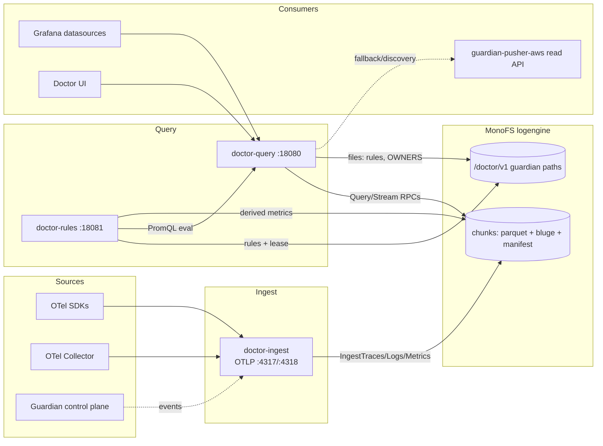

# Doctor Architecture

> Written from the current source tree. Supersedes earlier design notes where
> they disagree with the code.

## 1. Overview

Doctor is a **privacy-first OpenTelemetry backend**. It receives OTLP
traffic, anonymizes sensitive data before persistence, and stores telemetry in
the **MonoFS logengine**. The query service exposes native trace/log/metric
APIs, drop-in Prometheus / Loki / Tempo compatibility APIs for Grafana, a
built-in browser UI, a multi-backend federation proxy, and recording rules.

Pipeline in one line:

```
OTLP → tenant resolution → anonymization → per-signal WAL buffers →
pipeline → MonoFS logengine → query (native + Prom/Loki/Tempo + federation)
```



## 2. Components

### 2.1 doctor-ingest (`cmd/doctor-ingest`)

OTLP receiver + anonymization + durable buffering + writer.

- gRPC OTLP on `:4317` (`DOCTOR_GRPC_ADDR`), HTTP/protobuf OTLP on `:4318`
  (`DOCTOR_HTTP_ADDR`), pprof on `:6060` (`DOCTOR_DEBUG_ADDR`).
- Requires `DOCTOR_PRIVACY_HMAC_KEY` and `DOCTOR_MONOFS_LOGENGINE_ADDR`.
- Runs per-signal WAL buffers with replay on boot, a bounded async pipeline,
  and a MonoFS writer. Optional self-telemetry via `DOCTOR_OTEL_*`.
- Also serves `POST /v1/guardian/events` and `/healthz`,
  `/api/v1/status/buildinfo`.

### 2.2 doctor-query (`cmd/doctor-query`)

Query HTTP API + embedded React UI.

- Listens on `:18080` (`DOCTOR_QUERY_HTTP_ADDR`).
- Wires: logengine client, query service, optional AWS federation, optional
  proxy router (default on), auth → tenant-trust → web-auth middleware chain.
- Serves native APIs plus Prometheus, Loki, and Tempo compatibility surfaces
  and the federation endpoint `/v1/proxy/endpoints`.

### 2.3 doctor-rules (`cmd/doctor-rules`)

Recording-rule CRUD API and per-shard evaluator with lease-based HA.

- Listens on `:18081` (`DOCTOR_RULES_HTTP_ADDR`).
- Requires `DOCTOR_MONOFS_LOGENGINE_ADDR` and `DOCTOR_MONOFS_TOKEN`.
- Only the lease holder evaluates; followers take over after lease expiry.

### 2.4 Frontend (`frontend/`)

React 19 + TypeScript + Vite 6 + Tailwind 4, HashRouter, Recharts. Built into
`internal/query/ui/dist` and embedded with `//go:embed`; the SPA fallback
never serves HTML for API prefixes (`api/`, `v1/`, `loki/`, `tempo/`, ...).
Views: dashboard, recording rules, traces (waterfall), logs (histogram), metrics
(PromQL builder), fleet dashboard, partition detail, partition assets.

## 3. Ingest Pipeline

### 3.1 Receivers

- gRPC: the three OTLP collector services are registered with a 256 MB
  message limit.
- HTTP: `/v1/traces`, `/v1/logs`, `/v1/metrics` accept **protobuf only**,
  capped at 10 MB, respond `202`. OTLP/JSON over HTTP is not supported.
- Tenant resolution: gRPC reads the tenant metadata key (default
  `x-doctor-tenant`, case-insensitive), HTTP reads the header; both fall back
  to `DOCTOR_DEFAULT_TENANT` then `default`.

### 3.2 Anonymization (`internal/privacy`, `internal/otlp`)

Sanitization happens during flattening, before anything is buffered:

- Resource attributes are sanitized once per resource, then identity is
  extracted: `service` (service.name → app.kubernetes.io/name → k8s workload
  names → pod → instance), `partition` (guardian.partition → partition →
  k8s.namespace → namespace), `intent`, `asset`.
- Attribute **keys** matching
  `(?i)(password|secret|token|authorization|cookie|session|apikey|jwt|bearer|credential)`
  or values that look like secrets (bearer/JWT/`sk-`/`pk-`/api keys) are
  replaced with `[REDACTED]`.
- Keys matching `email|user|account|client|ip|remote_addr` are HMAC-SHA256
  tokenized to `tok_<16 hex>`; free text has emails and IPv4 addresses
  tokenized in place.
- Not carried: span links, scope name/version, all but the first exemplar
  trace/span pair per metric point, exponential histogram bucket detail
  (only `_count`/`_sum`).

### 3.3 Buffering (`internal/ingest`, `internal/wal`)

Each signal has an independent WAL-backed buffer (`TraceBuffer`, `LogBuffer`,
`MetricBuffer`):

- Priority on write: pipeline → buffer → direct writer.
- Append with `fsync`; flush on interval (5s default) or size thresholds
  (4 MB / 4096 records for traces); `MaxPendingBytes` overflow returns
  `ErrBufferFull` → HTTP 429 / gRPC `ResourceExhausted`.
- `Replay()` on boot drains unflushed batches.
- Buffers live under `.doctor/{trace,log,metric}-buffer/` (length-prefixed
  JSON frames; temp+rename replacement).

### 3.4 Write path

`internal/ingest.Pipeline` is a bounded queue (`DOCTOR_PIPELINE_QUEUE_SIZE`
1000, `DOCTOR_PIPELINE_WORKERS` 4) feeding `MonoFSWriter`, which calls
`IngestTraces`/`IngestLogs`/`IngestMetrics` on the MonoFS router with a fresh
`chunk-<id>-<nanos>` chunk ID. Labels are merged from resource attributes plus
`guardian.partition/intent/asset` and correlation IDs; metric labels pass a
filter that keeps `trace_id`, `span_id`, `task_id`, `log_id`, `request_id`
out of series identity.

> Note: `WriteGuardianEvents` is a no-op on the MonoFS backend. Guardian
> history shown in the UI is fetched live from Guardian at query time, not
> stored in logengine. `CostController` and the legacy `wal.WAL` are dead
> code paths (not wired into the binaries).

## 4. Storage Model

### 4.1 Telemetry: MonoFS logengine

Doctor has **no on-disk segment format, compaction, or retention of its
own** — all telemetry goes to the logengine over gRPC
(`internal/store/monofs/logengine_client.go`):

- Ingest: `IngestLogs`, `IngestMetrics`, `IngestTraces` (client-generated
  chunk IDs; 256 MB messages).
- Read: `QueryLogs` (LogQL string), `QueryLogsRaw`, `StreamQueryMetrics`
  (512-record batches), `StreamMetricSeries` (chunk series index: name,
  labels, min/max time), `StreamQueryTraces`.
- On the MonoFS side, chunks are Parquet files + Bluge full-text index +
  `manifest.json` (+ metric series index, trace bloom filters), HRW-sharded by
  chunk key. Retention/compaction are MonoFS concerns.

### 4.2 Control data: MonoFS guardian paths

`internal/store/monofs/grpc_client.go` (versioned reads/writes with CAS):

- `/doctor/v1/rules/<tenant>/<group>.yaml` — rule groups.
- `/doctor/v1/rules/.lease/leader.json` — ruler leader lease.
- `/doctor/v1/endpoints/<name>/.guardian/OWNERS` — access control files.

### 4.3 Local disk

Only WAL buffers (durability) and `.doctor/sessions` (browser sessions). The
filesystem store (`internal/store/fs`) is a test/dev catalog, not a
production backend.

## 5. Query Architecture

All query handlers live in `internal/query/service.go` (route table). When the
proxy router is enabled (default), queries fan out across backends; otherwise
they go straight to the logengine.

### 5.1 Native APIs

| Endpoint | Notes |
| --- | --- |
| `GET /v1/spans/search` | span search by service/trace/from/to |
| `GET /v1/traces/recent` | recent traces (span discovery cap 5000) |
| `GET /v1/traces/{traceID}` | trace lookup; `latest*` magic IDs supported |
| `GET /v1/logs/services` | services with logs |
| `GET /v1/logs/search` | LogQL-style pushdown |
| `GET /v1/metrics/range` | metric range (hard cap 200k points → 422) |
| `GET /v1/services/discover`, `/v1/services/suggest` | service discovery + canned PromQL |
| `GET /v1/guardian/{topology,events,health,overview}` | Guardian proxy + health scoring |
| `GET /v1/proxy/endpoints` | federated backend list + health |
| `GET /v1/ui/config` | UI runtime config |

Guardian health scoring: successes/(successes+failures) minus 0.05 per drift,
levels healthy/degraded/unhealthy, recommendations proceed/hold/rollback,
falling back to partition summaries when no events are in the window.

### 5.2 Prometheus compatibility (`prometheus_compat.go`)

- A custom `storage.Querier` adapter over the logengine, executed by the
  Prometheus `promql.Engine`; JSON envelopes match Prometheus.
- Endpoints: `/api/v1/query`, `query_range`, `labels`,
  `label/<name>/values`, `series`, `metadata`, `query_exemplars`, `rules`
  (empty), `status/buildinfo`.
- Exemplars come from stored per-point `TraceID`/`SpanID` (caps: 100/series,
  500 series, 5000 total).
- `count by (__name__)` fast path served from the chunk series index.
- Budgets: `DOCTOR_PROM_MAX_SAMPLES` (4M), `DOCTOR_PROM_MAX_SERIES` (100k),
  global `DOCTOR_PROM_GLOBAL_MAX_SAMPLES` (8M); exceeding → 422.
- Bare range queries over `guardian_task_executions`/`guardian_result_executions`
  are rejected unless aggregated.
- Discovery scans only a 15-minute window.

### 5.3 Loki compatibility (`observability_compat.go`, `loki_query.go`)

- Full LogQL subset parsed locally: selector + line filters pushed to storage;
  parser stages (`logfmt`, `json`, `line_format`, `label_format`, `pattern`,
  `regexp`, `unpack`, `drop`, `keep`) and label filters applied in-process;
  metric queries (`count_over_time`, rate-style) evaluated locally.
- Endpoints include `query`, `query_range`, `labels`, `series`,
  `index/stats|volume|volume_range`, `patterns`, `detected_fields`,
  `detected_labels`, `status/buildinfo`, `/ready`.
- Grafana healthcheck `vector(1)+vector(1)` short-circuits to `2`.
- Stream labels use an allowlist to bound cardinality: service/tenant/source,
  guardian identity, level, trace/span IDs, k8s names, `guardian_component`,
  `aws_*`.

### 5.4 Tempo compatibility (`tempo_handlers.go`, `internal/tempo`)

- Endpoints: `/api/echo`, `/api/status/buildinfo`, `/api/traces/{id}`,
  `/api/v2/traces/{id}`, `/api/search`, v1/v2 tag APIs,
  `/api/metrics/query_range`, `/api/metrics/query`.
- Trace-by-ID serves OTLP protobuf when the client sends
  `Accept: application/protobuf` (as Grafana does), OTLP JSON otherwise; the
  v2 endpoint wraps the trace in `TraceByIDResponse`.
- `latest`, `latest-aws`, `latest-doctor`, `latest-service:<prefix>` magic IDs
  (plus 32-hex aliases) let Grafana panels pin the newest trace.
- TraceQL search supports the subset Grafana emits (structural matchers,
  duration bounds, `||` on the same key, `nestedSetParent<0`, `!= nil`);
  `spss` returns matched span sets.
- TraceQL metrics: `rate()`, `count_over_time()`,
  `quantile_over_time(duration, ...)`, `by()` grouping, with caps
  (20k spans / 500 series / 5000 buckets / 500k samples).

## 6. Multi-Backend Federation (`internal/proxy`)

Backends come from a YAML/JSON registry file
(`DOCTOR_PROXY_BACKENDS_FILE`, hot-reloaded on mtime change) and/or Guardian
discovery (`DOCTOR_GUARDIAN_DISCOVERY_ENABLED`, polling `/api/pushers` plus
`/api/m2m/partitions`). Supported kinds: Prometheus, Loki, Tempo,
Elasticsearch, BigQuery, and AWS.

- **Routing**: per-backend circuit breaker (5 failures → 30s open), bounded
  fan-out (`DOCTOR_PROXY_MAX_INFLIGHT` 32), per-backend timeout (15s).
  Local (logengine) failures are fatal; remote failures become warnings
  surfaced as `X-Doctor-Partial`.
- **Merging**: metrics — local first, remote series tagged `source=<kind>`,
  identical label sets from distinct backends get `shard=<backend>`; logs —
  dedup by timestamp+service+body+IDs; traces — dedup by `(trace_id, span_id)`,
  local preferred, summaries merged by trace ID.
- **Fallback policy**: AWS (and other `fallback` backends) are queried only
  when local results are empty or the query selects `source="aws"`.
- **Translation**: TraceQL subset (`translate/traceql.go`), ES|QL
  (`esql.go`), BigQuery SQL (`bigquery.go`) so the three dataspaces can front
  non-native backends.

### 6.1 AWS federation

- Client: `internal/store/aws` → `guardian-pusher-aws` read API
  (`DOCTOR_AWS_BACKEND_URL`, bearer `DOCTOR_AWS_BACKEND_TOKEN`): CloudWatch
  metrics/logs, X-Ray services/traces, CloudWatch PromQL proxy.
- Federated records are tagged `source=aws` with `aws_region`/`aws_account`;
  `guardian_partition` falls back to the region.
- PromQL queries carrying `source="aws"` are forwarded verbatim to
  CloudWatch's own PromQL API (SigV4-signed by the pusher), so the full
  language works, including `histogram_quantile` and `@`-scoped labels.
- Discovery endpoints (`label/__name__/values`, `/series`, `/metadata`,
  `/v1/logs/services`, Tempo service list) always union the AWS federation
  when enabled.

## 7. Recording Rules (`internal/ruler`)

- **Storage**: `/doctor/v1/rules/<tenant>/<group>.yaml` with CAS writes
  (`ExpectedVersionID`), root configurable (`DOCTOR_RULES_STORE_ROOT`).
- **Scheduler**: reloads groups every 30s, min-heap by next due time,
  deterministic jitter in the first 10% of the interval, 8 workers
  (`DOCTOR_RULES_WORKERS`).
- **Evaluation**: each rule issues an instant PromQL query to
  `DOCTOR_RULES_QUERY_URL/api/v1/query`, applies `evaluation_delay`, merges
  per-shard samples by strategy — `sum` (default), `max`, `min`, `last`,
  `keep` — **skips partial sums** when the proxy reports `X-Doctor-Partial`,
  and writes derived gauge points (`source=recording`, `rule_group`, `rule`
  labels) back to the logengine.
- **HA**: `LeaseManager` on a MonoFS CAS lease at
  `<root>/.lease/leader.json` (TTL 30s, renew 10s); losing a renewal steps
  down and cancels evaluation.
- **API** (`:18081`): `GET /v1/rules`, `GET|PUT|DELETE /v1/rules/{tenant}/{group}`
  (YAML body), `POST /v1/rules/evaluate?tenant=&group=`. The `Authorizer`
  hook exists but is nil today (observe-first).

## 8. Access Control (`internal/access`, `internal/auth`)

- **Identity**: OIDC bearer verification plus a static break-glass admin
  token (`break-glass-admin`); optional browser login when OIDC client
  settings are present. `DOCTOR_AUTH_REQUIRE` rejects anonymous callers
  outside exempt paths (`/healthz`, `/ready`, `/api/echo`, `/metrics`,
  `/api/v1` prefix).
- **Resolvers** (`DOCTOR_ACCESS_RESOLVER`):
  - `owners` (default) — walks ancestor directories for `.guardian/OWNERS`
    deepest-first, caches decisions (TTL `DOCTOR_ACCESS_CACHE_TTL`, 60s),
    with `@team` → IdP group mapping (`DOCTOR_ACCESS_TEAM_MAPPING`).
  - `grants` — MonoFS authz grant store; `static` — allow lists;
    `chain` — owners → grants → static; `allow-all`.
- **Enforcement** (`DOCTOR_ACCESS_MODE`): `observe` (default) logs decisions;
  `enforce` actually filters **logs and traces**. **Metrics are never
  enforced.** Per-signal overrides exist (`DOCTOR_ACCESS_ENFORCE_LOGS/TRACES`).
  When all enforced targets for a signal are denied, the request returns 403;
  partial denials surface as `X-Doctor-Access-Observed`/partial headers.
- **Tenant trust**: `DOCTOR_ACCESS_TRUST_TENANT_HEADER=true` turns the tenant
  header/query parameter into a machine identity (`tenant:<name>`, group
  `doctor:tenant`) when no bearer identity exists — required for Grafana's
  provisioned datasources under enforcement. Only enable where every caller
  is trusted; the tenant header is not a secret.

## 9. HTTP Surface Summary

- **doctor-ingest**: OTLP gRPC + HTTP, `/v1/guardian/events`, `/healthz`,
  `/api/v1/status/buildinfo`.
- **doctor-query**: native APIs (section 5.1), Prometheus API
  (`/api/v1/*`), Loki API (`/loki/api/v1/*`), Tempo API (`/api/*`,
  `/api/v2/*`), `/v1/proxy/endpoints`, UI at `/`.
- **doctor-rules**: rule CRUD + `/v1/rules/evaluate`, `/healthz`.

Content negotiation: Tempo trace-by-ID is the only endpoint that serves
protobuf; everything else is JSON.

## 10. Deployment and Operations

- **Dockerfile**: multi-stage (Node 22 frontend, Go 1.26.4 service selected by
  `DOCTOR_SERVICE`), ldflags-injected buildinfo, distroless runtime. The
  MonoFS source is copied in via the `monofs` build context because of the
  go.mod replace directive.
- **Makefile**: `test`, `vet`, `build SERVICE=`, `frontend`, `docker-build`,
  `image-all`, `verify-correlation`, `verify-aws`.
- **Guardian partition**: `deploy/guardian/partitions/doctor-telemetry/`
  contains `config.yaml` and intents for the ingest gateway (Compute +
  LoadBalancer 4317/4318), query plane (proxy + owners resolver, observe
  mode), rules plane, and a join-only lifecycle intent, plus
  `examples/otel-collector.yaml` (scrapes MonoFS/guardiand/annotated pods and
  exports with `x-doctor-tenant: default`).
- **Verification scripts**: `scripts/verify-grafana-contract.sh` (every
  Grafana datasource/drilldown endpoint shape), `verify-correlation.sh`
  (trace → logs → exemplars), `verify-aws-federation.sh` (`source="aws"`
  surface).
- **Self-telemetry**: `DOCTOR_OTEL_*` enables OTLP export of Doctor's own
  traces/metrics/logs; heartbeat gauge `doctor.component.up`; ingest counters
  `doctor.ingest.requests.accepted` / `records.accepted`.

## 11. Design Tradeoffs

- **Privacy before persistence** — tokenization/redaction happen in the
  receiver so sensitive data never reaches the WAL or storage.
- **WAL buffers over synchronous writes** — bursts are absorbed locally with
  fsync durability; overflow fails fast with 429/ResourceExhausted instead of
  unbounded memory growth.
- **Compatibility as a first-class surface** — Prom/Loki/Tempo APIs and one
  shared label vocabulary let Grafana correlate metrics → traces → logs
  without Doctor-specific datasources; one dataspace over many backends.
- **Federation with conservative merging** — nothing is dropped: overlapping
  series/streams/spans get `shard` labels; fallback backends are opt-in via
  empty local results or `source="aws"`.
- **Rules with lease HA over CAS** — no external coordinator; a MonoFS CAS
  file is the single leader lock.

## 12. Known Gaps and Dead Code

- `DOCTOR_COST_*` cost controls are scaffolded but **not wired** into
  `doctor-ingest`; the knobs currently have no effect.
- Guardian event ingest is accepted but not persisted on the logengine path.
- HTTP OTLP is protobuf-only; OTLP/JSON over HTTP is unsupported.
- The legacy WAL (`internal/wal/wal.go`) and the filesystem store are
  unused/test-only.
- `internal/guardian` (auth middleware, rate limiter, dedup) is used only by
  tests, not wired into the ingest binary.
- There is no query-result cache; only OWNERS decisions are cached.
- `DOCTOR_QUERY_GUARDIAN_HEALTH_ENABLED` appears in the deployment manifest
  but is not read by the config code.
