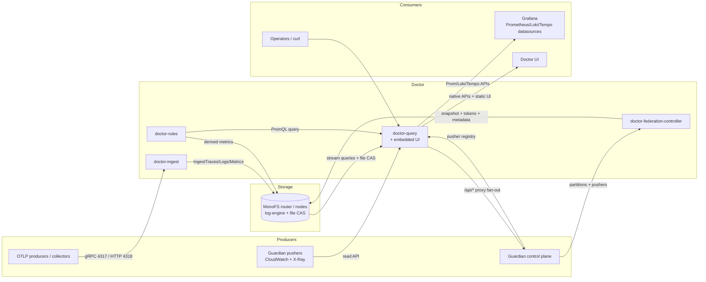
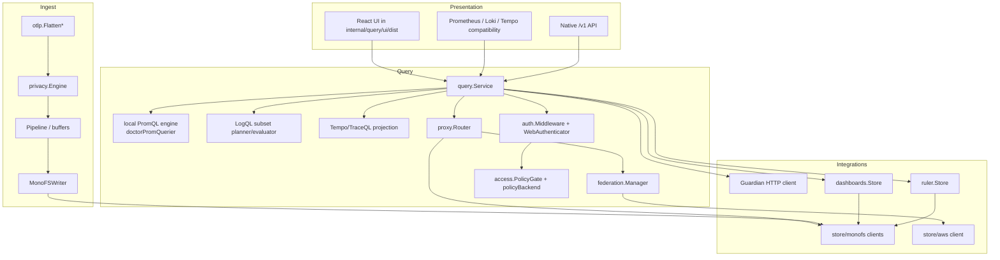
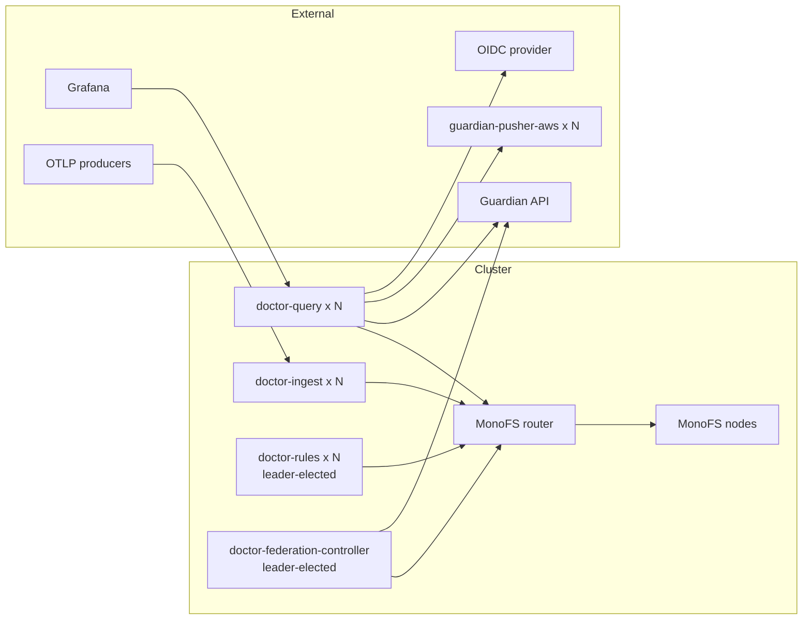

# Architecture overview

## 1. What Doctor is

Doctor is a self-hosted observability **data plane and query gateway**. It receives OpenTelemetry
telemetry, stores it through MonoFS's log-engine, and exposes the resulting data through
Prometheus-, Loki-, and Tempo-compatible HTTP APIs plus an embedded React UI. It also federates
CloudWatch/X-Ray data from a fleet of Guardian-managed AWS pushers and can proxy arbitrary
Prometheus/Loki/Tempo/Elasticsearch/BigQuery backends.

Doctor is not a collector agent and not the source of truth for deployment state. Guardian owns
partitions, intents, assets, pushers, probe execution, and access policy. MonoFS owns file storage,
catalog versions, and the log-engine. Doctor consumes and projects those systems.

## 2. Runtime binaries

| Binary | Role | Startup dependencies | Long-running loops |
|---|---|---|---|
| `doctor-ingest` | OTLP trace/log/metric receiver, privacy filter, writer | MonoFS log-engine router, privacy HMAC key, ingest bearer token | pipeline workers, trace/log/metric buffers (only when the pipeline is disabled), pprof on localhost |
| `doctor-query` | Query API, compatibility APIs, UI host, proxy router, federation query plane | MonoFS log-engine router; optional MonoFS file store, Guardian, AWS federation, OIDC, policy bundle | policy reload, federation catalog reload, client-pool pruning, proxy discovery |
| `doctor-rules` | Recording-rule scheduler/evaluator and rule API | MonoFS file store and log-engine, doctor-query URL, rules API token | leader lease, scheduler, HTTP API |
| `doctor-federation-controller` | Builds the AWS multi-account catalog from Guardian | Guardian API, MonoFS file store | leader lease + periodic sync |
| `doctor-federation-build` | Offline catalog builder | local input file | none |
| `doctor-federation-publish` | Publish a prebuilt snapshot | MonoFS file store | none |

The container image builds exactly one of these binaries (`DOCTOR_SERVICE`) and embeds the frontend
build into `doctor-query`.

## 3. Layered architecture

### Ingest plane

1. OTLP protobuf or OTLP/JSON is decoded by `internal/ingest`.
2. `internal/otlp` flattens ResourceSpans/ResourceLogs/ResourceMetrics into a shared `segment`
   record model and resolves canonical identity (`<partition>.<intent>.<asset>`).
3. `internal/privacy` sanitizes attribute values, bodies, span names, and status messages before
   storage.
4. One of three execution paths writes the records:
   - **pipeline** (bounded queue + workers) — the default because `DOCTOR_PIPELINE_ENABLED=true`
   - **per-signal buffer** (in-memory + WAL, batched flush)
   - **direct writer**
5. `MonoFSWriter` sends batches to MonoFS's router via `IngestTraces`, `IngestLogs`, and
   `IngestMetrics`.

Important observed behavior: the service checks the pipeline **before** the buffers. With the
default configuration both are created, so the buffers replay old WAL data at startup and then sit
idle while all new data goes through the pipeline. See
[internal/duplicate-functionality.md](../internal/duplicate-functionality.md).

### Query plane

`doctor-query` is one HTTP server with four route families:

- **Prometheus-compatible** (`/api/v1/*`) implemented by a custom `promstorage.Querier` over
  MonoFS metrics, with a special series-index fast path for `count by (__name__)` and discovery.
- **Loki-compatible** (`/loki/api/v1/*`) implemented with a hand-written LogQL subset parser and
  local evaluation of parser stages, label filters, and `count_over_time` aggregation.
- **Tempo-compatible** (`/api/*`) implemented with local span queries, a TraceQL subset, trace
  pagination, tag discovery, and TraceQL-metrics evaluation.
- **Native** (`/v1/*`) for the UI: recent traces, span/log search, service discovery, metric range,
  dashboards, rules proxy, federation status, proxy endpoints, Guardian topology/health/events/
  probes, UI config/user.

The query service can serve data through two different architectures:

- **legacy/direct**: `Service.logEngine` + optional `Service.aws` client.
- **proxy router**: `proxy.Router` with registered local/remote backends and optional AWS.

Both remain in the code and are selected at runtime (`Service.proxyRouter != nil`). This is the
largest source of duplicated query logic.

### Control/integration plane

- `doctor-rules` stores YAML rule groups in MonoFS, elects one leader, evaluates PromQL through
  `doctor-query`, and writes derived metric records back through the log-engine.
- `doctor-federation-controller` joins Guardian's partition and pusher feeds with pusher discovery
  metadata, publishes a sharded snapshot and a sharded token bundle to MonoFS, and maintains a
  metadata cache and leader lease.
- `doctor-query` reloads the snapshot periodically, plans queries against the catalog indexes, and
  fans out to selected pushers with bounded concurrency, retries, client pooling, and circuit
  breakers.
- Dashboards are stored as YAML documents in MonoFS with CAS versions.

## 4. Design invariants found in the code

These are the assumptions the implementation actually relies on:

1. **MonoFS is the only supported ingest/query storage backend.** `doctor-ingest` refuses to start
   without `DOCTOR_MONOFS_LOGENGINE_ADDR`; `doctor-query` does too. The legacy local `store/fs` and
   WAL-based segment writer are not wired into any service.
2. **Canonical identity is `<partition>.<intent>.<asset>`.** The shared `internal/identity` package
   validates and truncates names; `internal/otlp` promotes explicit Guardian coordinates to this
   form at ingest; `internal/query/labels.go` projects it into every compatibility API.
3. **Metrics are public; logs and traces are partition-filtered.** The shared policy package
   documents this explicitly (`CanReadSignal` always allows metrics). Doctor enforces the policy
   only for logs and traces. Metrics-based dashboards are an intended product use case.
4. **Access is observe-first.** The default `DOCTOR_ACCESS_MODE=observe` and
   `DOCTOR_ACCESS_REQUIRE=false` mean an unconfigured deployment is open. Enforcement is opt-in.
5. **Query and control-plane state is versioned through MonoFS CAS.** Dashboards, rules, federation
   manifests, leases, token shards, and the metadata cache all use expected-version writes.
6. **Federation identity is account+region.** A catalog target is one pusher read API per AWS
   account/region; partitions are labels/indexes on that target.
7. **The compatibility APIs are the product contract.** Grafana's provisioned datasources call
   Prometheus/Loki/Tempo routes; the Doctor UI mostly calls native `/v1` routes but also uses the
   compatibility APIs for metrics, Tempo search, and Loki volume.
8. **Frontend is embedded.** `//go:embed ui/dist` in `internal/query/ui.go`; the UI is served by
   `doctor-query` with an SPA fallback that refuses to serve HTML for API paths.

## 5. Deployment topology

The `deploy/` directory only contains one Guardian `Partition` manifest for the local
`doctor-telemetry` stack. There are no Compose/Kubernetes manifests for the six binaries in this
repository. The intended topology, inferred from configuration and clients, is:

Observed deployment assumptions:

- every process connects to the **MonoFS router**; node addresses are discovered through
  `GetClusterInfo`;
- `doctor-query` and `doctor-rules` need a write-capable MonoFS file token;
- `doctor-ingest` does not use the file store, only the log-engine router;
- the frontend and API share one origin;
- Guardian is reached server-side using the caller's OIDC token (query reads) or an internal
  machine token (controller/token resolver).

## 6. Configuration model

Configuration is entirely environment-based (`internal/config/config.go`) except for the
federation CLI flags. The most important groups:

| Group | Representative variables | Used by |
|---|---|---|
| Storage | `DOCTOR_MONOFS_LOGENGINE_ADDR`, `DOCTOR_MONOFS_TOKEN`, `DOCTOR_MONOFS_CLIENT_ID` | ingest/query/rules/controller |
| Ingest buffering | `DOCTOR_PIPELINE_ENABLED`, `DOCTOR_TRACE_BUFFER_*`, `DOCTOR_LOG_BUFFER_*`, `DOCTOR_METRIC_BUFFER_*` | ingest |
| Ingest auth/tenant | `DOCTOR_INGEST_AUTH_TOKEN`, `DOCTOR_INGEST_ALLOWED_TENANTS` | ingest |
| Privacy | `DOCTOR_PRIVACY_HMAC_KEY` (required) | ingest |
| Auth | `DOCTOR_AUTH_REQUIRE`, `DOCTOR_OIDC_*`, `DOCTOR_BREAK_GLASS_TOKEN`, `DOCTOR_OIDC_REQUIRE_LOGIN` | query |
| Access | `DOCTOR_ACCESS_RESOLVER`, `DOCTOR_ACCESS_MODE`, `DOCTOR_ACCESS_POLICY_*`, `DOCTOR_ACCESS_*` | query |
| Federation | `DOCTOR_FEDERATION_*`, `DOCTOR_AWS_*`, `DOCTOR_GUARDIAN_*` | query/controller |
| Proxy | `DOCTOR_PROXY_ENABLED`, `DOCTOR_PROXY_BACKENDS_FILE`, `DOCTOR_GUARDIAN_DISCOVERY_*` | query |
| Rules | `DOCTOR_RULES_*` | rules |
| UI | `DOCTOR_GUARDIAN_UI_URL`, `DOCTOR_DEFAULT_PARTITION`, `DOCTOR_DASHBOARDS_STORE_ROOT` | query |
| Doctor telemetry | `OTEL_EXPORTER_OTLP_ENDPOINT`, `OTEL_SERVICE_NAME`, `DOCTOR_OTEL_*` | all |

A full variable list with defaults is in
[architecture/components.md § Configuration](components.md#configuration-reference).

## 7. Observability of Doctor itself

- All services call `telemetry.Setup` and can export OTLP traces, metrics, and logs to an endpoint.
- `doctor-ingest`, `doctor-query`, and `doctor-rules` register a `doctor.component.up` gauge where
  applicable.
- Ingest exposes accepted-request/record counters and buffer gauges through the OTel meter API.
- Federation exposes catalog, planner, fan-out, circuit, and token gauges/counters.
- Each binary registers `/metrics` with `promhttp`; it exposes Go/process metrics, not the OTel
  instruments unless a Prometheus reader is added.
- `doctor-rules` initializes OTel telemetry and exposes scheduler/lease status.
- Query health is `/healthz`; `/ready` returns 503 when the log engine is missing or enforced policy
  is not loaded. It does not check federation catalog age or OIDC.

## 8. Known architectural pressure points

These are expanded in the internal documents:

- two simultaneous ingest execution models (pipeline and buffers);
- two simultaneous query models (legacy/direct and proxy router);
- three access-control models (OIDC gate, legacy resolver gate, repo policy gate);
- duplicate LogQL/TraceQL parsing and duplicate trace search/summary logic;
- MonoFS transport is still plaintext and the log-engine client has no credential;
- tenant is a label, not an isolation boundary;
- `doctor-rules` and the ingest API now require bearer tokens, but the rules authorizer is still
  all-or-nothing and the dashboard plane still has no per-user authorization.

See [internal/missing-pieces.md](../internal/missing-pieces.md),
[internal/duplicate-functionality.md](../internal/duplicate-functionality.md), and
[internal/overcomplexity.md](../internal/overcomplexity.md).
