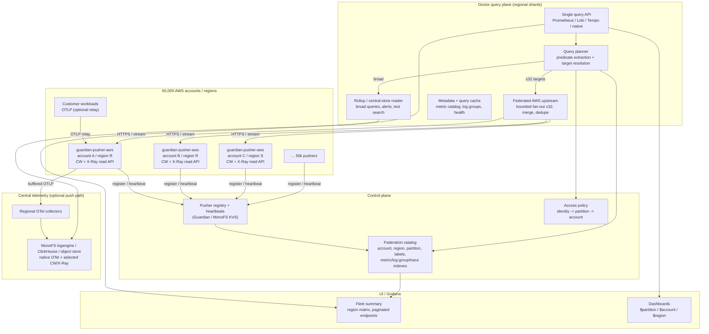

# Multi-Account Telemetry Federation at 50,000 Pushers / Accounts

- **Status:** Draft for review
- **Date:** 2026-10-22
- **Scope:** Doctor query plane, Guardian pusher registry, `guardian-pusher-aws` read API, OTel ingest/relay, Grafana/Doctor dashboards
- **Detailed design + implementation:** [`multi-account-federation-50k-design.md`](./multi-account-federation-50k-design.md)
- **Related:** `doctor/docs/design/scaling-monofs-guardian.md` (`D-50K-1`), `doctor/docs/design/observability-ui.md` (§7.3), `OBSERVABILITY_NAMING.md`, `guardian/docs/aws-observability-enablement.md`

---

## 1. Executive Summary

The current single-backend AWS federation is a good demo design but not a fleet design:

- Doctor registers AWS pushers as generic proxy backends and keeps one `awsstore.Client` per configured URL.
- `GuardianDiscovery` can surface all pushers, but query routing is still a linear scan over the backend snapshot; `MaxFanoutBackends=32` prevents a 50k fan-out storm, but it does not make 50k accounts *queryable*.
- There is no catalog indexed by account/region/partition/metric/log group, no per-account credential/rate-limit model, and no central store for broad queries.
- The pusher exposes CloudWatch/X-Ray **read** APIs only. It does not ingest or serve OTel.

At 50,000 accounts the only workable model is **hybrid**:

1. **Catalog + indexed query planner** resolve a query to a small, bounded target set (≤32 pushers).
2. **Pull federation** serves narrow, account/region/partition-scoped queries (live CloudWatch/X-Ray).
3. **Push/centralized telemetry** serves broad fleet dashboards, alerts, and text search; no query fans out to 50k.
4. **Pusher OTLP relay** (optional) lets network-isolated accounts send OTel through the pusher to central ingest. The pusher must not become a per-account OTel database.

**Effort:** a 50k-capable MVP (catalog + planner + bounded multi-account pull for CloudWatch/X-Ray) is **~6 weeks** for 2–3 engineers. Full production rollout including OTel relay, central rollups, and 50k load validation is **~4–5 months**.

**Key principle:** do not model 50,000 pushers as 50,000 router backends. Model one logical AWS federation backend with an indexed, bounded fan-out planner behind it.

---

## 2. Goals, Non-Goals, Assumptions

### Goals

- Federate CloudWatch metrics/logs and X-Ray traces across **50,000 AWS accounts / pushers**.
- Keep a single query surface (Doctor Prometheus/Loki/Tempo + Grafana) across native OTel and AWS telemetry.
- Resolve account/region/partition-scoped queries in **<5 ms p99** without scanning all pushers.
- Never fan out more than **32** live AWS backends per query.
- Serve broad fleet dashboards without live fan-out.
- Enforce per-account/per-partition access using the existing policy model.
- Support per-account credentials, quotas, health, and circuit breaking.
- Keep the pusher read API account-scoped and stateless.

### Non-Goals (this plan)

- Alerting/notification routing.
- Replacing CloudWatch/X-Ray as the system of record for customer data.
- Storing all raw CloudWatch logs for all 50k accounts in Strata by default.
- Making the pusher a general-purpose OTel database.
- Cross-cloud federation (GCP/Azure) beyond the existing generic proxy backend model.

### Assumptions

- One pusher normally serves one AWS account in one region; an account may have multiple pushers for multiple regions.
- Pushers can reach a Strata regional gateway (outbound preferred), or are reachable over private networking.
- Each pusher has a per-account token and an AWS role/credential that can read CloudWatch/X-Ray.
- Query traffic is mostly scoped: dashboards per partition/account, per-service views, trace/log drilldowns.
- Broad fleet views can tolerate **pushed/rolled-up** data with 1–5 minute lag.
- Data residency requirements may forbid cross-region central storage for some tenants.

---

## 3. Current State and Why It Does Not Scale

| Area | Current implementation | 50k problem |
| --- | --- | --- |
| AWS client | `Service.aws *awsstore.Client` (one URL/token) | Cannot address account 2..N |
| Router registration | One `proxy.Backend{Kind: KindAWS}` in `setupProxyRouter` | No account/region metadata on the backend |
| Discovery | `GuardianDiscovery` builds a backend slice | O(N) scan per query for `backendMatchesCriteria` / `snapshot()` |
| Fan-out | `MaxFanoutBackends=32` | Stops storms but returns local-only for broad queries |
| Catalog | No account/region/partition/metric index | Cannot resolve "account X" or "metric Y" efficiently |
| Credentials | One token in env | No per-account token/role pool or rotation |
| Health | Router health per backend | 50k health checks is wasteful; Guardian already has heartbeats |
| Broad queries | Local MonoFS only + warning banner | Correct default, but no central substitute for fleet views |
| OTel | Direct to Doctor/collector | Network-isolated accounts need a relay |
| Policy | `aws_bindings` explicit account list | 50k entries makes the compiled policy large and slow |
| Dashboards | `$partition` variables | 50k account/region options cannot be loaded client-side |

The existing `D-50K-1` work is necessary but not sufficient: it prevents the 78-second fan-out; this plan makes the fleet *addressable*.

---

## 4. Target Architecture



### Two separate paths

| Path | Direction | Purpose | Query source |
| --- | --- | --- | --- |
| **Read federation** | Doctor → pusher → CloudWatch/X-Ray | Live, precise drilldown for one/few accounts | Federated AWS upstream |
| **OTel relay** | Workload → pusher → collector → central store | Telemetry from network-isolated accounts; broad search | Central store (`source="doctor"`) |

The pusher is a **collector/read adapter**, not a query store. Querying 50k pushers for OTel is not viable; querying the central store is.

---

## 5. Query Model at 50k

### 5.1 Query classes

| Class | Example | Resolution | Max targets | Data source |
| --- | --- | --- | --- | --- |
| A. Exact account | `CPUUtilization{account="123"}` | account index | 1 | pull |
| B. Partition | `... {partition="div-a-orders"}` | partition → accounts index | 32 | pull or rollup |
| C. Log group | `{aws_log_group="guardian/123/..."}` | log group → account | 1 | pull |
| D. Service/metric | `Invocations` in partition | metric → accounts index | 32 | pull or rollup |
| E. Trace ID | `trace_id=...` | trace index | 1 | central/pull |
| F. Text search | `error timeout` | central log store | 0 | central |
| G. Broad dashboard | all partitions | regional rollups | 0 | central |
| H. Fleet health | pusher status | Guardian registry | 0 | local |

Rules:

- **Never** run a live fan-out without at least one of: `account`, `region`, `partition`, `aws_log_group`, `service`, `trace_id`, or a metric resolved from the metric index.
- If a query resolves to more than `MaxFanoutBackends` targets, return local/central data plus `X-Doctor-Fanout-Pruned: true` and a UI hint. Do not queue 50k requests.
- Broad queries are answered from central rollups/store; if the tenant has no central data, return an explicit "scope required" error.
- Query planner must reject unbounded `account=~".*"` patterns at fleet scale unless `allow_fleet_fanout` is explicitly enabled (and even then, cap).

### 5.2 Predicate extraction

The planner parses PromQL/LogQL/TraceQL and the native API query params to extract:

- `account` / `aws_account` / `@aws.account`
- `region` / `aws_region` / `@aws.region`
- `partition` / `guardian_partition` / `@aws.tag.guardian.io/partition`
- `aws_log_group`
- `service` / `service.name`
- `trace_id`
- metric name (PromQL)
- time range

It resolves them against the catalog indexes, not by scanning all backends. For regex matchers, resolve matching accounts from the index, then enforce the cap.

### 5.3 Partial results

Every federated response carries:

- `X-Doctor-Partial: true` when any target failed or was pruned
- `X-Doctor-Fanout-Matched`, `X-Doctor-Fanout-Selected`
- per-backend warnings in the existing `warnings` channel
- a stable `source="aws"` and `@aws.account`/`@aws.region` labels

The UI must render these as a non-blocking banner; never silently drop accounts.

---

## 6. Components

### 6.1 Federation Catalog

Persistent + in-memory index of pushers/accounts.

**Schema (minimum):**

```json
{
  "id": "aws-div-a-orders",
  "account": "780603797542",
  "region": "us-east-1",
  "partition": "div-a-orders",
  "tenant": "default",
  "endpoint": "https://guardian-awsread-1:19090",
  "token_ref": "secret/awsread/780603797542",
  "capabilities": ["metrics", "logs", "xray", "observed", "probes"],
  "version": "2026.10.22",
  "labels": {"division": "DivisionA", "department": "DepartmentA"},
  "health": {"state": "healthy", "last_heartbeat": "..."},
  "metrics": {"names": 100, "last_sync": "..."},
  "log_groups": 42,
  "trace_index": "shard-17"
}
```

**Indexes:**

- `byAccount[account] -> []target`
- `byRegion[region] -> []target`
- `byPartition[partition] -> []target`
- `byLogGroup[log_group] -> target`
- `byMetric[metric_name] -> []target` (TTL, populated from `/v1/aws/meta` or push)
- `byTrace[trace_id] -> target` (only if a central trace index is not used)
- `byLabel[label][value] -> []target`

**Scale:** 50k targets × ~2 KB ≈ 100 MB; indexes ~2–3×. A single query node can hold the index, but run 3–6 regional replicas for availability and query concurrency.

**Sources:**

- Guardian pusher registry (`/api/pushers`, delta `?updated_since=`) for identity/health.
- Each pusher `/v1/aws/meta` for account/region/capabilities/metric names/log groups.
- Guardian onboarding/observed metadata for partition labels.
- Optional static bootstrap file for demos/air-gapped environments.

**Refresh:**

- Heartbeats: via Guardian/push, not 50k HTTP health checks.
- Capability/metric catalog: 5–15 min TTL, jittered; not on every query.
- Negative cache for offline accounts.

### 6.2 Indexed Query Planner

Replace hot-path linear scans:

```go
type Target struct {
    Name, Account, Region, Partition string
    Endpoint, TokenRef string
    Capabilities []string
    Health Health
    Labels map[string]string
}

type Catalog interface {
    Resolve(ctx context.Context, p Predicates) ([]Target, error)
    ByAccount(account string) []Target
    ByPartition(partition string) []Target
    ByLogGroup(group string) []Target
    ByMetric(metric, region string) []Target
    ByTrace(traceID string) (Target, bool)
}
```

`Resolve` intersects indexes and returns at most `MaxFanoutBackends` targets. It must be O(number of matches), not O(50k).

### 6.3 Federated AWS Upstream

One logical `proxy.Backend` named `aws-federated` (not 50k backends). Internally:

1. Planner resolves targets.
2. A lazy `awsstore.Client` pool keyed by target ID (no 50k clients at startup).
3. Per-target token bucket (`max in-flight`, `max req/s`) and circuit breaker.
4. Fan-out with global semaphore and timeout budget.
5. Merge metrics/logs/traces using existing `proxy.Merge*` helpers.
6. Stamp `source="aws"`, `@aws.account`, `@aws.region`, `@aws.tag.guardian.io/partition`, `backend=<target>`.
7. Return partial warnings.

Why one logical backend: the router’s snapshot/sort and endpoint APIs stay small; the planner owns target selection and fan-out.

### 6.4 Central Rollups / Store

For broad queries, alerts, and text search:

- **Metrics:** remote-write selected CloudWatch metrics into the existing Prometheus-compatible store, or fetch/roll up per account. Keep a `source="aws"` label and `@aws.account`/`@aws.region`.
- **Logs:** CloudWatch subscription filters → Kinesis/Firehose → central object store/index (Loki/ClickHouse/MonoFS). Only selected log groups by default; the long tail stays pull-only.
- **Traces:** X-Ray/OTel → central trace store; build a `trace_id -> account/region` index. Without an index, trace-by-ID cannot be answered at 50k.
- **Retention:** per-tenant, per-signal; tier to object storage.
- **Lag SLO:** 1–5 minutes for dashboards/alerts; drilldown pull gives live data.

### 6.5 OTel Relay in the Pusher (optional)

For accounts that cannot reach Doctor directly:

- Add an OTLP gRPC/HTTP receiver to `guardian-pusher-aws` (`:4317`/`:4318`).
- Enrich resources with `guardian.partition`, `guardian.intent`, `guardian.asset`, `guardian.account`, `guardian.region`, `guardian.pusher`.
- Buffer on local disk (bounded, e.g. 15 min / 1 GB), retry with backoff.
- Forward to the nearest regional collector; do not store/query OTel in the pusher.
- Apply per-account quotas and backpressure; drop with metrics when the buffer is full.

This is a write-path feature. It does **not** make the pusher a query backend for OTel.

### 6.6 Credentials and Tokens

- Per-account read token, stored in a secret manager; never in a 50k-line config file.
- Reference by `token_ref`; the federated upstream fetches/caches short-lived tokens.
- AWS credentials: per-account role/assume-role with external ID; cache STS credentials; rate-limit assume-role calls.
- mTLS or signed requests between Doctor/gateway and pushers.
- Rotate tokens with dual-token overlap; health endpoint reports token age.
- SSRF protection: endpoints come from the catalog, never from user input; allowlist private CIDRs/hosts.

### 6.7 Access Policy at 50k

The current compiled policy lists explicit `aws_bindings` per account. At 50k this becomes large and slow to poll.

Options (in order of preference):

1. **Catalog-backed canonicalization:** the catalog already maps `account/region -> partition`; Doctor resolves the partition before policy checks. The policy only grants partitions to users/groups. No 50k binding list.
2. **Selector bindings:** `aws_bindings` supports `selector: {label: division, value: DivisionA}` resolved from the catalog at policy load.
3. **Generated binding shards:** split the compiled policy by tenant/region and load only the shard needed by a query node. More operational complexity.

The query planner must apply the policy filter **before** fan-out (target selection), not after, to avoid querying accounts the user cannot see.

---

## 7. Capacity Model (illustrative; validate in Phase 0)

Assumptions:

- 50,000 accounts, 1 pusher each, 1 region each (worst case: 3 regions/account = 150k targets).
- Heartbeat every 30s: 1,667 events/s; use batching/aggregation.
- Narrow query peak: 1,000 QPS; average fan-out 3; p95 fan-out 10; hard cap 32.
- Broad query peak: 100 QPS; served from central/rollups (0 pusher fan-out).
- Metrics: 100 metrics/account at 60s = 5M samples/min = ~14 GB/day compressed before retention.
- Logs: 10 MB/day/account = 500 GB/day; 1 GB/day/account = 50 TB/day (requires filtering/retention).
- Traces: sample at 1–10% for central; keep 100% for short-window drilldown only.

Bottlenecks to design for:

- CloudWatch `GetMetricData` / Logs Insights quotas per account and region.
- STS assume-role throttling at 50k accounts.
- 50k connections/heartbeats to the control plane.
- Query planner CPU at 1k QPS (must be O(matches), not O(50k)).
- Merge cardinality: `@aws.account` × `@aws.region` × dimensions; avoid unbounded labels.

---

## 8. Security, Isolation, Reliability

### Security

- Tenant/partition isolation is enforced at target selection and response merge.
- Per-account read tokens; no shared global token.
- Endpoint allowlist; no user-provided URLs.
- Audit every federated query: identity, selected accounts, query hash, row counts, duration.
- Redact sensitive fields before returning (reuse the privacy engine).
- Rate-limit per identity/tenant/account.

### Reliability

- Per-target circuit breaker; global concurrency cap.
- Timeout budget: narrow 5s, broad 15s; return partial results.
- Retry only idempotent reads with exponential backoff + jitter.
- Health from heartbeats; do not synchronously probe 50k endpoints.
- Regional failover: query nodes/gateways can be deployed per region; catalog replicated.
- Backpressure: shed broad/expensive queries first; prioritize dashboards/alerts.

### Observability of the federation

Metrics:

- `doctor_federation_targets{state}`
- `doctor_federation_query_targets` (histogram)
- `doctor_federation_query_duration_seconds{signal}`
- `doctor_federation_partial_total{reason}`
- `doctor_federation_pusher_errors_total{account,reason}`
- `doctor_federation_cloudwatch_throttles_total{account}`
- `doctor_federation_catalog_age_seconds`
- `doctor_federation_cache_hit_total{kind}`

Logs/traces for federation itself, with `guardian.component=doctor-federation`.

---

## 9. Delivery Plan

### Phase 0 — Requirements and decisions (1 week)

**Deliverables**

- Query-class matrix, SLOs, fan-out policy, retention policy.
- Decision: which signals are pull-only, push-only, or hybrid.
- Capacity/cost spreadsheet for 50k.
- Threat model and data-residency constraints.
- Confirm pusher connectivity model (HTTP pull vs outbound stream).

**Exit criteria**

- Signed-off RFC; no open questions on query semantics or retention.

### Phase 1 — Catalog and indexed planner (3 weeks)

**Work**

- Catalog schema and loader from Guardian delta API + `/v1/aws/meta`.
- In-memory indexes: account, region, partition, log group, metric (TTL), labels.
- Query planner: predicate extraction, index intersection, max fan-out, partial warnings.
- Replace hot-path `snapshot()` scan and `backendMatchesCriteria` with indexed resolution.
- Paginated/searchable `/v1/federation/targets` for the UI.
- Policy: catalog-backed account→partition canonicalization; deprecate 50k explicit bindings.

**Exit criteria**

- 50k synthetic targets loaded; account/region/partition resolution p99 <5 ms.
- No O(50k) scan on the query hot path.
- Unit/integration tests for index correctness and policy filtering.

### Phase 2 — Federated AWS read path (3 weeks)

**Work**

- `federation.Manager` with lazy `awsstore.Client` pool and token cache.
- `FederatedAWSUpstream` implementing metrics/logs/traces with bounded fan-out.
- Per-target rate limiter, circuit breaker, health; CloudWatch quota awareness.
- Merge/dedupe tests across multiple accounts; account/region/partition labels.
- Native APIs (`/v1/logs/search`, `/v1/traces/recent`, `/v1/logs/services`, Prom/Loki/Tempo handlers) route through the manager.
- Demo migration: replace `DOCTOR_AWS_BACKEND_URL/TOKEN` with a 3-entry catalog; keep a compatibility single-URL mode.

**Exit criteria**

- Three demo accounts visible simultaneously; no query fans out >32.
- Narrow query p95 <2s with 10% simulated target failure; partial results surfaced.
- 1,000-target simulation passes; no token/credential leaks.

### Phase 3 — Pusher OTLP relay (4–6 weeks, optional)

**Work**

- OTLP receiver + resource enrichment + bounded disk buffer + retry in `guardian-pusher-aws`.
- Regional collector gateway with tenant/account quotas and backpressure.
- Central ingest scaling and retention policies.
- End-to-end: workload → pusher → collector → Doctor native store; query uses central data.
- Do **not** add an OTel query API to the pusher.

**Exit criteria**

- 1,000 pushers relaying synthetic OTLP at target rate with <5 min lag.
- Buffer overflow behavior is observable and bounded.
- No query path depends on pusher-local OTel storage.

### Phase 4 — Central rollups and broad-query serving (4–6 weeks)

**Work**

- Metrics rollups/remote write for fleet dashboards and alerts.
- Log central pipeline for selected groups; text search over central store.
- Trace index (`trace_id -> account/region`) and central trace store for sampled traces.
- Query planner fallback: broad query → central; narrow → pull; explicit "scope required" if neither.
- Cost/retention controls per tenant.

**Exit criteria**

- All-account dashboard p95 <5s with zero pusher fan-out.
- Central lag <5 min; pull drilldown <2s.
- Data residency controls verified.

### Phase 5 — 50k load and rollout (3 weeks)

**Work**

- Simulate 50k pushers, 1k QPS narrow + 100 QPS broad, heartbeat storm, region failure, CloudWatch throttling.
- Canary 100 → 1,000 → 10,000 → 50,000 accounts.
- Runbooks, dashboards, quotas, cost alarms.
- Load-shedding and degradation drills.

**Exit criteria**

- 50k targets; no query >32 targets; p95 SLOs met.
- Control plane survives 2× heartbeat storm.
- Rollback plan tested.

### MVP backlog (Phases 1–2)

| Work item | Estimate | Notes |
| --- | --- | --- |
| Catalog schema + loader | 4d | Guardian delta API, `/v1/aws/meta`, static bootstrap |
| In-memory indexes | 3d | account, region, partition, log group, metric, labels |
| Query planner | 5d | predicate extraction, index intersection, cap, partial warnings |
| Indexed router integration | 4d | remove O(50k) hot-path scans |
| `federation.Manager` + client pool | 4d | lazy clients, token cache, per-target health |
| `FederatedAWSUpstream` | 5d | metrics/logs/traces fan-out + merge |
| Rate limits + circuit breakers | 3d | per account, CloudWatch quota awareness |
| Catalog-backed policy | 3d | account→partition; deprecate 50k explicit bindings |
| Native/Prom/Loki/Tempo wiring | 4d | all read paths through the manager |
| Tests + 1k-target load | 5d | failure injection, partial results |
| Dashboards `$account`/`$region` | 3d | bounded option queries |

**Total:** ~43 engineer-days; roughly 4–5 weeks for two engineers with parallel work, or ~6 weeks with review/rollout buffer.

### Total

- **MVP (Phases 1–2): ~6 weeks** with 2–3 engineers.
- **Full 50k (Phases 1–5): ~4–5 months** with 3–4 engineers, including OTel relay and central rollups.

### MVP definition of done

- 50k synthetic targets in the catalog; account/region/partition resolution p99 <5 ms.
- Three real accounts plus 1k simulated targets queryable simultaneously.
- No query fans out to more than 32 live AWS targets.
- Narrow query p95 <2 s; broad query either served from central/local data or rejected with a clear scope hint.
- No cross-tenant/cross-partition leakage in tests.
- Per-account throttling, timeout, and partial-result behavior are observable and tested.
- Demo uses a catalog with all three pushers; no single `DOCTOR_AWS_BACKEND_URL` requirement.

---

## 10. Testing and Validation

- **Unit:** planner index intersection, regex resolution, cap enforcement, policy filtering, merge/dedupe.
- **Integration:** 3 real demo accounts + 1k simulated pushers; CloudWatch mock with throttling.
- **Load:** 50k catalog entries, 1k QPS, heartbeat storm, 50k stream connects (if stream mode).
- **Failure:** target timeout, 429/5xx, token expiry, region outage, catalog staleness, partial results.
- **Security:** cross-tenant query attempts, SSRF payloads, token replay, oversized responses.
- **Cost:** CloudWatch API calls per query class; per-account budget alarms.

---

## 11. Risks and Mitigations

| Risk | Impact | Mitigation |
| --- | --- | --- |
| CloudWatch API quotas/cost | Throttling, surprise bills | Per-account rate limits, query budget, central rollups, cache |
| 50k STS assume-role calls | Throttling | Credential cache, role session reuse, regional STS endpoints |
| Query planner index staleness | Wrong targets / missing data | TTL + heartbeat-driven refresh; partial warnings |
| 50k endpoints as attack surface | Security | Outbound stream/gateway, mTLS, endpoint allowlist |
| Merge cardinality explosion | Memory/latency | Bound labels, cap series, aggregate before merge |
| Data residency | Compliance | Regional query/storage shards; no cross-region by default |
| Pusher version drift | Capability mismatch | Capability negotiation; version gates; canary |
| Central pipeline cost | Budget | Selective log groups, sampling, retention tiers |
| Policy scale | Slow policy load | Catalog-backed bindings; per-tenant policy shards |

---

## 12. Open Decisions

1. **Pusher connectivity:** HTTP pull from Doctor vs outbound gRPC stream to a regional gateway. Recommendation: stream for 50k; keep HTTP for the demo/MVP.
2. **Broad-query store:** reuse MonoFS logengine vs external ClickHouse/Mimir/Thanos. Decision depends on retention/cost targets.
3. **OTel relay:** required for all accounts or only network-isolated ones? Recommendation: opt-in relay, direct OTLP otherwise.
4. **Trace index:** central trace store vs pusher-side trace index. Recommendation: central sampled store + `trace_id` index.
5. **Policy model:** catalog-backed bindings vs generated per-tenant policy shards. Recommendation: catalog-backed.
6. **Region sharding:** one global catalog vs per-region catalogs. Recommendation: per-region query shards with a replicated global catalog.

---

## 13. Current Code Touchpoints

| Area | File | Change |
| --- | --- | --- |
| AWS client | `doctor/internal/store/aws/client.go` | Add `Meta()`, lazy client pool, health/token cache |
| Config | `doctor/internal/config/config.go` | Replace single URL/token with catalog URL/file + compat single URL |
| Query setup | `doctor/cmd/doctor-query/main.go` | Register one `aws-federated` upstream; remove one-client assumption |
| Router | `doctor/internal/proxy/router.go` | Add indexed target resolution; keep merge/limits |
| Discovery | `doctor/internal/proxy/discovery_guardian.go` | Delta sync, catalog projection, pagination |
| Backend model | `doctor/internal/proxy/backend.go` | Use `Account`, `Region`, `Labels`, `Capabilities`, `Health` |
| Native query | `doctor/internal/query/service.go` | Route `handleRecentTraces`, `handleLogServices`, `handleLogSearch` through federation |
| Loki/Tempo/Prom | `doctor/internal/query/*_compat.go`, `aws_federation.go` | Use federated upstream; no single `s.aws` |
| Pusher read API | `guardian/internal/awsread/handler.go` | `/v1/aws/meta` (exists), `/v1/aws/health`, optional stream mode |
| Pusher OTLP | `guardian/cmd/guardian-pusher-aws` | Optional OTLP receiver + buffer + forward |
| Policy | `monofs/pkg/authz/policy`, `doctor/internal/access` | Catalog-backed account→partition; selector bindings |
| Dashboards | `guardian/internal/dashboardgen`, `doctor/internal/dashboards` | `$account`/`$region` variables; bounded option queries |
| Demo | `demo-divisions/lib/step3_onboard.sh` | Generate a 3-entry catalog instead of a single URL |

---

## 14. Recommendation

Approve Phases 0–2 first. They deliver a **50k-addressable multi-account federation** for CloudWatch/X-Ray without changing the pusher data model or building a central lake. That is the smallest change that removes the current "one AWS backend" limitation and makes account/region/partition queries correct at fleet scale.

Treat the OTel relay (Phase 3) and central rollups (Phase 4) as separate decisions driven by network isolation, data residency, and broad-query SLOs. Do not put OTel storage or a 50k query fan-out in the pusher.
