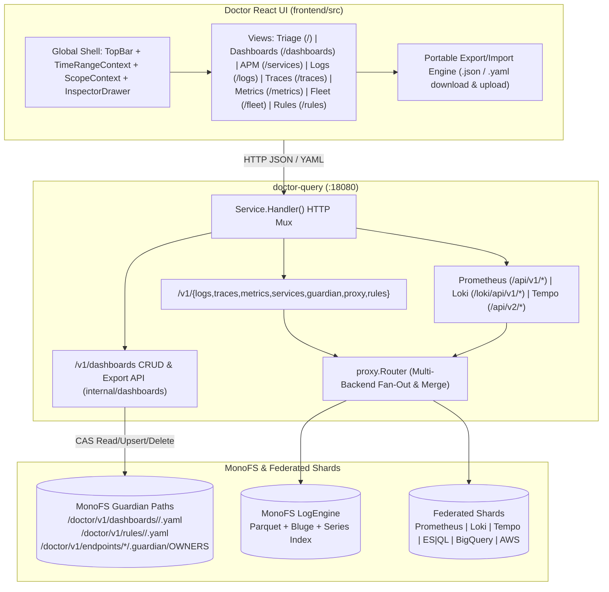
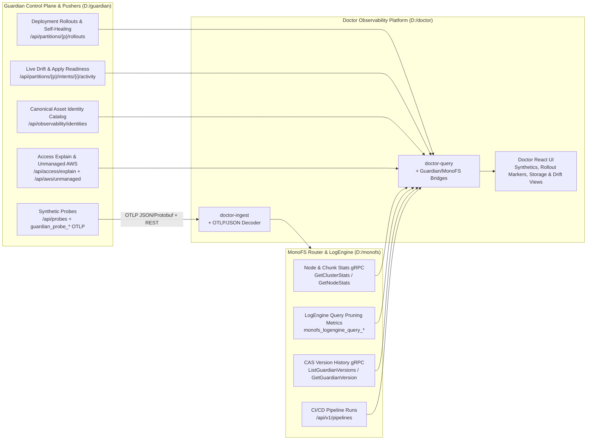
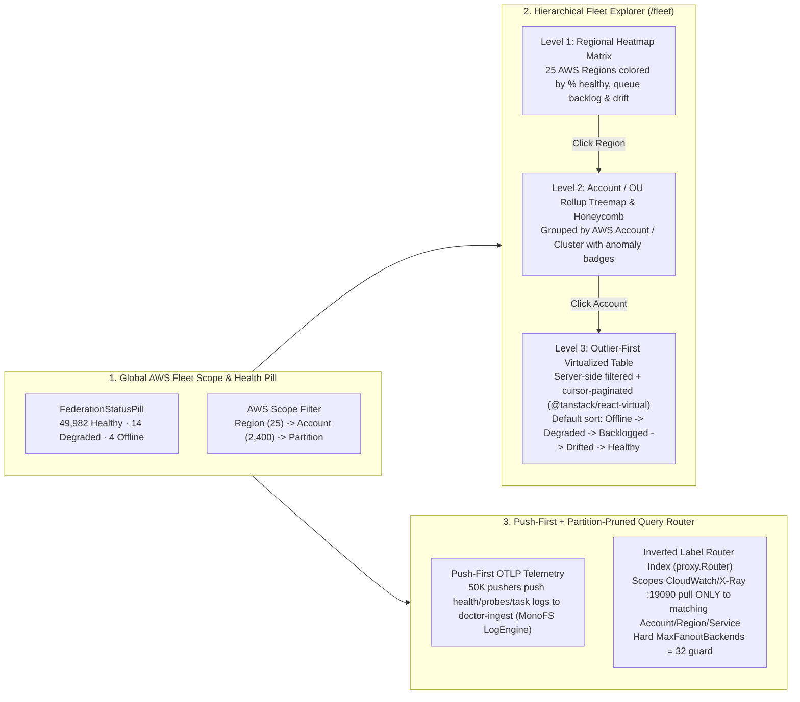

# Doctor Observability Platform UI & Shared Dashboards — Design

Status: **Draft for implementation**  
Audience: Doctor maintainers, Strata platform engineers  
Scope: `frontend/` (React 19 + TypeScript + Vite 6 + Tailwind 4), `internal/dashboards/` (new MonoFS-backed shared dashboard store), `internal/query/` (`/v1/dashboards` CRUD + export/import APIs), `cmd/doctor-query/main.go`  
Non-goals: Alerting & notification routing (deferred to a future phase)

---

## 1. Summary

Doctor's query service (`doctor-query`) already exposes a complete observability data plane across native endpoints, Prometheus (`/api/v1/*`), Loki (`/loki/api/v1/*`), Tempo (`/api/*`, `/api/v2/*`), Guardian (`/v1/guardian/*`), recording rules (`/v1/rules/*`), and multi-backend federation (`/v1/proxy/endpoints`). However, the current embedded React UI (`frontend/src/`) only consumes a small subset of these capabilities.

This design transforms Doctor's UI into a **full-featured observability platform** combining the best workflows of **Datadog** (APM Service Catalog, RED golden signals, visual + code query builders, metric exemplars, shared dashboards with `$variable` templating, cross-signal correlation drawers) and **OpenObserve** (high-density 3-pane Logs & Traces Explorers with dynamic field/facet sidebars, server-side volume histograms, customizable table columns, and JSON tree inspection).

Additionally, this design introduces **Shared Dashboards** persisted in **MonoFS** (`/doctor/v1/dashboards/<tenant>/<slug>.yaml`) with optimistic concurrency control (CAS `ExpectedVersionID`), built-in system preset dashboards, and first-class **Download / Export (`.json` & `.yaml`) and Import** workflows.

---

## 2. Confirmed Decisions

| # | Decision | Notes |
|---|---|---|
| D1 | **Zero new telemetry ingestion changes required** | All metrics, logs, traces, exemplars, service discovery, and federation health are already served by `doctor-query`. |
| D2 | **Shared Dashboards stored in MonoFS** | Persisted under `/doctor/v1/dashboards/<tenant>/<id>.yaml` using the same `FileStore` CAS pattern as `internal/ruler/store.go` (`ExpectedVersionID`). Falls back to an in-memory/local store when `DOCTOR_MONOFS_TOKEN` is unset in local dev. |
| D3 | **Downloadable / Portable Dashboards & Views** | Every dashboard (and individual widget or saved view) can be downloaded as a standalone `.json` or `.yaml` file (`GET /v1/dashboards/{tenant}/{id}?format=json\|yaml&download=1`) or exported as a multi-dashboard bundle, and re-imported via UI drag-and-drop or `PUT /v1/dashboards/{tenant}/{id}`. |
| D4 | **Global Time Range & Context Synchronization** | A unified `TimeRangeContext` in the top bar replaces isolated per-page `15m/1h/6h/24h` state, syncing `?from=&to=&tenant=&partition=&service=&env=` across all views and supporting chart brush-to-zoom. |
| D5 | **Universal Context Drawer (`InspectorDrawer`)** | Clicking any Log row, Trace ID, Metric Exemplar diamond, or Service node opens a slide-over drawer for metrics $\rightarrow$ traces $\rightarrow$ logs correlation without leaving the active page. |
| D6 | **Dual-Mode Querying (Visual Builder + Raw Query)** | Logs (Visual Filter Pills + LogQL), Metrics (Visual Tag/Rollup Builder + PromQL), and Traces (Visual Facets + TraceQL) support both point-and-click and raw query languages. |
| D7 | **Alerting is explicitly out of scope** | Alert rules, silences, and notification channels are excluded for now. Recording rules (`/rules`) remain supported and gain live PromQL chart previews. |

---

## 3. Current State vs. Target Capabilities

| Domain | Backend Endpoints Ready Today | Current UI File(s) | Key Gaps Addressed by This Design |
|---|---|---|---|
| **App Shell & Time Context** | `/v1/ui/config`, `/v1/ui/user`, `/v1/proxy/endpoints` | `AppLayout.tsx`, `TopBar.tsx`, `Sidebar.tsx`, `CommandPalette.tsx` | Time window & partition filters are isolated per page; no custom date range picker; no federation health indicator (`X-Doctor-Partial`); no slide-over correlation drawer. |
| **Dashboards Studio** | *New*: `/v1/dashboards/*` (MonoFS CAS store) + existing Prom/Loki/Tempo APIs | Buried inside `PartitionAssetsPage.tsx` (`localStorage` only) | Promote to top-level `/dashboards` route; shared MonoFS storage; `$variable` dropdowns; multi-signal widgets (Timeseries, KPI, Top List, Log Stream, Trace List, Topology, Markdown); 1-click JSON/YAML download & import. |
| **APM & Service Catalog** | `/v1/services/discover`, `/v1/services/suggest`, `/api/metrics/query_range` (TraceQL RED metrics) | **None** | Build `/services` catalog table & service detail drawer/page with RED metrics (RPS, Error %, p50/p95/p99), telemetry badges, and endpoint breakdowns. |
| **Logs Explorer** | `/v1/logs/search`, `/v1/logs/services`, `/loki/api/v1/query_range`, `/loki/api/v1/labels`, `/loki/api/v1/label/{name}/values`, `/loki/api/v1/index/volume_range`, `/loki/api/v1/index/stats` | `LogsPage.tsx`, `LogHistogram.tsx` | Build OpenObserve-style 3-pane explorer: left field/facet sidebar with counts & `+`/`-` filter buttons, server-side stacked volume histogram with brush-to-zoom, customizable table columns, JSON tree inspector, and "surrounding logs" context. |
| **Traces & Flamegraph** | `/v1/traces/recent`, `/v1/traces/{id}`, `/v1/spans/search`, `/api/search` (TraceQL), `/api/v2/search/tags`, `/api/v2/search/tag/{tag}/values`, `/api/metrics/query_range` | `TracesPage.tsx`, `TraceWaterfall.tsx` | Remove 28-row flat SVG cap; build collapsible parent-child span tree + ICICLE/Flamegraph view + minimap scrubber; add TraceQL search bar, tag facet sidebar, duration slider, and inline span-correlated logs. |
| **Metrics Explorer** | `/api/v1/query`, `/api/v1/query_range`, `/api/v1/labels`, `/api/v1/label/{name}/values`, `/api/v1/series`, `/api/v1/metadata`, `/api/v1/query_exemplars` | `MetricsPage.tsx`, `MetricLineChart.tsx` | Add Datadog-style visual metric/label/aggregation builder + multi-query (`A`, `B`, `A/B`) formulas; interactive crosshair chart with sortable legend (`min/avg/max/last`); clickable **Exemplar markers** (`trace_id`) that open the trace drawer; series cardinality explorer. |
| **Fleet, Topology & Data Sources** | `/v1/guardian/{overview,topology,health,events}`, `/v1/proxy/endpoints` | `FleetDashboard.tsx`, `PartitionAssetsPage.tsx` | Add Federated Data Sources & Shards health tab (`/v1/proxy/endpoints` circuit breakers, latency, signals); integrate shared dashboard widgets into partition/asset views. |
| **Recording Rules** | `/v1/rules`, `/v1/rules/status`, `/v1/rules/{tenant}/{group}`, `/v1/rules/evaluate` | `RecordingRulesPage.tsx` | Add live PromQL preview chart for rule expressions and 1-click deep links to view recorded metrics (`source="recording"`) in Metrics Explorer. |

---

## 4. Architecture Overview



---

## 5. Shared Dashboards Architecture & Download/Export Spec

### 5.1 MonoFS Storage Layout (`internal/dashboards`)

Shared dashboards follow the exact storage idiom established by `internal/ruler/store.go`:
- **Root path**: `/doctor/v1/dashboards` (configurable via `DOCTOR_DASHBOARDS_STORE_ROOT`, default `/doctor/v1/dashboards`).
- **Per-dashboard path**: `/doctor/v1/dashboards/<tenant>/<id>.yaml` (stored canonically as YAML in MonoFS so diffs and version history in MonoFS are human-readable, while the HTTP API serves and accepts both **JSON** and **YAML**).
- **Concurrency control**: Writes use `store.PathWrite` with `ExpectedVersionID` populated from `ListVersions` (or `"absent"` when `createOnly=true`), preventing accidental overwrites when two engineers edit a dashboard concurrently.
- **Fallback mode**: When `DOCTOR_MONOFS_TOKEN` is unset (e.g., local development without a writable MonoFS token), `doctor-query` initializes `dashboards.NewStore` with `ruler.NewMemoryStore()` (or optional local directory `.doctor/dashboards`) seeded with built-in system dashboards so the UI works out of the box.

```go
// internal/dashboards/store.go
package dashboards

type Store struct {
    Files     ruler.FileStore // implemented by *monofs.GRPCClient and *ruler.MemoryStore
    Token     string
    Root      string          // default "/doctor/v1/dashboards"
    Principal string          // default "doctor-query"
}
```

### 5.2 Dashboard Data Model (JSON & YAML Schema)

The schema is designed to be self-contained and portable so a user can click **Download JSON** or **Download YAML**, commit the file to Git, share it in Slack, or re-import it into another Doctor environment or tenant:

```typescript
export interface DashboardDocument {
  version: "doctor.dashboard/v1";
  id: string;                     // slug, e.g. "service-red-overview"
  title: string;
  description?: string;
  tenant: string;
  tags: string[];                 // e.g. ["apm", "mono-fs", "production"]
  builtIn?: boolean;              // true for read-only system presets (clonable)
  defaultTimeRange?: string;      // e.g. "1h"
  refreshInterval?: string;       // e.g. "30s"
  variables: DashboardVariable[]; // template variables ($partition, $service, etc.)
  layout: DashboardWidget[];      // 12-column responsive grid widgets
  meta?: {
    versionId?: string;           // MonoFS CAS VersionID
    updatedAt?: string;
    updatedBy?: string;
  };
}

export interface DashboardVariable {
  name: string;                   // e.g. "partition", "service", "source"
  label: string;
  type: "label_values" | "custom" | "text" | "partition" | "service";
  labelKey?: string;              // for label_values: e.g. "service", "guardian_partition"
  metricFilter?: string;          // optional metric scope
  options?: string[];             // for static custom list
  defaultValue: string;           // e.g. "$__all" or specific value
  multi?: boolean;                // allow multi-select (renders regex e.g. "(svc-a|svc-b)")
  includeAll?: boolean;
}

export type WidgetKind =
  | "timeseries"      // Line / Area / Stacked Bar chart (PromQL, LogQL metric, TraceQL metric)
  | "stat"            // Big KPI number + sparkline + threshold coloring
  | "toplist"         // Horizontal ranked bar list (Top N series)
  | "gauge"           // Radial or horizontal utilization gauge (0-100%)
  | "table"           // Multi-column instant query / series table
  | "logs"            // Live embedded LogQL stream panel
  | "traces"          // Embedded TraceQL / recent traces list panel
  | "topology"        // Embedded partition/service topology map
  | "markdown";       // Runbook notes, links, and on-call instructions

export interface DashboardWidget {
  id: string;
  title: string;
  description?: string;
  kind: WidgetKind;
  gridPos: {
    x: number;        // 0..11 (12-column grid)
    y: number;
    w: number;        // 1..12
    h: number;        // row units
  };
  queries: WidgetQuery[];
  visualization?: {
    displayMode?: "line" | "area" | "bars";
    stacked?: boolean;
    showExemplars?: boolean;
    unit?: "none" | "short" | "percent" | "seconds" | "ms" | "bytes" | "bps" | "reqps";
    decimals?: number;
    thresholds?: Array<{ value: number; color: "green" | "amber" | "red" }>;
    markdownContent?: string;
  };
}

export interface WidgetQuery {
  refId: string;                  // "A", "B", etc.
  datasource: "prometheus" | "loki" | "tempo" | "native_logs" | "native_traces";
  expr: string;                   // supports $partition, $service, $rate_interval macros
  legendFormat?: string;          // e.g. "{{service}} ({{status_code}})"
  disabled?: boolean;
}
```

### 5.3 HTTP API Endpoints on `doctor-query`

Registered in `internal/query/service.go`:

| Method | Path | Purpose |
|---|---|---|
| `GET` | `/v1/dashboards?tenant=<t>&tag=<tag>&q=<search>` | List all dashboards (built-in presets + shared MonoFS dashboards for the tenant). |
| `GET` | `/v1/dashboards/{tenant}/{id}` | Fetch full dashboard definition. Supports `?format=json` (default) or `?format=yaml`. When `?download=1` is passed, sets `Content-Disposition: attachment; filename="<id>.json"` (or `.yaml`). |
| `PUT` | `/v1/dashboards/{tenant}/{id}` | Create or update a shared dashboard (accepts `application/json` or `application/yaml`). Honors optional `If-Match: <versionId>` header for CAS conflict detection (`409 Conflict`). |
| `DELETE` | `/v1/dashboards/{tenant}/{id}` | Delete a shared dashboard from MonoFS (`403` if `builtIn: true`). |
| `POST` | `/v1/dashboards/import` | Bulk-import a single `DashboardDocument` or a `DashboardBundle` (`version: "doctor.dashboard.bundle/v1"` containing multiple dashboards). |
| `GET` | `/v1/dashboards/export?tenant=<t>&ids=a,b,c&format=json\|yaml` | Download a portable bundle of selected (or all) tenant dashboards with `Content-Disposition: attachment`. |

### 5.4 Built-in System Dashboards (Shipped Embedded)

Even before a team creates custom dashboards, Doctor ships with 5 built-in presets (clonable into editable shared dashboards):
1. **Strata & Guardian Fleet Overview**: Partition health, reconcile rates (`guardian_reconciler_partition_executions`), dispatcher writes, drifted/failing assets, and recent error logs.
2. **Service RED Overview (APM Template)**: Parameterized by `$partition` and `$service` — Request Rate, Error Ratio %, Latency p50/p95/p99 with Exemplars, Top Failing Operations, Correlated Service Logs, and Recent Traces.
3. **MonoFS & LogEngine Storage**: `monofs_ops_total`, `monofs_read_bytes_total`, `monofs_write_bytes_total`, `monofs_query_duration_seconds` p95, KVS active keys, and Pebble batch commits.
4. **Doctor Self-Observability**: `doctor.component.up`, `doctor_ingest_requests_accepted`, pipeline queue depth, PromQL evaluation latency, and federated proxy endpoint status.
5. **AWS CloudWatch & X-Ray Federation**: Pre-scoped to `source="aws"` showing federated EC2/Lambda/RDS metrics, CloudWatch log volume, and X-Ray trace summaries.

---

## 6. Detailed Design of UI Pillars

### 6.1 Global App Shell, Time Range Engine & Universal Inspector Drawer

#### Global Time & Scope Bar (`TopBar.tsx` + `TimeRangeContext.tsx`)
```
+---------------------------------------------------------------------------------------------------+
| Doctor / Logs Explorer     [Tenant: default v] [Partition: All v] [Sources: 4/4 Healthy]          |
|                            [ < ] [ Last 1 hour (1h) v ] [ > ] [ UTC ] [ Auto: 30s v ] [ Refresh ] |
+---------------------------------------------------------------------------------------------------+
```
- **Time Picker Popover (`GlobalTimePicker.tsx`)**:
  - **Quick Relative Presets**: `5m`, `15m`, `30m`, `1h`, `3h`, `6h`, `12h`, `24h`, `2d`, `7d`.
  - **Absolute Time Range**: Start & End calendar/time inputs (ISO-8601 / RFC3339) + "Apply time range".
  - **Time Step Controls**: `<` (shift window backward by 50% of duration) and `>` (shift window forward) + `Zoom Out (2x)`.
  - **Chart Brush Integration**: Dragging horizontally on any `MetricLineChart`, `LogHistogram`, or `TraceHistogram` calls `setAbsoluteRange(from, to)` on `TimeRangeContext`.
- **Federation Status Pill (`FederationStatusPill.tsx`)**:
  - Polls `GET /v1/proxy/endpoints` every 30s and intercepts `X-Doctor-Partial` / `X-Doctor-Access-Observed` headers from API responses.
  - Clicking the pill opens a popover listing all configured backends (`doctor`, `aws`, `prom-*`, `loki-*`, `es-*`, `tempo-*`), their health state, circuit-breaker status, and signal capabilities.

#### Universal Context Drawer (`InspectorDrawer.tsx`)
A slide-over drawer (`width: 680px..860px`, resizable, `Escape` to close) mounted in `AppLayout.tsx` so any page can trigger `openInspector({ kind, id, ... })`:
- **Trace Inspection Mode**: Renders trace summary header (Root Service, Duration, Span Count, Status), full interactive `TraceWaterfall` / Flamegraph, span detail tabs, and **Correlated Logs** for that `trace_id`.
- **Log Inspection Mode**: Renders severity badge, timestamp, identity pills (`partition`, `intent`, `asset`, `service`), collapsible JSON/attribute table with `+`/`-` filter actions, "View surrounding logs ($\pm 1\text{m}$)", and inline trace waterfall if `trace_id` is present.
- **Service Inspection Mode**: Quick RED metrics preview, top endpoints, and deep links to `/services/:name`, `/logs?service=...`, `/traces?service=...`.

---

### 6.2 OpenObserve-Style Logs Explorer (`/logs`)

```
+----------------------+----------------------------------------------------------------------------+
| SEARCH FIELDS        | [ Visual Filters | LogQL ]  {service="guardiand"} |= "error" | json   [Run]|
| [Filter fields...  ] +----------------------------------------------------------------------------+
|                      | LOG VOLUME (14,280 entries · 3.2 MB · 18 streams)          [Group: Sev v]  |
| v Quick Facets       |  ||   ||  |||   |   |||||  ||   (Stacked Error/Warn/Info SVG + Brush Zoom) |
|  v severity (4)      +----------------------------------------------------------------------------+
|   [x] ERROR    142   | Columns: [Time] [Sev] [Partition] [Service] [trace_id] [Message]  [+ Cols] |
|   [x] WARN     830   | 09:21:04.112 | ERR  | prod-eu | guardiand | 7f9a.. | reconcile failed...   |
|   [x] INFO  12,400   | 09:21:03.890 | WARN | prod-eu | monofs    | 3b1c.. | slow chunk read...    |
|  v service (12)      | 09:21:02.401 | INFO | prod-us | doctor    |   —    | flushed 4096 spans    |
|   guardiand  6,120 + |                                                                            |
|   monofs     4,810 + |                                                                            |
|  v partition (6)     |                                                                            |
|  v source (2)        |                                                                            |
|  v Extracted JSON    |                                                                            |
|   http.status_code   |                                                                            |
+----------------------+----------------------------------------------------------------------------+
```

1. **Left Pane — Dynamic Field & Facet Explorer (`LogFacetSidebar.tsx`)**:
   - Combines server-side label discovery (`/loki/api/v1/labels` and `/loki/api/v1/label/{name}/values`) with client-side field frequency analysis across the active log batch (including auto-parsed JSON bodies and `resource_attributes` / `attributes`).
   - Shows top values with proportional progress bars and counts.
   - Hover actions on every facet value:
     - `+` Include filter (`field="value"`)
     - `-` Exclude filter (`field!="value"`)
     - `Col` Toggle field as a table column in the log stream.
2. **Dual Query Bar (Visual Filter Bar + LogQL Editor)**:
   - **Simple / Visual Mode**: Interactive filter chips for `partition`, `service`, `severity`, `source`, `logGroup` (AWS CloudWatch), and free-text / phrase search.
   - **LogQL Mode**: Full query input routed to `/loki/api/v1/query_range` supporting stream selectors `{service="...", partition="..."}` and pipeline stages (`|= "error"`, `!= "healthz"`, `|~ "timeout|refused"`, `| json`, `| logfmt`, `| line_format`). Includes syntax autocomplete and a quick-insert pipeline menu.
3. **Server-Side Volume Histogram (`LogHistogram.tsx`)**:
   - Uses `GET /loki/api/v1/index/volume_range` (with `targetLabels=level` or `targetLabels=service`) and `GET /loki/api/v1/index/stats` (streams, entries, bytes) when in LogQL mode, falling back seamlessly to client-side bucketing.
   - Supports click-and-drag time brushing to zoom into spikes.
4. **Customizable Log Table & Saved Views**:
   - Column picker modal/popover to pin any attribute (e.g., `intent`, `asset`, `trace_id`, `k8s_pod_name`, `http.method`) as a column.
   - **Download Logs**: Export current filtered log results as `.json` or `.csv`.
   - **Saved Log Views**: Save current query + selected columns + facet state as a named preset (and add directly to a Shared Dashboard as a widget).

---

### 6.3 Datadog-Style APM & Service Catalog (`/services`)

Powered by `GET /v1/services/discover`, `GET /v1/services/suggest`, and `GET /api/metrics/query_range` (TraceQL metrics):

```
+---------------------------------------------------------------------------------------------------+
| APM Service Catalog (18 Services)          [Search services...] [Partition: All v] [Type: All v]  |
+---------------------------------------------------------------------------------------------------+
| Service          | Partition / Intent | Signals       | Requests/s | Latency (p95 / p99) | Err %  |
|------------------|--------------------|---------------|------------|---------------------|--------|
| doctor-query     | doctor-telemetry   | [M] [T] [L]   | 142.4 rps  |  18.2ms /   84.0ms  | 0.04%  |
| monofs-router    | storage-core       | [M] [T] [L]   | 890.1 rps  |   4.1ms /   19.5ms  | 0.00%  |
| guardiand        | control-plane      | [M] [T] [L]   |  31.0 rps  | 112.0ms /  450.2ms  | 2.15%  |
| checkout-lambda  | aws-eu-west-1      | [T] [AWS]     |  19.8 rps  | 240.5ms /  890.0ms  | 1.40%  |
+---------------------------------------------------------------------------------------------------+
```

1. **Catalog View (`ServicesPage.tsx`)**:
   - Fetches `/v1/services/discover?window=<range>` to list every service with its `partition`, `intent`, `asset`, `cluster`, `has_metrics`, `has_traces`, `has_logs`, `trace_count`, `log_count`, and `error_rate`.
   - Enriches active services with RED metrics via TraceQL metrics (`/api/metrics/query_range` with `{ resource.service.name = "<svc>" } | rate()` and `quantile_over_time(duration, 0.5, 0.95, 0.99)`) or Prometheus (`http_requests_total` / `http_request_duration_seconds_bucket`).
2. **Service Detail View (`/services/:name`)**:
   - **Header**: Service identity badges, health status, "Open in Topology", "Add to Dashboard".
   - **4 Golden Signal Charts**:
     1. **Request Throughput (RPS)** (by status/kind).
     2. **Error Rate & Count** (spans with `status=error` + error logs).
     3. **Latency Percentiles** (`p50`, `p90`, `p95`, `p99` over time).
     4. **Log Volume by Severity**.
   - **Operations / Resources Table**: Groups spans by `name` (endpoint/operation) showing call count, p95 latency, and error % per endpoint.
   - **Bottom Split**: Tabs for *Service Traces*, *Service Logs*, and *Discovered Metrics* (`metric_names` from `/v1/services/discover`).

---

### 6.4 Advanced Traces Explorer & Flamegraph (`/traces`)

1. **TraceQL Search Bar & Facets (`TracesPage.tsx`)**:
   - Supports both quick filters (`partition`, `service`, `minDuration`, `maxDuration`, `status=error`) and raw **TraceQL** queries (e.g., `{ resource.service.name = "guardiand" && duration > 100ms && status = error }`) routed to `GET /api/search`.
   - Left-hand **Trace Tag Facets** populated from `/api/v2/search/tags` and `/api/v2/search/tag/{tag}/values`.
   - Top **Span Rate & Latency p95 Chart** above the trace list so users can see latency spikes and drag-to-zoom.
2. **Hierarchical Waterfall & Flamegraph (`TraceWaterfall.tsx`)**:
   - Replaces the flat 28-row SVG (`MAX_ROWS = 28`) with a full virtualized/scrollable span tree builder:
     - Reconstructs the parent-child DAG from `span_id` and `parent_span_id` (handling orphan/missing parent spans gracefully by attaching them to the virtual trace root).
     - Computes **self-time** vs. **total duration** and highlights the **critical path** across synchronous child spans.
   - **View Modes**:
     - **Tree Waterfall**: Indented collapsible span hierarchy on the left (`280px`), service badge, duration bar + critical-path highlight on the right, error markers (`status_code=ERROR`), and event ticks.
     - **Flamegraph (Icicle)**: Full-width horizontal bars stacked by call depth (`depth 0..N`) for visual bottleneck identification.
     - **Span Table & Service Breakdown**: Summary of time spent per service (`% of trace duration`, span count, error count).
   - **Inline Span-to-Logs Correlation**:
     - Selecting any span in the waterfall opens the **Span Detail Panel** with tabs: *Attributes*, *Resource*, *Events/Exceptions*, and **Logs (`trace_id` correlated)**—which automatically queries `/v1/logs/search?q=<trace_id>` and highlights logs whose `span_id` matches the selected span.

---

### 6.5 Metrics Explorer & Exemplar Correlation (`/metrics`)

1. **Dual Query Builder (`MetricsPage.tsx`)**:
   - **Visual Builder Tab**:
     - **Metric Combobox**: Searchable dropdown of `/api/v1/label/__name__/values` with category hints.
     - **Label Tag Filters**: Dynamic `key` (`=`, `!=`, `=~`, `!~`) `value` pickers backed by `/api/v1/labels` and `/api/v1/label/{name}/values`.
     - **Rollup / Function**: `Raw`, `rate($__interval)`, `irate($__interval)`, `increase($__interval)`, `histogram_quantile(0.95, ...)`.
     - **Aggregation**: `sum`, `avg`, `min`, `max`, `count`, `topk(10)` grouped `by (label1, label2)`.
   - **PromQL Code Tab**:
     - Supports multiple queries (`A`, `B`, `C`) and arithmetic expressions (e.g., error ratio `A / B * 100`).
2. **Interactive Chart Engine with Exemplars (`MetricLineChart.tsx`)**:
   - Interactive hover crosshair showing synchronized values across all series at timestamp $t$.
   - **Sortable Legend Table** below the chart showing `Series`, `Min`, `Max`, `Avg`, `Last` with click-to-solo series (`Alt+Click` or click).
   - **Exemplars Overlay (`showExemplars` toggle)**:
     - Queries `GET /api/v1/query_exemplars?query=<expr>&start=<from>&end=<to>` alongside `query_range`.
     - Renders distinct diamond markers (`◆`) at `(timestamp, value)` coordinates for points carrying a `trace_id`.
     - Hovering an exemplar shows `trace_id`, `span_id`, `value`, and timestamp; clicking it opens the trace waterfall immediately in `InspectorDrawer`!
3. **Save to Dashboard Button**:
   - One-click **"Add to Dashboard"** button in Metrics Explorer (and Logs/Traces Explorers) that lets the user pick any Shared Dashboard and append the current query as a new widget.

---

### 6.6 Dashboards Studio (`/dashboards`)

```
+---------------------------------------------------------------------------------------------------+
| Dashboards / Service RED Overview [Built-in Preset]   [Clone to Shared] [Download JSON v] [+New]  |
| Variables: [ $partition = prod-eu v ] [ $service = guardiand v ] [ $source = All v ]   [Edit Mode]|
+---------------------------------------------------------------------------------------------------+
| +-----------------------+ +-----------------------+ +-----------------------+ +-----------------+ |
| | REQUEST RATE (RPS)    | | ERROR RATIO           | | P95 LATENCY           | | ACTIVE SERIES   | |
| | 142.8 req/s   +4.2%   | | 0.04%         HEALTHY | | 18.4 ms       HEALTHY | | 1,240           | |
| | ~~~~~~/\~~~~          | | ____________          | | ~~~~\~~~~             | |                 | |
| +-----------------------+ +-----------------------+ +-----------------------+ +-----------------+ |
| +-------------------------------------------------+ +-------------------------------------------+ |
| | REQUEST LATENCY (p50 / p95 / p99) + EXEMPLARS   | | TOP FAILING OPERATIONS (TraceQL)          | |
| |   /\        ◆ (trace 7f9a..)                    | | POST /v1/reconcile   ████████████   14/m  | |
| |  /  \  /\  /  \                                 | | GET  /api/topology   ████            3/m  | |
| +-------------------------------------------------+ +-------------------------------------------+ |
| +-------------------------------------------------+ +-------------------------------------------+ |
| | RECENT ERROR LOGS ({service="$service"})        | | RECENT SLOW TRACES (> 200ms)              | |
| | 09:21:04 [ERR] reconcile timeout on asset-4     | | 7f9a21..  guardiand  452ms  18 spans  ERR | |
| | 09:19:52 [ERR] connection reset by peer         | | 9c1104..  guardiand  310ms  12 spans   OK | |
| +-------------------------------------------------+ +-------------------------------------------+ |
+---------------------------------------------------------------------------------------------------+
```

1. **Dashboard Browser (`/dashboards`)**:
   - Lists **Built-in Presets** and **Shared Team Dashboards** (from `GET /v1/dashboards`), filterable by tag or search query.
   - Actions per dashboard: `Open`, `Clone`, `Download JSON`, `Download YAML`, `Delete` (for non-built-in).
   - Top-level buttons: `+ New Dashboard`, `Import JSON/YAML` (file upload or paste modal), `Export All Bundle`.
2. **Variable Interpolation Engine**:
   - Resolves `$tenant`, `$partition`, `$service`, `$intent`, `$asset`, `$source`, `$__interval`, and `$__range` across all widget queries (`PromQL`, `LogQL`, `TraceQL`).
   - Variable selections sync to URL query params (`?var-partition=prod-eu&var-service=guardiand`) so dashboard links are 100% shareable.
3. **Interactive Widget Editor Modal**:
   - Visual & code query editor per widget (`A`, `B`, ...), widget type switcher (`timeseries`, `stat`, `toplist`, `gauge`, `table`, `logs`, `traces`, `topology`, `markdown`), unit formatter (`ms`, `s`, `bytes`, `%`, `reqps`), thresholds, and live preview.

---

## 7. Cross-Repo Observability Enhancements (`guardian` + `monofs`)

Inspecting the sibling repositories (`D:\guardian` and `D:\monofs`) reveals several rich observability subsystems that already exist in Guardian and MonoFS and can be wired directly into Doctor to elevate it beyond standard log/metric/trace viewers into a **deployment-, drift-, probe-, and storage-aware observability platform**:



### 7.1 Guardian Enhancements (`D:\guardian`)

| # | Capability in `D:\guardian` | Source Files | What It Provides | How We Integrate It into Doctor |
|---|---|---|---|---|
| **G1** | **Synthetic Health Probes (Datadog Synthetics / Blackbox Monitoring)** | `internal/ui/probes.go` (`handleProbes`, `handleProbeRoute`), `internal/pusher/probes/types.go`, `internal/pusher/probes/telemetry.go` | Guardian pushers execute active HTTP/TCP/DNS synthetic probes per `partition`/`intent`/`asset`, persisting snapshots in MonoFS (`paths.ProbesRoot()`) and exposing `GET /api/probes` (`probeID`, `service`, `partition`, `intent`, `asset`, `type`, `mode`, `target`, `status`, `success`, `durationMs`, `statusCode`, `error`, `consecutiveFailures`). Also emits `guardian_probe_up`, `guardian_probe_duration_seconds`, `guardian_probe_consecutive_failures`, plus OTLP logs and `guardian.probe.run` spans on state transitions/failures. | 1. **Fix OTLP/JSON Ingest Gap**: `guardian/internal/pusher/probes/telemetry.go` sends OTLP **JSON** (`application/json`) to `/v1/metrics`, `/v1/logs`, `/v1/traces`, whereas `doctor-ingest` currently only parses OTLP **Protobuf**. Adding `protojson` decoding when `Content-Type: application/json` in `doctor-ingest` immediately ingests all `guardian_probe_*` metrics, logs, and spans!<br>2. **New Synthetics / Probes View (`/probes` or Fleet tab)**: Proxy `/api/probes` via `doctor-query` (`/v1/guardian/probes`) to display live HTTP/TCP blackbox probe cards, SLA uptime %, latency sparklines, and failure reasons linked to the target service's logs/traces. |
| **G2** | **Deployment Rollout & Self-Healing Chart Annotations** | `internal/ui/server.go` (`handlePartitionRoute` `"rollouts"`), `internal/ui/data.go` (`PartitionRolloutsResponse`, `RolloutView`) | Returns structured rollout history per partition/intent: `deploymentRevision`, `createdAt`, `appliedAt`, `taskIDs`, `selfHealing`, `rollback`, `rollbackTo`, `rollbackReason`, `healthStatus`, and per-asset `change`. | **Deployment Overlays on Charts**: `MetricLineChart.tsx` and `LogHistogram.tsx` render vertical deployment markers (`🚀 rev-8f2a` or `⏪ Rollback -> rev-7c10 [self-healing]`) across all Metrics, Logs, and APM charts. Clicking a marker shows the exact asset diff and task logs in `InspectorDrawer`. |
| **G3** | **Live Drift Inspector, Apply Readiness & 1-Click Reconcile** | `internal/ui/server.go` (`handlePartitionIntentRoute` `"activity"`), `internal/ui/data.go` (`IntentActivityResponse`) | Exposes live `taskActive`, `taskTimedOut`, `observedHealth`, `applyReadiness` (why an asset is blocked), `drift` (`*taskdomain.DriftReport`), `lastError`, `lastTaskID`, and task execution `logs`. | **Drift & Readiness Tab in Service / Triage Drawer**: When inspecting a degraded service in Doctor, engineers see whether infrastructure has drifted from Git intent or if a rollout task is active/blocked, with a **Trigger Reconcile** action (`POST /api/partitions/{name}/reconcile`). |
| **G4** | **Canonical Asset Identity Catalog (Zero-Telemetry / Silent Services & Untruncated Names)** | `internal/ui/observability.go`, `internal/observability/catalog.go` (`Identities()`), `internal/observability/identity.go` | Enumerates every declared asset across all partitions/intents (`service`, `full_name`, `partition`, `intent`, `asset`, `pusher`, `cluster`, `truncated`), even when the service has emitted **zero telemetry** in the query window, and maps truncated 200-char X-Ray service names back to their full `<partition>.<intent>.<asset>` identity. | **Silent/Dark Service Detection in APM Catalog (`/services`)**: Merge `/api/observability/identities` into Doctor's `/v1/services/discover`. Services declared in Guardian that emit no telemetry appear with a `SILENT / NO TELEMETRY` badge instead of being invisible, and truncated X-Ray names automatically resolve to their full `partition.intent.asset` name. |
| **G5** | **Access Policy Explainability & Unmanaged AWS Stack Detection** | `internal/ui/server.go` (`handleAccessExplain`), `internal/ui/unmanaged.go` (`handleUnmanaged`) | `/api/access/explain?partition=&intent=` explains *why* a principal is allowed or denied access (`matchedRules`, `reason`). `/api/aws/unmanaged` lists CloudFormation stacks running in AWS that are not tracked by Guardian. | 1. **Access Explain Modal** in the top bar tenant/partition selector (explains RBAC visibility for multi-tenant partitions).<br>2. **Unmanaged / Shadow AWS Stacks warning** in the Topology & Fleet view when AWS telemetry arrives from stacks not managed by Guardian. |

### 7.2 MonoFS Enhancements (`D:\monofs`)

| # | Capability in `D:\monofs` | Source Files | What It Provides | How We Integrate It into Doctor |
|---|---|---|---|---|
| **M1** | **Per-Node LogEngine Chunk Counts, Disk Utilization & KVS Raft Status** | `internal/router/stats.go` (`GetClusterStats`, `GetNodeStats`), `internal/router/kvs_status.go`, `internal/storage/logengine/engine.go` (`LogEngineStats`) | MonoFS Router gRPC `GetClusterStats` and `GetNodeStats` already return per-node `LogEngineStats` (`LogChunks`, `MetricChunks`, `TraceChunks`), disk space (`UsedSpaceBytes`, `TotalSpaceBytes`, `FreeSpaceBytes`), `SyncProgress`, `BackingUpNodes` (HRW failover), and `KVSNodeStatus` (`Mode`, `Role` leader/follower, `LeaderId`, `KeyCount`). | **OpenObserve-Style Storage & Shards Inspector (`/v1/storage/status` + Fleet Storage Tab)**: Expose a lightweight bridge in `doctor-query` calling `GetClusterStats`/`GetNodeStats` so the UI displays per-node Parquet/Bluge chunk counts (`LogChunks`, `MetricChunks`, `TraceChunks`), disk usage bars, HRW failover mappings, and KVS Raft leader status. |
| **M2** | **LogEngine Query Planner & Index Pruning Telemetry** | `internal/storage/logengine/metrics.go` | Emits granular query execution metrics: `monofs_logengine_query_stage_duration_seconds{signal, stage="chunk_listing\|manifest_pruning\|parquet_open"}`, `monofs_logengine_query_chunks_listed_total`, `monofs_logengine_query_chunks_pruned_total{signal, reason}`, and `monofs_logengine_query_parquet_opens_total{signal, result}`. | **Query Pruning Efficiency Badge & Preset Dashboard**: Show query execution stats in the Logs/Metrics/Traces status bar (e.g., `142 ms · 94% chunks pruned via manifest`) and include a dedicated **MonoFS LogEngine Pruning & Compaction** panel group in the `preset-monofs-storage` dashboard. |
| **M3** | **Built-in Version History & Diffs for Shared Dashboards and Rules** | `D:\doctor\internal\store\monofs\grpc_client.go` (`ListVersions`, `GetVersion` over `ListGuardianVersions` / `GetGuardianVersion`) | Because Doctor stores shared dashboards (`/doctor/v1/dashboards/<tenant>/<id>.yaml`) and rules (`/doctor/v1/rules/<tenant>/<group>.yaml`) in MonoFS via `GuardianStateService`, MonoFS **automatically versions every write** (`VersionID`, `BatchRevisionID`, `ContentSHA256`, `CommittedAt`, `PrincipalID`, `Reason`)! | **Dashboard & Rule Version History Drawer (`GET /v1/dashboards/{tenant}/{id}/versions`)**: Users can click **History** on any shared dashboard or recording rule group in Doctor to view every historical revision, inspect a side-by-side JSON/YAML diff, and **Restore** any previous version in 1 click. |
| **M4** | **CI/CD Pipeline Run & Commit Correlation** | `internal/router/ui_types.go` (`PipelineSummary`, `PipelineRunData`, `JobStatusData`), `internal/router/pipeline_ui_handler.go` | MonoFS Router tracks CI/CD pipeline executions (`RunID`, `PipelineName`, `State`, `CommitSHA`, `Branch`, `Jobs`, `P50DurationMs`, `P95DurationMs`). | **End-to-End Commit-to-Telemetry Traceability**: Link Guardian `deploymentRevision` markers on Doctor charts directly to the originating MonoFS Pipeline Run and Git `CommitSHA`. |
| **M5** | **Real-Time Config Push (`Subscribe` / `WatchStore`)** | `internal/router/subscribe.go`, `D:\guardian\pkg\guardianapi\types.go` (`WatchStore`) | MonoFS supports streaming path change notifications (`Subscribe`) instead of polling. | **Instant Dashboard & Rule Reload**: `doctor-query` and `doctor-rules` can subscribe to `/doctor/v1/dashboards/` and `/doctor/v1/rules/` changes for sub-second propagation across replicas. |

### 7.3 Scale Assumption: Observing 50,000 AWS Pushers (`guardian-pusher-aws`) Comfortably

When Doctor and Guardian sit on top of **50,000 AWS pushers** across dozens of AWS regions and thousands of AWS accounts, two things break immediately if not designed for fleet scale:
1. **Backend Federation & Discovery**: `GuardianDiscovery` (`internal/proxy/discovery_guardian.go:186`) polling all 50,000 pushers hits `io.LimitReader(8 MiB)` (`line 233`), `GET /v1/proxy/endpoints` (`internal/proxy/router.go:155`) serializes a 30 MiB JSON array to the browser, and any unscoped query in `Router.Logs` / `Router.metricsQuery` (`router.go:260, 367`) spawns 50,000 HTTP calls (`sem = 32` $\rightarrow 78\text{s}$ per query).
2. **Frontend DOM & Cognitive Overload**: Rendering 50,000 pusher cards, 50,000 dropdown options, or 50,000 topology nodes freezes the browser and makes it impossible for an operator to spot the 14 degraded pushers among 49,986 healthy ones.

#### How Doctor Observes 50,000 AWS Pushers Comfortably



1. **3-Level Hierarchical Fleet Matrix (`/fleet` Page Upgrade)**:
   - **Level 1 — Macro Regional Matrix (25 AWS Regions)**: Instead of dumping 50,000 pushers onto the screen, `/fleet` opens with a **Regional Status Matrix** (`us-east-1`, `us-west-2`, `eu-west-1`, etc.) powered by a fast server-side aggregation endpoint `GET /v1/fleet/summary`. Each region tile shows total pushers, active anomalies (`Offline`, `Stale Heartbeat >90s`, `Task Queue Backlogged`, `Drifted`, `Version Skew`), and p95 heartbeat age.
   - **Level 2 — AWS Account / Cluster Rollup & Version Matrix**: Clicking a region drills into an **AWS Account / Cluster Grid** + **Version Rollout Distribution Bar** (e.g., `48,200 on v1.4.2 · 1,800 canary on v1.4.3`), immediately highlighting accounts experiencing CloudWatch throttling or failed CDK tasks.
   - **Level 3 — Outlier-First, Server-Side Faceted & Virtualized Pusher Table**:
     - **Outlier-First Default Sorting**: Automatically orders rows by `Offline` $\rightarrow$ `Degraded / Error` $\rightarrow$ `Queue Depth > 0` $\rightarrow$ `Heartbeat Age > 60s` $\rightarrow$ `Healthy`, so the 18 problematic pushers out of 50,000 are always visible on row 1 without scrolling.
     - **Faceted Search & Cursor Pagination**: Powered by `GET /v1/proxy/endpoints?region=eu-west-1&account=123456789012&status=unhealthy&q=eks-&limit=100&cursor=...` with `@tanstack/react-virtual` row virtualization so the DOM never renders more than ~40 rows at once.
2. **Partition-Pruned Federation & Routing Preview in `proxy.Router`**:
   - **Delta Discovery & Raised Payload Cap (`internal/proxy/discovery_guardian.go`)**: Support delta sync (`?updated_since=`) and streaming JSON decoding in `GuardianDiscovery` so `doctor-query` synchronizes 50,000 pushers with minimal bandwidth.
   - **Inverted Label Index in `proxy.Router` (`internal/proxy/router.go`)**: Index registered pull backends by `region`, `account`, `cluster`, `partition`, and `service` (from Guardian's Canonical Identity Catalog).
   - **Smart Fan-Out Pruning + `MaxFanoutBackends = 32` Guard**:
     - Self-observability queries (pusher CPU/memory, queue depth, task durations, synthetic probes) are answered **100% from MonoFS LogEngine** (pushed via OTLP to `doctor-ingest`) with **0 HTTP fan-out calls** to pushers.
     - Live AWS CloudWatch/X-Ray pull queries (`:19090`) are pruned using the query's `region`, `account`, `partition`, or `service` selectors to hit only the **$1\text{–}5$ matching pushers**.
     - If an unscoped query would match $> 32$ pull backends, `proxy.Router` queries the local MonoFS store and returns header `X-Doctor-Fanout-Pruned: true` (`matched=50000, max=32`), which renders a clean non-blocking hint in the UI: *"Showing pushed telemetry from MonoFS. Select an AWS Region, Account, or Service to include live CloudWatch/X-Ray pull federation."*
3. **Pre-Built "AWS 50K Pusher Fleet Command Center" Shared Dashboard (`preset-aws-50k-fleet`)**:
   - Shipped out-of-the-box in `internal/dashboards/presets.go` with template variables `$region`, `$account`, `$cluster`, and `$version`, featuring Regional Health Heatmap, Heartbeat Age Distribution Histogram, Top 20 Pushers by Queue Depth, CDK/Apply Task Duration p95, and AWS API Rate-Limit / Throttling Error Rate.

---

## 8. Package & File Layout

### 8.1 Backend Additions (`internal/dashboards/`, `internal/ingest/` & `internal/query/`)

```text
internal/
  dashboards/
    model.go              # DashboardDocument, Widget, Variable, Version types + JSON/YAML parse & validation
    presets.go            # 5 embedded built-in preset dashboards (Fleet, RED, MonoFS, Self, AWS)
    store.go              # MonoFS FileStore CAS persistence (/doctor/v1/dashboards/<tenant>/<id>.yaml) + Version History
    store_test.go         # Unit tests with ruler.MemoryStore (CRUD, CAS conflicts, presets, bundles, versions)
  ingest/
    http_receiver.go      # Add application/json (protojson) OTLP decoding alongside application/x-protobuf for Guardian probes
  query/
    dashboards_handlers.go      # GET/PUT/DELETE /v1/dashboards/*, /versions, /import, /export
    dashboards_handlers_test.go # HTTP contract tests (JSON/YAML negotiation, Content-Disposition download)
    service.go                  # Wire SetDashboardStore() and register /v1/dashboards routes
  config/
    config.go             # Add DashboardsStoreRoot (DOCTOR_DASHBOARDS_STORE_ROOT, default /doctor/v1/dashboards)
cmd/
  doctor-query/
    main.go               # Wire dashboards.NewStore (MonoFS GRPCClient when token set, MemoryStore fallback)
```

### 8.2 Frontend Additions & Upgrades (`frontend/src/`)

```text
frontend/src/
  context/
    ConfigContext.tsx             # Existing runtime config
    TimeRangeContext.tsx          # NEW: Global time window, presets, custom range, brush zoom, auto-refresh
    InspectorContext.tsx          # NEW: Global slide-over drawer state (openTrace, openLog, openService, openRollout)
  api/
    client.ts                     # EXPAND: Loki, Tempo, Exemplars, Service Discovery, Proxy, Dashboards CRUD/Export/Versions, Guardian Probes/Rollouts, Storage Stats
  types/
    api.ts                        # EXPAND: Types for all unused backend endpoints + Guardian probes/rollouts + MonoFS storage stats
    dashboard.ts                  # NEW: DashboardDocument, DashboardWidget, DashboardVariable, DashboardVersion, Bundle types
  lib/
    download.ts                   # NEW: Browser file download helper (.json, .yaml, .csv) & file import reader
    variables.ts                  # NEW: Dashboard $variable interpolation engine
  components/
    layout/
      AppLayout.tsx               # UPDATE: Mount TimeRangeProvider, InspectorProvider, InspectorDrawer
      TopBar.tsx                  # UPDATE: GlobalTimePicker, Tenant/Partition selector, FederationStatusPill
      Sidebar.tsx                 # UPDATE: Add Dashboards (/dashboards), APM Services (/services), Synthetics (/probes)
      CommandPalette.tsx          # UPDATE: Search dashboards, discovered services, probes, and quick actions
      GlobalTimePicker.tsx        # NEW: Relative presets, absolute UTC/local picker, step back/forward
      FederationStatusPill.tsx    # NEW: /v1/proxy/endpoints + MonoFS storage health & X-Doctor-Partial indicator
      InspectorDrawer.tsx         # NEW: Slide-over cross-signal correlation drawer (Trace, Log, Service, Rollout, Drift)
    charts/
      MetricLineChart.tsx         # UPGRADE: Crosshair, sortable legend, brush zoom, Exemplar diamonds, Guardian Rollout markers
      LogHistogram.tsx            # UPGRADE: Loki /index/volume_range stacked histogram + brush zoom + Rollout markers
      TraceWaterfall.tsx          # UPGRADE: Collapsible parent-child span tree, Flamegraph mode, critical path, span logs
      Sparkline.tsx               # NEW: Compact SVG sparkline for APM catalog, probes & KPI cards
    logs/
      LogFacetSidebar.tsx         # NEW: OpenObserve-style field value distribution & +/- filter actions
      LogDetailDrawer.tsx         # NEW: JSON tree viewer, attribute actions, surrounding logs, inline trace
    dashboards/
      DashboardWidgetCard.tsx     # NEW: Universal renderer for timeseries, stat, toplist, gauge, logs, traces, markdown
      DashboardVariableBar.tsx    # NEW: Dynamic $variable dropdown bar
      WidgetEditorModal.tsx       # NEW: Create/edit widget modal with live preview
      ImportExportModal.tsx       # NEW: Upload/paste JSON or YAML & download single/bundle files
      VersionHistoryModal.tsx     # NEW: MonoFS CAS version history & 1-click rollback for shared dashboards
  pages/
    DashboardPage.tsx             # UPDATE: Connect to global time context & link into APM / Dashboards
    DashboardsPage.tsx            # NEW: Shared Dashboards Studio (/dashboards & /dashboards/:id)
    ServicesPage.tsx              # NEW: Datadog-style APM Service Catalog (with Guardian silent/canonical identities) & RED Detail
    ProbesPage.tsx                # NEW: Guardian Synthetic Probes / Blackbox Monitoring view (/probes)
    LogsPage.tsx                  # UPGRADE: 3-pane OpenObserve Logs Explorer
    TracesPage.tsx                # UPGRADE: TraceQL search, tag facets, latency histogram, Flamegraph/Waterfall
    MetricsPage.tsx               # UPGRADE: Visual + PromQL multi-query builder, Exemplars, Series explorer, "Add to Dashboard"
    FleetDashboard.tsx            # UPDATE: Add Federated Data Sources & MonoFS LogEngine Chunk/Node Storage Inspector tab
    RecordingRulesPage.tsx        # UPDATE: Live PromQL expression chart preview + MonoFS rule version history
```

---

## 9. Phased Implementation Plan

### Phase 1: Shared Dashboards Backend (`internal/dashboards` & `/v1/dashboards`) + OTLP/JSON Ingest Fix
1. Implement `internal/dashboards/model.go`, `presets.go`, and `store.go` backed by `ruler.FileStore` (MonoFS CAS + `MemoryStore` fallback + MonoFS `ListVersions`/`GetVersion` version history).
2. Implement `internal/query/dashboards_handlers.go` (`GET/PUT/DELETE /v1/dashboards/{tenant}/{id}`, `GET /v1/dashboards/{tenant}/{id}/versions`, `GET /v1/dashboards`, `POST /v1/dashboards/import`, `GET /v1/dashboards/export` with `format=json|yaml` and `download=1`).
3. Add `application/json` (`protojson`) support to `doctor-ingest` HTTP handlers (`/v1/metrics`, `/v1/logs`, `/v1/traces`) so Guardian pusher synthetic probe telemetry (`guardian/internal/pusher/probes/telemetry.go`) is ingested natively.
4. Wire the store into `cmd/doctor-query/main.go` and add unit/handler tests (`store_test.go`, `dashboards_handlers_test.go`).

### Phase 2: Global App Shell, Time Range Engine & Universal Inspector Drawer
1. Expand `frontend/src/types/api.ts`, `frontend/src/types/dashboard.ts`, `frontend/src/api/client.ts`, and `frontend/src/lib/download.ts`.
2. Build `TimeRangeContext.tsx`, `GlobalTimePicker.tsx`, `FederationStatusPill.tsx`, and `InspectorDrawer.tsx`.
3. Update `AppLayout.tsx`, `TopBar.tsx`, `Sidebar.tsx`, `CommandPalette.tsx`, and `App.tsx` routes (`/dashboards`, `/dashboards/:id`, `/services`, `/services/:name`, `/probes`).

### Phase 3: Shared Dashboards Studio (`/dashboards`), Version History & Export/Download
1. Build `DashboardsPage.tsx`, `DashboardVariableBar.tsx`, `DashboardWidgetCard.tsx`, `WidgetEditorModal.tsx`, `ImportExportModal.tsx`, and `VersionHistoryModal.tsx`.
2. Support creating, editing, cloning, saving to MonoFS, viewing MonoFS CAS version history, and downloading any dashboard as `.json` or `.yaml` (or exporting/importing full bundles).

### Phase 4: OpenObserve-Grade Logs Explorer (`/logs`) & APM Service Catalog (`/services`)
1. Upgrade `LogsPage.tsx` with `LogFacetSidebar.tsx`, dual Visual/LogQL query bar, `/loki/api/v1/index/volume_range` histogram (`LogHistogram.tsx`), customizable columns, CSV/JSON download, and `LogDetailDrawer.tsx`.
2. Build `ServicesPage.tsx` (APM Service Catalog + Service RED Detail view powered by `/v1/services/discover` merged with Guardian's `/api/observability/identities` for silent-service & untruncated-name visibility).

### Phase 5: Advanced Traces Flamegraph (`/traces`), Metrics Exemplars (`/metrics`), Guardian Probes & MonoFS Storage Inspector
1. Upgrade `TraceWaterfall.tsx` (hierarchical collapsible span tree, Flamegraph icicle view, critical path, inline correlated span logs) and `TracesPage.tsx` (TraceQL search bar + tag facets).
2. Upgrade `MetricLineChart.tsx` (interactive crosshair, sortable legend, brush-to-zoom, `/api/v1/query_exemplars` diamond markers, and Guardian rollout vertical annotations) and `MetricsPage.tsx` (Visual tag builder + multi-query PromQL + "Add to Dashboard").
3. Build `ProbesPage.tsx` (Guardian synthetic HTTP/TCP probes monitor) and add the Federated Data Sources + MonoFS LogEngine Storage/Chunks Inspector tab to `FleetDashboard.tsx` and live PromQL chart preview to `RecordingRulesPage.tsx`.

---

## 10. Verification & Testing Criteria

1. **Backend Tests**: `go test ./internal/dashboards/... ./internal/query/... ./internal/ingest/...` verifies MonoFS CAS persistence, version history, preset seeding, JSON/YAML content negotiation, `Content-Disposition` download headers, and OTLP/JSON probe ingestion.
2. **Frontend Build & Typecheck**: `npm --prefix frontend run build` (`tsc -b && vite build`) compiles cleanly with zero TypeScript or bundle errors.
3. **End-to-End Workflows**:
   - Create/edit a shared dashboard in `/dashboards`, refresh browser $\rightarrow$ persisted via `/v1/dashboards` with MonoFS CAS version history.
   - Click **Download JSON** / **Download YAML** $\rightarrow$ downloads valid portable file; re-import via **Import** $\rightarrow$ restores dashboard.
   - Pivot from Metrics Exemplar (`◆`) or Guardian Rollout marker (`🚀`) $\rightarrow$ opens Trace Waterfall / Rollout Diff in `InspectorDrawer` $\rightarrow$ shows correlated Span Logs & Drift status.
