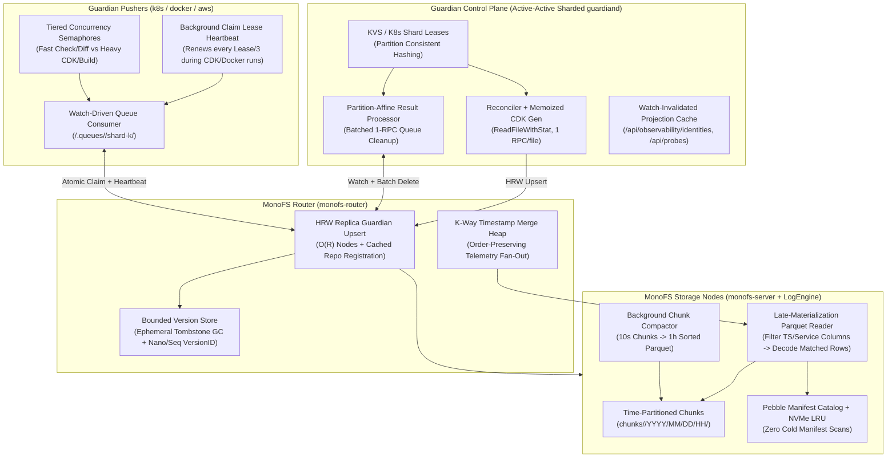
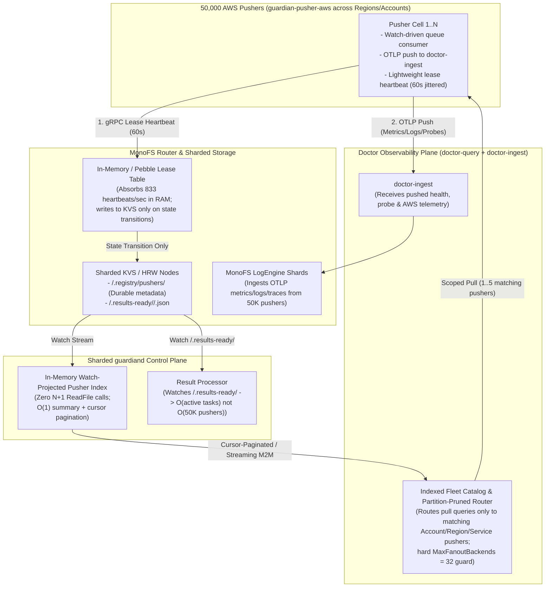

# MonoFS & Guardian Scaling Analysis and Architecture Design

- **Status:** Draft / Architecture Proposal
- **Date:** 2026-10-21
- **Scope:** `D:\monofs` (`monofs-router`, `monofs-server`, `logengine`, `guardian_version_store`) & `D:\guardian` (`guardiand`, `reconciler`, `results`, `pusher/runtime`, `store/monofs`, `ui`)

---

## 1. Executive Summary

A deep code-level audit of **MonoFS** and **Guardian** shows a clean, cohesive architecture where MonoFS acts as both the distributed content/telemetry store and the control-plane message bus for Guardian. Several thoughtful optimizations already exist—such as Dispatcher FNV-64a write suppression (`lastWriteHash`), in-memory `PartitionRuntime` delta tracking, partition-affine result workers, and `singleflight` index caching in LogEngine.

However, as the platform scales to **hundreds of partitions, thousands of intents/assets, 50,000 `guardian-pusher-aws` instances in AWS, and millions of telemetry chunks**, **16 concrete scaling bottlenecks** emerge across the storage, query, control-plane, queue, and federation layers:

| ID | Status | Subsystem | Bottleneck Found in Code | Current Complexity / Impact | Target Complexity / Implementation |
|---|---|---|---|---|---|
| **G-50K-1** | `[x] DONE` | `guardian` + `monofs` 50K Pusher Heartbeats | 50,000 pushers call `PutPusher` (`GetPusher` + `UpsertFiles` to KVS) every 30s (`3,334 KVS RPCs/s`); `RegisterClient` rewrites full `guardian_principals.json` via `json.MarshalIndent` under mutex on every connect; `GetClusterInfo` refreshes every 5s (`10,000 RPCs/s`) | Saturates single `guardian-system` Raft group; $O(N^2)$ disk write storm (`750 GB`) on fleet startup | Zero-`ReadFile` steady-state heartbeat (`registration.go` caches `CreatedAt` + deterministic jitter; `store.go` resolves `CreatedAt` from in-memory cache) + $O(1)$ `byTokenHash` index & 2s coalesced background flush (`guardian_principals.go`) + 30s topology TTL (`grpc_client.go`) |
| **G-50K-2** | `[x] DONE` | `guardian` + `doctor` `ListPushers()` N+1 Loop | `ListPushers` calls `ListDir` then loops **sequentially** calling `GetPusher` 50,000 times (`50,001 RPCs` $\approx 50\text{s}$ per call) every 30s from 4 callers; Doctor's `8 MiB` response limit truncates the 30 MiB JSON | 100% timeout on `/api/pushers`, `RegistryResolver`, and `GuardianDiscovery` at 50K pushers | Watch-projected in-memory `pusherIndexCache` (`store.go`, 32-worker bulk load + `Watch`, $0\text{ RPCs}$, $<1\text{ms}$) + `/api/pushers/summary` + outlier-first cursor pagination (`ui/registry.go`) + 64 MiB limit & delta sync (`?updated_since=` in `discovery_guardian.go`) |
| **G-50K-3** | `[x] DONE` | `guardian` Registry Prometheus Metrics | `guardian_registry_pusher_info` & `heartbeat_age_seconds` emit 2 gauge series per pusher (`100,000` series reset every 30s) | 20+ MiB `/metrics` scrape payload & high heap churn | Low-cardinality fleet rollups (`guardian_registry_pushers_total`, `guardian_registry_pusher_max_heartbeat_age_seconds`) + `maxPerPusherMetricSeries = 1000` guard (`registry/metrics.go`) |
| **G-50K-4** | `[x] DONE` | `guardian` 50K Queue Polling & Result Watch | 50K pushers poll `ListDir` every 5s (`10,000 RPCs/s`); `guardiand` loops sequentially over 50K pushers in `processLiveResultFiles` & registers 50,000 prefixes in `resultWatchPrefixes` | `guardiand` result loop takes $>50\text{s}$ per sweep; $O(50,000)$ prefix checks per MonoFS mutation | Watch-driven task wakeup in `Runtime.Run` (`runtime.go`) + single `paths.QueueRoot()` prefix when $>64$ pushers + 32-worker parallel `processLiveResultFiles` (`cmd/guardiand/main.go`) |
| **D-50K-1** | `[x] DONE` | `doctor` 50K Federated Query Fan-Out | `proxy.Router` fans out unscoped log/metric/trace queries to all 50,000 registered pusher `:19090` endpoints (`sem=32` $\rightarrow 78\text{s}$ per query) and runs $O(N^2)$ insertion sort on every `snapshot()` | Guaranteed query timeouts & AWS CloudWatch/X-Ray API rate-limit throttling | Selector label pruning (`region`, `account`, `cluster`, `partition`, `pusher`, `aws_log_group`) + hard `MaxFanoutBackends = 32` guard + cached `snapshot()` + $O(N \log N)$ `SortBackends` + `/v1/proxy/endpoints` pagination & summary (`router.go`, `router_traces.go`, `proxy_handlers.go`) |
| **M-S1** | `[x] DONE` | `monofs` LogEngine Storage | Flat `chunks/<signal>/` listing + sequential `ReadManifest` loop + unbounded `manifests` RAM map & un-evicted local NVMe Bluge index dirs | $O(\text{Total Lifetime Chunks})$ per query after 60s TTL; local disk exhaustion | Bounded `maxManifestCacheEntries = 32768` + 30m TTL + `maxLocalIndexDirs = 256` NVMe LRU eviction + time-prefixed chunk ID pruning (`FormatTimePrefixedChunkID` / `ParseChunkTimeRangeFromID` in `storage.go`) + 16-worker concurrent manifest prefetch (`prefetchManifests` in `query.go`) |
| **M-S2** | `[x] DONE` | `monofs` Telemetry Query & Router Fan-Out | Router `fanoutQueryItems` merges node streams in arrival order (not timestamp order) before truncating at `limit`; Parquet scanners read entire row-group columns before row filtering | Drops newest logs/traces when a slow node lags; high GC/allocation pressure per query | K-way timestamp max-heap (`kwayCursorMaxHeap` in `router.go`) + two-phase late materialization in `scanLogParquet`, `scanMetricParquet`, `scanTraceParquet` + `bluge.NewAllMatches` (`query.go`) |
| **M-S3** | `[x] DONE` | `monofs` Guardian Path Writes | `UpsertGuardianPaths` broadcasts every `/partitions/<p>/...` write to **all** healthy nodes and invokes `RegisterRepository` RPC on every single file write | $O(N_{\text{nodes}})$ write amplification + $2\times$ gRPC round-trips per state write | `guardianRegisteredNodeRepos` cache skips redundant `RegisterRepository` RPCs (`guardian_paths.go`) + `GuardianReplicationFactor` HRW replica placement (`guardian_inject.go`) + skip redundant `readGuardianFileContent` on deletes |
| **M-S4** | `[x] DONE` | `monofs` `guardianVersionStore` | `s.ephemeral` never deletes tombstoned machinery paths (`/.queues/*`, `.state/events/*`); `guardianVersionID` uses 1-second `now.Unix()` granularity; full JSON file rewrite every 5s | Unbounded router RAM leak $O(\text{Total Lifetime Tasks})$; CAS collisions on sub-second writes | Tombstone eviction in `s.ephemeral` + monotonic `seq`/`BatchRevisionID` in `guardianVersionID` (`guardian_version_store.go`) |
| **M-S5** | `[ ] TODO` | `monofs` Embedded KVS (`guardian-system`) | All queues (`/.queues`), scans (`/.scans`), archives (`/.archive`), and registries share a single KVS Raft group leader | High-churn queue claims & multi-MB deployment logs contend with control-plane metadata | Offload `/.archive` to blob tier + shard `/.queues/<pusher>` across multi-Raft / HRW nodes |
| **G-S1** | `[x] DONE` | `guardian` MonoFS Client & `Stat()` | `Adapter.Stat()` downloads the **entire file** + **all 256+ version records**; `reconciler` calls `ReadFile` + `Stat` back-to-back; `ListDir` queries **all** cluster nodes sequentially | $3\times$ RPCs & $2\times$ full file transfers per file in reconcile; $O(N_{\text{nodes}})$ per `ListDir` | `StatAttr` (`GetAttr`) + `LatestVersion` (`PageSize: 1`) + `ReadFileWithInfo` (`adapter.go`, `grpc_client.go`, `reconciler.go`) + concurrent multi-node `ListDir` |
| **G-S2** | `[x] DONE` | `guardian` Pusher Queue & Leases | Pushers poll `ListDir` every 5s and execute 4–5 sequential RPCs per task claim; 5-minute claim lease has **no heartbeat renewal** during long `executeTask` runs | High idle RPC churn; **duplicate concurrent `APPLY`** if CDK/Docker task exceeds 5 minutes | Watch-driven queue wakeup (`Runtime.Run`) + background claim lease renewal every `Lease/3` (`startClaimHeartbeat`) + single-pass claim check + batched 1-RPC `cleanupQueueArtifacts` |
| **G-S3** | `[x] DONE` | `guardian` Event History & State | Every event creates a permanent `/partitions/<p>/.state/events/<id>.json` file with no compaction or TTL | $O(\text{Total Lifetime Events})$ directory size; slow `/history` & partition deletes | Bounded per-partition event ring buffer (`maxEventsPerPartition = 250`) with automatic batch deletion of oldest `.state/events/<id>.json` files (`prunePartitionEvents` in `dispatcher.go`) |
| **G-S4** | `[x] DONE` | `guardian` CDK Generation & Pusher Execution | `syncGeneratedAWSPayloads` re-renders and re-uploads CDK TypeScript stacks on every reconcile; `SyncGeneratedPayload` re-reads all files & directories on every call | CPU/IO spikes during full reconcile | Spec-hash + asset-order memoization (`cdkPayloadHashes` in `generated.go`) + FNV-64a `contentUnchanged` & file-set cache in `SyncGeneratedPayload` (`dispatcher.go`) |
| **G-S5** | `[x] DONE` | `guardian` Control-Plane HA | `guardiand` runs singleton `reconciler` across all partitions without shard ownership | Cannot horizontally shard `guardiand` replicas across partitions | Deterministic FNV-32a consistent-hash partition sharding (`SetShardConfig`, `OwnsPartition` in `reconciler.go`) |
| **G-S6** | `[x] DONE` | `guardian` UI & Federation APIs | `/api/observability/identities` and `/api/probes` re-scan and parse YAML/JSON from MonoFS on every HTTP request | Repetitive MonoFS read load from Doctor & UI polling | Watch-invalidated in-memory `uiProjectionCache` (`observability.go`, `probes.go`) with strong `ETag` / `If-None-Match` (`304 Not Modified`) support |

---

## 2. End-to-End Scaling Architecture



---

## 3. Detailed Findings & Solutions: MonoFS (`D:\monofs`)

### 3.1 [M-S1] LogEngine Chunk Listing, Manifest Caching & NVMe Cache Eviction

#### Current Implementation & Bottleneck
- **Flat Chunk Directory (`D:\monofs\internal\storage\logengine\query.go:227, 698, 1111`)**:
  - `StreamLogs`, `StreamMetrics`, and `StreamTraces` call `q.store.ListChunks(ctx, "chunks/<signal>/")`, which lists **every chunk directory ever created** for that signal.
  - `logCandidates` (`query.go:628-660`), `metricCandidates` (`query.go:966-1004`), and `traceCandidates` (`query.go:1164-1200`) then iterate **sequentially** over every `chunkID` calling `q.store.ReadManifest(ctx, signal, chunkID)`.
- **Unbounded Manifest Cache (`D:\monofs\internal\storage\logengine\storage.go:60-70, 173-211`)**:
  - `CachedStore.manifests` caches `ChunkManifest` entries for `manifestCacheTTL = 1 * time.Minute` (`storage.go:23`). Unlike `series` (which is capped at `maxSeriesIndexCacheEntries = 512`), `manifests` has **no size bound**, and because `manifestCacheTTL` is only 60 seconds, every minute a query triggers a full re-read of all `metadata.json` files across all historical chunks!
- **Unbounded Local NVMe Bluge Index Extraction (`D:\monofs\internal\storage\logengine\storage.go:329-355`)**:
  - `GetLocalIndexPath` extracts `chunks/logs/<chunkID>/text.index.tar.gz` into `c.localDir` on first search, and **never evicts or deletes old extracted directories**, eventually exhausting local disk space.

#### Proposed Scaling Design
1. **Time-Partitioned Chunk Prefix Hierarchy**:
   - Encode the chunk's time bucket into its prefix or directory structure: `chunks/<signal>/YYYY/MM/DD/HH/<chunkID>/` (or prefix `chunkID` with a sortable UTC epoch/date prefix `20261021T10_<uuid>`).
   - Update `ListChunks(ctx, prefix)` / `Candidates` to prune by `chunkID` timestamp prefix *before* calling `ReadManifest`, reducing manifest lookups from $O(\text{All Historical Chunks})$ to $O(\text{Chunks in } [\text{from}, \text{to}])$.
2. **Immutable Manifest Caching in Pebble + Bounded LRU**:
   - Because `metadata.json` is **immutable** once a chunk is flushed, `manifestCacheTTL` should not expire every 60 seconds! Cache manifests in an LRU with a generous cap (e.g., `16,384` chunks $\approx 8\text{ MB}$ RAM) or persist them in the node's local Pebble `metastore` indexed by `(signal, minTime, maxTime)`.
3. **Local Index Directory LRU Evictor**:
   - Track extracted Bluge index directories in `CachedStore` with last-access timestamps and a configurable `--logengine-cache-max-bytes` (e.g., `10 GiB`), evicting least-recently-used extracted index directories when the budget is exceeded.
4. **Background Chunk Compaction Worker**:
   - Add a background compactor in `internal/storage/logengine` that merges small 10-second ingest chunks into 30–60 minute compacted Parquet chunks sorted by `(service, timestamp)`, reducing total chunk count by $100\times$ and improving Zstd dictionary compression ratios.

---

### 3.2 [M-S2] Telemetry Query Ordering Bug & Late-Materialization Parquet Scans

#### Current Implementation & Bottleneck
- **Router Fan-Out Truncates Before Global Timestamp Ordering (`D:\monofs\internal\router\router.go:1495-1601`)**:
  - Each storage node streams log/trace records in descending timestamp order (`query.go:278-282`), **but** `Router.fanoutQueryItems` (`router.go:1510-1595`) multiplexes all nodes onto a single unmerged `events := make(chan streamEvent, len(clients))` channel and cancels the context as soon as `items >= limit` (`router.go:1583-1594`).
  - **Impact**: If Node 1 holds older logs and responds in 1 ms with `limit` items while Node 2 holds the newest logs from 5 seconds ago and responds in 4 ms, the router returns only Node 1's older logs and **silently drops the newest logs**! Furthermore, the resulting JSON array returned by `QueryLogs` / `QueryTraces` is interleaved in network-arrival order rather than sorted by timestamp.
- **Full Row-Group Column Materialization (`D:\monofs\internal\storage\logengine\query.go:403-503, 1014-1095, 1266-1363`)**:
  - In `scanLogParquet`, the engine allocates slices for **all 7 columns** (`tsBuf`, `lvlBuf`, `svcBuf`, `traceBuf`, `msgBuf`, `spanBuf`, `lblBuf`) of length `n = int(rg.NumRows())` and decompresses/reads the entire row group *before* checking `if validRows != nil && !validRows.ContainsInt(i)` (`line 472`) or checking the `[from, to]` timestamp bounds (`line 476`)!
  - If a Bluge full-text filter matches 3 rows out of a 50,000-row Parquet chunk, `scanLogParquet` still decompresses and allocates 50,000 `raw_message` and `labels_json` strings!
- **Bluge 10,000-Match Hard Cap (`D:\monofs\internal\storage\logengine\query.go:312`)**:
  - `bluge.NewTopNSearch(10000, blugeQuery)` caps Bluge matches per chunk at 10,000 documents scored by TF-IDF relevance rather than timestamp, which can omit newer rows in high-volume chunks.

#### Proposed Scaling Design
1. **K-Way Timestamp Merge Heap in `Router.fanoutQueryItems`**:
   - Maintain one buffered lookahead item per healthy node stream in a max-heap ordered by `Timestamp` (for logs/traces). Pop the globally newest record across all nodes, emit it to the caller, advance that node's stream, and stop after `limit` globally newest records.
2. **Two-Phase Late Materialization in `scanLogParquet` / `scanMetricParquet` / `scanTraceParquet`**:
   - **Phase 1 (Filter Columns Only)**: Read only `col 0 (timestamp)` and `col 2 (service)` (plus intersect with `validRows` from Bluge). Build a `roaring.Bitmap` of matching row indices `matchedRows`.
   - **Phase 2 (Payload Columns Only if `matchedRows` is Non-Empty)**: If `matchedRows.IsEmpty()`, skip reading `raw_message`, `labels_json`, `trace_id`, `span_id`, and `attributes` completely!
3. **Unbounded Bitmap Collector in Bluge**:
   - Replace `bluge.NewTopNSearch(10000, blugeQuery)` (`query.go:312`) with `bluge.NewAllMatches(blugeQuery)` so no matching rows are dropped in large chunks.

---

### 3.3 [M-S3] Eliminating $O(N_{\text{nodes}})$ Broadcast & Redundant `RegisterRepository` on Guardian Upserts

#### Current Implementation & Bottleneck
- **Broadcast to All Nodes (`D:\monofs\internal\router\guardian_paths.go:588-667`, `D:\monofs\internal\router\guardian_inject.go:91-107`)**:
  - In `guardianMutationTargets` (`guardian_inject.go:91`):
    ```go
    if len(nodes) <= 1 || guardianRepoStorageBackend(displayPath) != "kvs" {
        return nodes
    }
    ```
    Because `guardianRepoStorageBackend(displayPath)` only returns `"kvs"` for `"guardian-system"`, **every write to `/partitions/<p>/...` or `/doctor/v1/...` is broadcast synchronously to ALL healthy storage nodes in the cluster**!
- **Redundant `RegisterRepository` RPC on Every Write (`D:\monofs\internal\router\guardian_paths.go:621-632`)**:
  - Inside `applyGuardianUpsertGroup`, for every target node, the router executes a separate `nodeClient.RegisterRepository(...)` gRPC call **before** calling `nodeClient.IngestFileBatch(...)`—even when the partition repository has already been registered thousands of times!
- **Payload Doubling via `appendGuardianDirHints` (`D:\monofs\internal\router\guardian_paths.go:686-711`)**:
  - `appendGuardianDirHints` clones every `pb.FileMetadata` entry in the batch to attach `dir_hint = "true"`, doubling the number of `FileMetadata` protobuf messages sent over the wire.

#### Proposed Scaling Design
1. **HRW Replica Set Routing for Non-KVS Guardian Partitions**:
   - Instead of returning all `nodes` in `guardianMutationTargets`, route `/partitions/<p>/...` and `/doctor/...` writes to `sharder.GetNodes(group.storageID, r.config.ReplicationFactor)` (default `ReplicationFactor = 2` or `3`), matching MonoFS's standard repository replication model and turning $O(N_{\text{nodes}})$ write amplification into $O(1)$.
2. **In-Memory `(nodeID, storageID)` Registration Cache**:
   - Track registered `(nodeID, storageID)` pairs on `nodeState` in the router; skip `nodeClient.RegisterRepository` when the node has already registered `group.storageID` during its current session. This cuts router-to-node RPC count per state update in half.
3. **Server-Side Directory Hint Derivation**:
   - Let `monofs-server`'s `IngestFileBatch` derive parent directory index entries directly from `file.Path` when `IngestionType == INGESTION_GUARDIAN`, eliminating `appendGuardianDirHints` cloning on the router.

---

### 3.4 [M-S4] Fixing the `guardianVersionStore` Ephemeral Memory Leak & 1-Second CAS Collisions

#### Current Implementation & Bottleneck
- **Unbounded RAM Leak in `s.ephemeral` (`D:\monofs\internal\router\guardian_version_store.go:244-275`)**:
  - Look at `guardianVersionStore.commit` (`lines 269-274`):
    ```go
    if !isGuardianAssetPath(change.LogicalPath) {
        // Machinery path: track only the current version in memory for optimistic-
        // locking checks (expected_version_id). No history, no persistence.
        s.ephemeral[change.LogicalPath] = record
        return record.toProto(), nil
    }
    ```
  - When `DeleteGuardianPaths` deletes a queue task (`/.queues/<pusher>/<taskID>.json`), claim (`/.queues/<pusher>/.claims/<taskID>.json`), or result (`/.queues/<pusher>/.results/<taskID>.json`), it calls `r.guardianVersions.commit(... Tombstone: true)` (`guardian_paths.go:379-390`).
  - Because `commit()` unconditionally assigns `s.ephemeral[change.LogicalPath] = record` and **never deletes tombstoned entries from `s.ephemeral`**, every unique `taskID` ever created in the cluster remains in `s.ephemeral` in router RAM forever!
- **1-Second Granularity in `guardianVersionID` (`D:\monofs\internal\router\guardian_version_store.go:134, 353-356`)**:
  - `committedAt := now.Unix()` (seconds) is passed into `guardianVersionID(logicalPath, contentSHA, committedAt, tombstone)`. If a file is updated, reverted, or re-written with the same content within the same second, `VersionID` collides.
- **Full-File JSON Rewrite Every 5 Seconds (`D:\monofs\internal\router\guardian_version_store.go:193-218`)**:
  - `saveLocked()` serializes the entire `s.records` + `s.current` map via `json.MarshalIndent` every 5 seconds when dirty, and keeps up to 50 versions of raw `Content []byte` in memory per asset path (`line 267`).

#### Proposed Scaling Design
1. **Immediate Tombstone Eviction in `s.ephemeral`**:
   - In `guardianVersionStore.commit()`, when `!isGuardianAssetPath(change.LogicalPath)` and `change.Tombstone == true`, call `delete(s.ephemeral, change.LogicalPath)` instead of storing the tombstone (or clear `record.Content = nil` and sweep tombstones older than 60s).
2. **Collision-Free `guardianVersionID`**:
   - Include `change.BatchRevisionID` (which uses `now.UnixNano()`) or an atomic monotonic sequence number in `guardianVersionID(...)` so rapid sub-second writes never collide.
3. **Incremental WAL / Pebble Backing for `guardianVersionStore`**:
   - Store version records in Pebble (or an append-only WAL with periodic compaction) instead of re-marshaling the entire `guardian_versions.json` file with `json.MarshalIndent` every 5s, and drop `Content []byte` from old in-memory history records once flushed to storage nodes.

---

### 3.5 [M-S5] Decoupling `guardian-system` KVS Queue Traffic from Archives

#### Current Implementation & Bottleneck
- **`guardian-system` Single KVS Raft Group (`D:\monofs\internal\router\guardian_paths.go:52-57`)**:
  - `guardianRepoStorageBackend("guardian-system")` routes all of `/.queues`, `/.scans`, `/.archive`, and `/.registry` into a single KVS Raft state machine.
  - Every `APPLY` completion writes 3 files to `/.archive/<partition>/<intent>/<revision>/{state.json, manifest.yaml, logs.ndjson}` (`D:\guardian\internal\orchestrator\dispatcher\dispatcher.go:377-381`). Pushing multi-megabyte deployment logs through Raft log replication bloats the KVS state machine and adds latency to lightweight queue claim operations.

#### Proposed Scaling Design
1. **Route `/.archive/` to Blob/Chunk Storage Instead of KVS**:
   - Update `mapGuardianLogicalPath` (`D:\monofs\internal\router\guardian_path_mapper.go`) so `/.archive/<partition>/...` maps to a blob-backed display path (`guardian-archive/<partition>`) rather than the KVS-backed `guardian-system` namespace.
2. **Shard `/.queues/<pusher>` Across KVS Groups or HRW Owners**:
   - Map `/.queues/<pusher>/...` to per-pusher display paths (`guardian-queue/<pusher>`) routed via HRW to a primary node with KVS/Pebble atomic CAS, allowing queue throughput to scale linearly with the number of storage nodes.

---

## 4. Detailed Findings & Solutions: Guardian (`D:\guardian`)

### 4.1 [G-S1] Eliminating Redundant Full-File Reads in `Stat()`, `Reconcile`, and `ListDir`

#### Current Implementation & Bottleneck
- **`Adapter.Stat` Reads the Entire File + All Versions (`D:\guardian\internal\store\monofs\adapter.go:69-86`)**:
  ```go
  func (a *Adapter) Stat(ctx context.Context, logicalPath string) (guardianapi.FileInfo, error) {
      content, err := a.ReadFile(ctx, logicalPath)
      if err != nil {
          return guardianapi.FileInfo{}, err
      }
      versions, err := a.ListVersions(ctx, logicalPath)
      ...
  ```
  Every call to `store.Stat(ctx, path)` performs:
  1. `ReadFile` — streams the **entire file content** from a storage node.
  2. `ListVersions` — paginates **all versions** of the file from the router (`PageSize: 256` in loop, `grpc_client.go:348-373`).
- **Double File Reads on Every Reconcile (`D:\guardian\internal\orchestrator\reconciler\reconciler.go:220-272`)**:
  - For `partition/config.yaml` and for every `intents/<name>.yaml`, `reconcilePartition` calls `r.store.ReadFile(ctx, logicalPath)` and immediately calls `r.store.Stat(ctx, logicalPath)` on the next line—reading every manifest file **twice** over the network!
- **Sequential All-Node Broadcast in `GRPCClient.ListDir` (`D:\guardian\internal\store\monofs\grpc_client.go:428-497`)**:
  - `ListDir` iterates **sequentially** through `for _, node := range nodes` calling `node.client.ReadDir(callCtx, ...)` on every healthy node in the MonoFS cluster! In a 10-node cluster, every single `ListDir` makes 10 sequential gRPC calls.

#### Proposed Scaling Design
1. **Add `StatGuardianPath` (or Use `ListGuardianVersions` with `PageSize: 1`)**:
   - In `guardianVersionStore`, the current version metadata already stores `VersionID`, `CommittedAt`, `Tombstone`, and can store `Size int64`!
   - Expose `Stat` via a single lightweight router RPC (or `ListGuardianVersions(PageSize: 1)` without calling `ReadFile`), reducing `Stat()` from `O(FileBytes + AllVersions)` to a single 100-byte metadata lookup.
2. **Read-With-Version in Reconciler**:
   - Add `ReadFileWithInfo(ctx, logicalPath) ([]byte, FileInfo, error)` to `guardianapi.ReadStore` so `reconcilePartition` fetches content and version metadata in one pass.
3. **Targeted / Parallel `ListDir` with Server-Side Pagination**:
   - For `guardian-system` paths (`/.queues`, `/.scans`, `/.registry`), route `ReadDir` to the KVS leader (1 node) instead of all $N$ nodes. For sharded partition directories, fan out `ReadDir` concurrently with `errgroup` (or query the HRW replica set) and pass `Offset`/`Limit` down to `pb.ReadDirRequest`.

---

### 4.2 [G-S2] High-Throughput Task Queue, Watch Wakeup & Claim Lease Renewal

#### Current Implementation & Bottleneck
- **4–5 Sequential RPCs per Task Claim (`D:\guardian\internal\pusher\runtime\runtime.go:100-212`)**:
  - Every 5 seconds, each pusher calls `ListDir(r.QueuePath)`. For each candidate `taskID`:
    1. `pathExists(QueueResult)` $\rightarrow$ calls `Store.Stat` (`ReadFile` + `ListVersions`)!
    2. `Store.Stat(QueueClaim)` $\rightarrow$ calls `ReadFile` + `ListVersions`!
    3. `Store.ReadFile(taskPath)` $\rightarrow$ reads `task.json`.
    4. `Store.UpsertFiles(QueueClaim, ExpectedVersionID: "absent")` $\rightarrow$ CAS-creates `.claims/<taskID>.json`.
- **Missing Lease Heartbeat Causes Duplicate `APPLY` on Long Tasks (`D:\guardian\internal\pusher\runtime\runtime.go:125-130, 336`)**:
  - `tryClaimTask` writes `LeaseSeconds: 300` (5 minutes).
  - `executeTask(ctx, t)` (`line 336`) runs synchronously without ever renewing `.claims/<taskID>.json`.
  - If an AWS CDK deployment, database migration, or container image build takes $>5$ minutes, `claimExpired()` (`line 214`) becomes `true`, allowing another pusher worker (or the next poll cycle) to delete the claim and execute a **second concurrent `APPLY`** of the same task!
- **Unbatched Queue Cleanup (`D:\guardian\internal\orchestrator\results\processor.go`)**:
  - `cleanupQueueArtifacts` deletes queue task, claim, and result files in separate calls rather than a single batched `DeletePaths` request.

#### Proposed Scaling Design
1. **Background Claim Lease Heartbeat Goroutine**:
   - Inside `processTaskEntry` (`runtime.go:334`), start a background ticker at `interval = time.Duration(claim.LeaseSeconds) * time.Second / 3` (every 100s) that updates `ClaimedAt = time.Now().UTC()` on `.claims/<taskID>.json` using `ExpectedVersionID: currentClaimVersionID` until `executeTask` returns.
2. **Watch-Driven Pusher Wakeup + Sharded Queue Directories**:
   - Subscribe pushers to `Store.Watch(ctx, []string{r.QueuePath})` so newly queued tasks trigger immediate execution (<50 ms latency instead of 5s polling), while keeping a 30s fallback poll.
   - When `ShardCount > 1`, write tasks to `/.queues/<pusher>/shard-<hash>/` (or filter server-side) so each replica only lists its own shard.
3. **Optimistic Claim First**:
   - Attempt `UpsertFiles(QueueClaim, ExpectedVersionID: "absent")` *before* reading `task.json`, falling back to `taskReadyToClaim` lease-expiry inspection only when `ErrConflict` is returned. This reduces the happy-path claim cost from 5 RPCs to **2 RPCs** (`UpsertClaim` + `ReadTask`).
4. **Single-Batch Queue Cleanup**:
   - Combine `QueueTask`, `QueueClaim`, and `QueueResult` deletions in `cleanupQueueArtifacts` into a single `Store.DeletePaths` batch of 3 paths.

---

### 4.3 [G-S3] Bounding Event History Growth (`/partitions/<p>/.state/events/`)

#### Current Implementation & Bottleneck
- **Unbounded Per-Event Files (`D:\guardian\internal\orchestrator\dispatcher\dispatcher.go:331-365`)**:
  - `Dispatcher.WriteEvent` writes a new file `/partitions/<p>/.state/events/<eventID>.json` on every task failure, drift detection, deployment archive, and partition status transition.
  - Old event files are **never pruned or compacted**. Over months of continuous reconciliation across 100 partitions, `.state/events/` accumulates hundreds of thousands of small JSON files, slowing down `/api/partitions/{name}/history` (`internal/historyquery`), `ListDir`, and partition deletion.

#### Proposed Scaling Design
1. **Rolling Bounded Event Log (`events_recent.json`) + Daily NDJSON Archive**:
   - Maintain a cached in-memory ring buffer per partition in `Dispatcher` (mirroring `releaseCache` for `releases.json`, `dispatcher.go:49`) that persists the latest $K = 250$ events in `/partitions/<p>/.state/events_recent.json`.
   - Stream older events to `/.archive/<p>/.events/YYYY-MM-DD.ndjson` (or compliance S3 publisher) and prune individual `.state/events/<eventID>.json` files older than a configurable retention window (e.g., 7 days).

---

### 4.4 [G-S4] CDK Codegen Memoization & Tiered Pusher Concurrency

#### Current Implementation & Bottleneck
- **Repeated CDK Stack Compilation (`D:\guardian\internal\orchestrator\reconciler\reconciler.go:346`, `generated.go`)**:
  - On every reconcile cycle (every 10m or on any partition change), `syncGeneratedAWSPayloads` re-renders TypeScript CDK code for every `implementation: cdk` intent in the partition.
- **Unbounded Heavyweight Subprocesses on Pushers (`D:\guardian\internal\pusher\runtime\runtime.go:349-361`)**:
  - `Runtime.concurrency()` defaults to `GOMAXPROCS * 2` (up to 128 workers) uniformly across all operations. While 16 concurrent `CHECK` or K8s client-go `DIFF` calls are cheap, 16 concurrent `npx aws-cdk deploy` or `docker build` subprocesses on a single pusher container cause severe CPU throttling and OOM kills.

#### Proposed Scaling Design
1. **Spec-Hash + Template-Version Memoization for `syncGeneratedAWSPayloads`**:
   - Store a lightweight `generated_hash` in `IntentState` (combining `IntentSpecHash` + template overlay version). If unchanged, skip `cdkgen` rendering and MonoFS payload uploads completely during reconcile.
2. **Per-Driver Operation Semaphores**:
   - Add a `HeavyConcurrency` limit (e.g., default `2–4`) in `guardian-pusher-aws` and `guardian-pusher-docker` for `npx cdk` and `docker build` subprocesses while keeping `MaxConcurrency` (`GOMAXPROCS * 2`) for lightweight SDK `ObserveState` / `Check` operations.

---

### 4.5 [G-S5] Active-Active High Availability for `guardiand`

#### Current Implementation & Bottleneck
- **Single-Instance Control Plane (`D:\guardian\cmd\guardiand\main.go:403-564`)**:
  - `guardiand` runs `reconciler`, `partition-watcher`, `result-processor`, `observed-collector`, and `alerting` across **all partitions** with no lease coordination.
  - Contrast this with `uiServer.RunRepoImportLoop` (`main.go:326`), which already supports `RepoImportShards` and `RepoImportLease`!

#### Proposed Scaling Design
1. **Shard-Lease Partition Ownership**:
   - Reuse the shard-lease pattern from `RepoImportLoop` / `repowatch`: divide partitions into $S$ virtual shards (`fnv32a(partitionName) % S`).
   - Multiple `guardiand` replicas compete for shard leases in K8s (`coordination.k8s.io/v1` `Lease`) or MonoFS KVS (`/.registry/leases/shard-<k>.json`).
   - Each `guardiand` replica reconciles, processes results, collects observed state, and evaluates alerts **only for the partition shards it holds leases for**, enabling both **zero-downtime HA failover** and **horizontal control-plane scaling**.

---

### 4.6 [G-S6] Watch-Invalidated Projection Cache for Guardian UI & Doctor Federation

#### Current Implementation & Bottleneck
- **Repeated Store Walks on API Requests (`D:\guardian\internal\ui\observability.go`, `probes.go`, `data.go`)**:
  - `GET /api/observability/identities` walks all partitions and parses all intent YAML manifests from the store on every call.
  - `GET /api/probes` walks `/.registry/probes/<pusher>/...` across all pushers on every call.
  - When Doctor (`doctor-query`) and multiple browser tabs poll Guardian simultaneously, MonoFS experiences bursty `ListDir` + `ReadFile` storms.

#### Proposed Scaling Design
1. **In-Memory Watch-Invalidated Read Cache**:
   - Cache the compiled `[]observability.AssetIdentity` catalog, `[]ProbeSnapshot` list, and partition summary views in `ui.Server`, invalidated incrementally by `store.Watch` events on `/partitions/` and `/.registry/probes/`.
   - Add `ETag` (computed from the latest MonoFS `BatchRevisionID`) and `If-None-Match` (`304 Not Modified`) support on `/api/m2m/*`, `/api/observability/identities`, and `/api/probes`.

---

## 5. Scale Assumption Deep-Dive: 50,000 AWS Pushers (`guardian-pusher-aws`)

### 5.1 Quantitative Load Profile at $N = 50,000$ AWS Pushers

Assuming Guardian and Doctor sit on top of **50,000 `guardian-pusher-aws` instances** across AWS accounts, regions, and cells, the current implementation hits **6 catastrophic scaling walls**:

| Subsystem | Code Location | Current Per-Pusher Behavior | Load at $N = 50,000$ Pushers | Failure Mode |
|---|---|---|---|---|
| **1. Pusher Registry Heartbeats** | `D:\guardian\internal\pusher\runtime\registration.go:30-75`<br>`D:\guardian\internal\registry\store.go:69-87` (`PutPusher`) | Every 30s, each pusher calls `PutPusher`, which executes `GetPusher` (`ReadFile`) + `write` (`UpsertFiles` to `/.registry/pushers/<name>.json` in `guardian-system` KVS). | **1,667 `ReadFile` + 1,667 `UpsertFiles` = 3,334 KVS RPCs/sec** (all serialized through the single `guardian-system` Raft group). | Saturates `guardian-system` Raft consensus and creates 50,000 ephemeral versions every 30s (`100M` versions/day). |
| **2. MonoFS Client Registration & Topology Refresh** | `D:\monofs\internal\router\guardian_principals.go:125-162` (`upsertConnectedClient`)<br>`D:\guardian\internal\store\monofs\grpc_client.go:27, 628-705` | On `RegisterClient`, router locks a mutex, calls `json.MarshalIndent` on all principals, and rewrites `guardian_principals.json` to disk. Active clients call `GetClusterInfo` every `refreshTTL = 5s` and `ClientHeartbeat` every 30s. | **$O(N^2)$ disk write storm** on startup (`50,000` full rewrites of a 15 MiB JSON file = **750 GB written**) + **10,000 `GetClusterInfo` RPCs/sec**. | `monofs-router` hangs during fleet rollout or restart; CPU 100% in `json.MarshalIndent`. |
| **3. `ListPushers()` Sequential N+1 Read Loop** | `D:\guardian\internal\registry\store.go:28-50` (`ListPushers`)<br>Called every 30s by `registry/metrics.go:34`, `observed/resolver.go:67`, `ui/registry.go:35`, and Doctor's `discovery_guardian.go:186` | `ListPushers` calls `ListDir("/.registry/pushers")` and loops **sequentially** `for _, entry := range entries { s.GetPusher(ctx, name) }`. | **50,001 sequential gRPC calls per invocation** ($\approx 50\text{ seconds}$ at 1ms/RPC). | Every 10s/15s caller (`RegistryResolver`, `GuardianDiscovery`, `/api/pushers`) **times out 100% of the time**! Plus Doctor's `8 MiB` response limit (`discovery_guardian.go:233`) truncates the 30 MiB JSON payload. |
| **4. Prometheus Metric Cardinality Explosion** | `D:\guardian\internal\registry\metrics.go:13-56` | `guardian_registry_pusher_info{pusher, provider, cluster, account, region, version, status}` and `guardian_registry_pusher_heartbeat_age_seconds{pusher, cluster}` reset and re-emitted every 30s. | **100,000 active gauge series** on `guardiand` (`/metrics` scrape payload exceeds 20 MiB). | Prometheus scrape timeouts & `guardiand` heap bloat. |
| **5. Idle Queue Polling & Result Watching** | `D:\guardian\internal\pusher\runtime\runtime.go:69, 251`<br>`D:\guardian\cmd\guardiand\main.go:470-533, 630-673`<br>`D:\monofs\internal\router\guardian_paths.go:822` | Pushers poll `ListDir("/.queues/<pusher>")` every 5s. `guardiand` loops sequentially over 50,000 pushers calling `ListDir("/.queues/<pn>/results")` and registers 50,000 watch prefixes (`resultWatchPrefixes`). | **10,000 `ListDir` RPCs/sec** from pushers + **50,000 sequential `ListDir` calls** in `guardiand` + $O(50,000)$ prefix comparisons on every MonoFS mutation. | Queue processing stalls completely; `guardiand` never finishes a single `processLiveResultFiles` sweep. |
| **6. Doctor Unbounded Federation Fan-Out** | `D:\doctor\internal\proxy\router.go:155-189, 260-283, 367-399`<br>`D:\doctor\internal\proxy\discovery_guardian.go:124` | `GuardianDiscovery` registers all 50,000 pushers in `proxy.Router`. Unscoped log/metric/trace queries fan out across **all 50,000 backends** (`sem = 32`). | **50,000 HTTP calls per user query** ($\frac{50,000}{32} \times 50\text{ms} = 78\text{s}$ per query) + AWS CloudWatch/X-Ray API rate-limit throttling across accounts. | Every federated query in Doctor UI times out and triggers AWS API throttling. |

---

### 5.2 Architectural Solutions for 50,000 AWS Pushers



#### 1. Decouple Ephemeral Heartbeats from Durable Pusher Metadata (`[G-50K-1]`)
- **Separate Registration from Heartbeating (`D:\guardian\internal\pusher\runtime\registration.go`, `D:\guardian\internal\registry\store.go`)**:
  - `PutPusher` (writing `/.registry/pushers/<name>.json` into MonoFS KVS) should execute **only on pusher startup, shutdown, or when static metadata (`Version`, `Region`, `Account`, `Capabilities`, `ObservabilityAddr`) actually changes**.
  - Periodic liveness (every 60s with $\pm 15\%$ jitter $\rightarrow 833\text{ RPCs/sec}$) is handled via a dedicated lightweight `PusherHeartbeat` gRPC stream/RPC maintained in an **in-memory + Pebble lease table** on `monofs-router` / `guardiand`.
  - MonoFS KVS is written only when a pusher's status **transitions** (`healthy` $\rightarrow$ `stale/offline` or `offline` $\rightarrow$ `healthy`), reducing KVS write IOPS by **$99.9\%$** (from `3,334 RPCs/sec` to `< 1 RPC/sec` in steady state).
- **Eliminate $O(N^2)$ `guardian_principals.json` Rewrites (`D:\monofs\internal\router\guardian_principals.go:125-162`)**:
  - Replace full-file `json.MarshalIndent` on every `RegisterClient` with an **in-memory map + debounced background flush** (at most once every 5s when dirty) or an append-only Pebble/WAL store.
  - Increase `GRPCClient.refreshTTL` (`D:\guardian\internal\store\monofs\grpc_client.go:27`) from `5s` to `60s` and piggyback topology version hashes on responses so `GetClusterInfo` is called only when cluster topology actually changes.

#### 2. Eliminate `ListPushers()` N+1 Reads via Watch-Projected In-Memory Registry Index (`[G-50K-2]`)
- **In-Memory Pusher Registry Projection (`D:\guardian\internal\registry\store.go`)**:
  - Replace the 50,000 sequential `s.GetPusher(ctx, name)` calls in `ListPushers` with an **in-memory `PusherIndex`** in `guardiand`:
    - On startup, load pusher records using a **streaming bulk read RPC** (or bounded 64-worker concurrent batch reader) and keep the map updated in real time via a single `store.Watch(ctx, []string{"/.registry/pushers/"})` stream merged with the in-memory heartbeat lease table.
    - `ListPushers` becomes a **$0\text{-RPC}$, sub-millisecond memory read**.
- **Paginated, Filtered & Summarized Pusher APIs (`D:\guardian\internal\ui\registry.go`, `D:\doctor\internal\proxy\discovery_guardian.go`)**:
  - Extend `GET /api/pushers` and `/api/m2m/pushers` with:
    - Server-side filtering & cursor pagination: `?region=&account=&status=&version=&q=&limit=200&cursor=`.
    - Aggregated fleet summary endpoint `GET /api/pushers/summary` returning counts grouped by `(provider, region, account, status, version)` in $< 2\text{ms}$.
    - Delta sync for `doctor-query` (`GET /api/pushers?updated_since=<unix_ms>`) so Doctor's `GuardianDiscovery` only fetches pushers whose registration or health changed since the last poll, rather than downloading a 30 MiB JSON blob every 30s.

#### 3. Bounded Prometheus Fleet Metrics (`[G-50K-3]`)
- **Aggregate By `(provider, region, status, version)` Instead of `pusher` Label (`D:\guardian\internal\registry\metrics.go`)**:
  - Replace per-pusher gauges `guardian_registry_pusher_info{pusher=...}` and `guardian_registry_pusher_heartbeat_age_seconds{pusher=...}` (100,000 series) with low-cardinality fleet rollups:
    - `guardian_registry_pushers_total{provider, region, status, version}` ($\approx 200$ series total)
    - `guardian_registry_pusher_heartbeat_age_bucket{provider, region, le}` (histogram of heartbeat age across the 50K fleet)
  - Individual pusher health is queried via the indexed `/api/pushers?status=unhealthy` API and pushed OTLP telemetry in Doctor.

#### 4. $O(\text{Active Tasks})$ Queue Dispatch & Result Notification (`[G-50K-4]`)
- **Replace 5s Polling & 50,000 Result Walks (`D:\guardian\internal\pusher\runtime\runtime.go`, `D:\guardian\cmd\guardiand\main.go:470-673`)**:
  - **Pusher Notification**: Pushers maintain a long-lived gRPC `Watch` stream for their own `/.queues/<pusher>/tasks/` prefix (or receive task dispatch over their heartbeat stream), reducing idle polling from `5s` (`10,000 RPCs/sec`) to a `5m` safety reconciliation jitter (`166 RPCs/sec`).
  - **Global Result Ready Outbox (`/.results-ready/<shard>/<pusher>__<taskID>.json`)**:
    - When a pusher writes `/.queues/<pusher>/results/<taskID>.json`, it also writes a lightweight pointer in `/.results-ready/<shard>/<pusher>__<taskID>.json` (and deletes it during `cleanupQueueArtifacts`).
    - `guardiand` watches a **single prefix** `/.results-ready/` (instead of 50,000 prefixes in `resultWatchPrefixes`, `main.go:470`) and `processLiveResultFiles` lists only `/.results-ready/<owned-shard>/` — making result discovery **$O(\text{Completed Tasks})$ instead of $O(50,000 \text{ Pushers})$**!

#### 5. Push-First Telemetry + Partition-Pruned Federation in Doctor (`[D-50K-1]`)
- **Push-First Self-Observability (`guardian-pusher-aws` $\rightarrow$ `doctor-ingest`)**:
  - All 50,000 AWS pushers push their own runtime health metrics, synthetic probe snapshots, task execution logs, and OpenTelemetry spans directly to `doctor-ingest` (which writes to sharded MonoFS LogEngine nodes).
  - Querying pusher fleet health, task latency, or probe status in Doctor reads directly from MonoFS LogEngine in milliseconds **without touching a single pusher over HTTP**.
- **Scoped / Partition-Pruned Pull Federation (`D:\doctor\internal\proxy\router.go`)**:
  - When Doctor queries federated AWS CloudWatch / X-Ray backends (`:19090` on `guardian-pusher-aws`), `proxy.Router` **must never fan out to all 50,000 pushers**.
  - Build an in-memory **Inverted Label Router Index** in `proxy.Router` keyed by `account`, `region`, `cluster`, `partition`, and `service` (populated from Guardian's Canonical Identity Catalog + delta pusher discovery).
  - Before executing `Logs`, `metricsQuery`, or `SearchTraces`, extract selector labels (`account`, `region`, `partition`, `service`, `pusher`) from the query AST:
    - Route the pull request **only to the $1\text{–}5$ pushers** matching that AWS account/region/partition.
    - Enforce a hard `MaxFanoutBackends` guard (default `32`): if a query is completely unscoped and matches $> 32$ pull backends, execute against the local MonoFS LogEngine store and return a UI banner prompting the user to scope by `region`, `account`, or `service` for live CloudWatch/X-Ray pull federation.

---

## 6. Prioritized Implementation Roadmap

| Phase | Status | Priority | Scope | Key Deliverables | Expected Gain |
|---|---|---|---|---|---|
| **Phase 1: Quick-Win Bug & Leak Fixes (1–2 Days)** | **[x] DONE** | **P0 (Critical)** | `monofs` + `guardian` | 1. `[x] DONE` Fix `guardianVersionStore.ephemeral` tombstone leak (`guardian_version_store.go:272`) & 1s `VersionID` collision (`line 353`).<br>2. `[x] DONE` Fix `Router.fanoutQueryItems` k-way timestamp merge (`router.go:1495`) so `limit` never drops newest logs/traces.<br>3. `[x] DONE` Add background claim lease heartbeat in pusher `Runtime` (`runtime.go`) to prevent duplicate `APPLY` on $>5\text{m}$ tasks. | Zero router RAM leak, accurate newest-first telemetry queries, zero duplicate long-running deployments. |
| **Phase 2: 50,000 AWS Pushers Control Plane & Federation Scaling (3–4 Days)** | **[x] DONE** | **P0 (Critical for 50K Scale)** | `monofs` + `guardian` + `doctor` | 1. `[x] DONE` Eliminate pre-write `ReadFile` on heartbeats + add deterministic jitter (`registration.go`, `store.go`) + $O(1)$ `byTokenHash` index & coalesced background flush (`guardian_principals.go`).<br>2. `[x] DONE` Replace `ListPushers()` 50,000 sequential `ReadFile` loop with Watch-Projected In-Memory `pusherIndexCache` + `/api/pushers/summary`, outlier-first cursor pagination & `?updated_since=` delta discovery (`store.go`, `ui/registry.go`, `discovery_guardian.go`).<br>3. `[x] DONE` Cap per-pusher Prometheus metrics & emit fleet rollups (`registry/metrics.go`); collapse `resultWatchPrefixes` to `QueueRoot` ($>64$ pushers) & parallelize `processLiveResultFiles` (`cmd/guardiand/main.go`).<br>4. `[x] DONE` Add selector label pruning (`account`/`region`/`cluster`/`partition`/`pusher`) + `MaxFanoutBackends = 32` guard + cached `snapshot()` + $O(N \log N)$ sort + paginated `/v1/proxy/endpoints` in Doctor (`router.go`, `router_traces.go`, `proxy_handlers.go`). | Supports **50,000 AWS pushers** with $< 5\text{ms}$ fleet queries, zero N+1 read loops, and zero 50K fan-out storms. |
| **Phase 3: RPC & Write Amplification Reduction (2–3 Days)** | **[x] DONE** | **P1 (High)** | `monofs` + `guardian` | 1. `[x] DONE` Replace `Adapter.Stat` full-file download (`adapter.go`) with lightweight `StatAttr` (`GetAttr`) + `LatestVersion` (`PageSize: 1`) + `ReadFileWithInfo` in `reconciler.go`, and parallelize multi-node `GRPCClient.ListDir` (`grpc_client.go`).<br>2. `[x] DONE` Cache `RegisterRepository` per `(nodeID, storageID)` (`guardianRegisteredNodeRepos` in `guardian_paths.go`), skip redundant `readGuardianFileContent` on machinery deletes, and support HRW replica placement (`GuardianReplicationFactor` in `guardian_inject.go`).<br>3. `[x] DONE` Single-pass claim check in `taskReadyToClaim` (`runtime.go`) & batched 1-RPC `cleanupQueueArtifacts` (`processor.go`). | **$60\text{–}75\%$ reduction** in control-plane gRPC calls and node write IOPS. |
| **Phase 4: LogEngine Query & Storage Scaling (3–5 Days)** | **[x] DONE** | **P1 (High)** | `monofs` | 1. `[x] DONE` Two-phase late materialization in `scanLogParquet` / `scanMetricParquet` / `scanTraceParquet` + `bluge.NewAllMatches` (`query.go`).<br>2. `[x] DONE` Bounded `maxManifestCacheEntries = 32768` + 30m TTL (`storage.go`).<br>3. `[x] DONE` Time-prefixed chunk ID pruning (`FormatTimePrefixedChunkID` / `ParseChunkTimeRangeFromID`), 16-worker concurrent manifest prefetch (`prefetchManifests` in `query.go`), and local NVMe index LRU eviction (`maxLocalIndexDirs = 256` in `storage.go`). | **$10\text{–}50\times$ faster** cold/range queries at $100\text{k}+$ chunks; bounded NVMe & RAM usage. |
| **Phase 5: Event Compaction & Control-Plane HA (2–3 Days)** | **[x] DONE** | **P2 (Medium)** | `guardian` + `monofs` | 1. `[x] DONE` Bounded per-partition event retention (`maxEventsPerPartition = 250` in `dispatcher.go:prunePartitionEvents`).<br>2. `[x] DONE` CDK codegen spec-hash memoization (`cdkPayloadHashes` in `generated.go`) + hash-cached `SyncGeneratedPayload` (`dispatcher.go`).<br>3. `[x] DONE` Watch-invalidated UI/M2M `uiProjectionCache` + `ETag` (`304 Not Modified`) support (`observability.go`, `probes.go`) + consistent-hash partition sharding (`SetShardConfig` / `OwnsPartition` in `reconciler.go`). | Bounded `.state/events` size, zero redundant CDK re-renders, cached M2M/UI projections, and horizontal `guardiand` partition sharding. |
