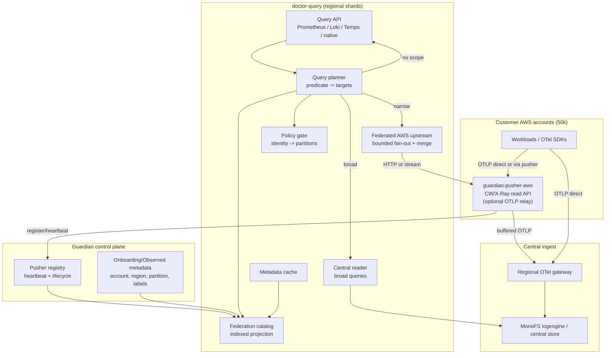
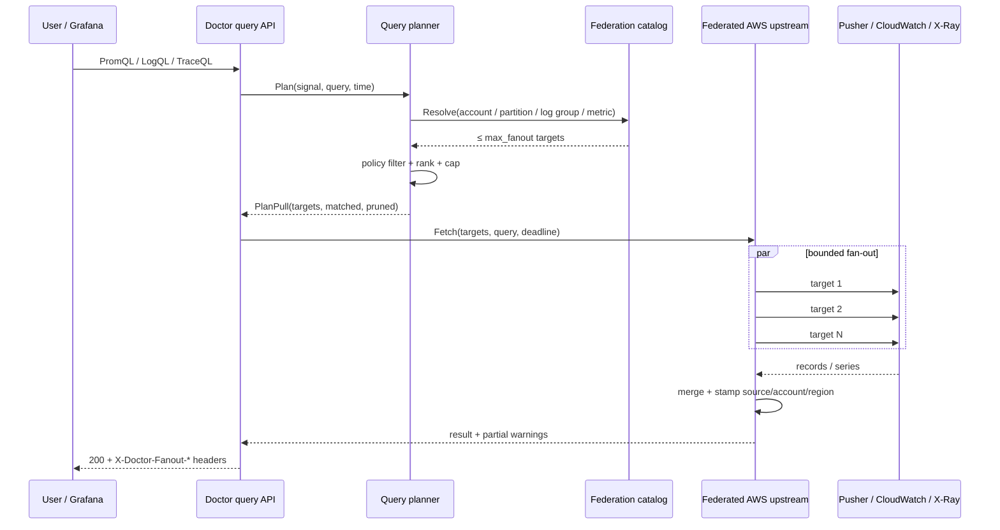
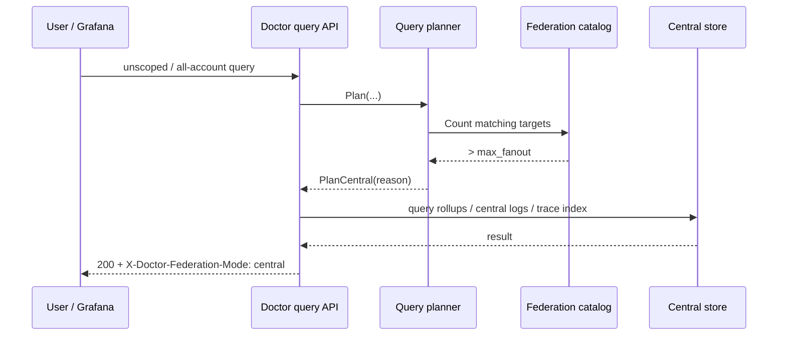
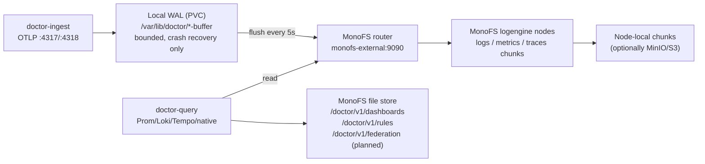
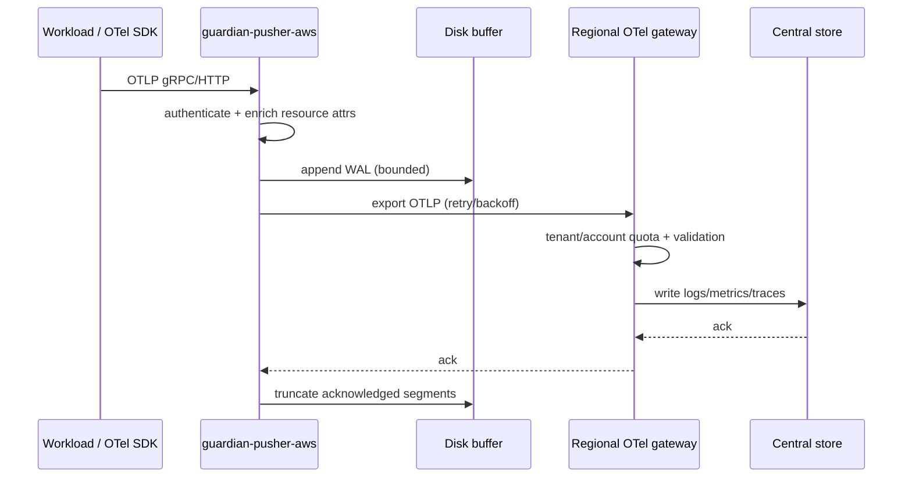

# Multi-Account Telemetry Federation — Design & Implementation

- **Status:** Draft for implementation
- **Date:** 2026-10-22
- **Audience:** Doctor, Guardian, MonoFS engineers
- **Companion plan:** `docs/federation/multi-account-federation-50k.md`
- **Target scale:** 50,000 AWS pushers / accounts (up to ~150,000 account-region targets)
- **Scope:** CloudWatch metrics/logs, X-Ray traces, OTel relay, query planning, policy, dashboards

---

## Implementation Status

| Phase | Scope | Status |
| --- | --- | --- |
| E1 Catalog | types, static YAML loader, token_env resolution, indexes | **DONE** — `doctor/internal/federation/catalog.go` + tests |
| E2 Planner | PromQL/LogQL predicates, account/region/partition/log-group/service resolution, 422 scope errors | **DONE** — `doctor/internal/federation/planner.go` + tests |
| E3 Manager | `proxy.AWSClient` fan-out, bounded concurrency, merge, partial results, metadata union | **DONE** — `doctor/internal/federation/manager.go` + tests |
| E4 Query integration | `Service.aws` interface, one logical `aws-federated` router backend, legacy fallback, 422 propagation | **DONE** — build/tests pass; live rollout verified |
| Demo catalog | ConfigMap + token Secret + deployment patch | **DONE** — live 3-account verification passed |
| Live verification | 3 accounts, metrics/logs, policy isolation, 422 | **DONE** — see below |
| MonoFS snapshot | `/doctor/v1/federation` sharded snapshot + manifest | **DONE** — store, CAS manifest, sharded publish, publisher CLI; in-cluster verification pending |
| OTel relay | pusher OTLP receiver + buffer + gateway | Not started |
| Central rollups | broad-query store + trace index | Not started |
| UI/dashboards | federation status page, `$account` variable | **PARTIAL** — `/v1/federation/status` added; Grafana `$account` not started |

### Live verification (2026-10-22)

- `/v1/federation/status`: 3 targets, 3 partitions, `max_fanout=32`.
- Multi-account metrics: `Invocations{source="aws",account="<account>"}` returned data for all three accounts.
- Multi-account logs: synthetic `federation-probe-<partition>` records returned for each account's log group.
- Wildcard log query `{source="aws", aws_log_group=~".*"}` returned all three accounts.
- Policy isolation: `usera` saw only `div-a-orders`/`div-a-billing`; `userb` saw only `div-b-inventory`.
- Broad query with `max_fanout=1` returned HTTP 422 with `query matches too many AWS federation targets`.
- Grafana Prometheus datasource: `sum(Invocations{source="aws","@aws.tag.guardian.io/partition"=~".*"})` returned 3 series; partition-scoped query returned 1.
- X-Ray trace data could not be verified end-to-end because the demo AWS CloudFormation stacks had been deleted; the `QueryTraces` routing/merge path is covered by unit tests.

## 1. Decision Summary

| # | Decision | Why |
| --- | --- | --- |
| D1 | Register **one logical `aws-federated` backend** in Doctor’s proxy router | 50k backends would make snapshots, endpoint APIs, and per-query scans O(N) |
| D2 | Put target selection in an **indexed catalog + query planner** | A query must resolve to ≤32 targets without scanning 50k rows |
| D3 | Use **pull federation for narrow queries**, **central data for broad queries** | CloudWatch quotas and tail latency make 50k live fan-out impossible |
| D4 | Keep the pusher **account-scoped and stateless** for CW/X-Ray reads | Preserves the existing security/credential boundary |
| D5 | Add an **OTel relay mode** in the pusher for isolated accounts; query OTel from central storage | Pusher-local OTel storage/query would duplicate the collector/Doctor and not scale |
| D6 | Replace 50k explicit `aws_bindings` with **catalog-backed account→partition resolution** | Keeps policy bundles small and fast |
| D7 | Make tracing/log search require a **scope predicate or central index** | Trace IDs do not encode account; text search over 50k accounts is not a pull query |
| D8 | Keep `DOCTOR_AWS_BACKEND_URL` as a **one-entry compatibility catalog** | No breaking change for the current demo/deployments |
| D9 | Persist catalog snapshots in **MonoFS** under `/doctor/v1/federation`, with in-memory indexes; static YAML for the first PR | MonoFS already provides versioned/CAS file storage; avoids new infrastructure at 50k |

---

## 2. Problem Statement

Doctor currently supports one AWS read API:

```go
// doctor/internal/query/service.go
type Service struct {
    ...
    aws *awsstore.Client
}
```

and one AWS proxy backend:

```go
// doctor/cmd/doctor-query/main.go
if cfg.AWSEnabled && cfg.AWSBackendURL != "" {
    awsClient = awsstore.NewClient(cfg.AWSBackendURL, cfg.AWSBackendToken)
    svc.SetAWSBackend(awsClient)
}
```

At 50k accounts this fails in four distinct ways:

1. **Addressability:** only one account can be configured.
2. **Discovery:** `GuardianDiscovery` can enumerate 50k pushers, but the router’s `snapshot()` / `backendMatchesCriteria` scan is O(N) per query.
3. **Fan-out:** even with `MaxFanoutBackends=32`, an unscoped query either returns local-only data or performs an arbitrary subset selection.
4. **Semantics:** broad dashboards, text search, and trace-ID lookup have no way to find the right accounts without an index.

The existing `D-50K-1` work prevents the 78-second fan-out storm. This document makes the fleet **queryable** at 50k without fan-out storms.

---

## 3. Goals, Non-Goals, SLOs

### Goals

- Register and query up to 50,000 pushers / 150,000 account-region targets.
- Resolve an account/region/partition/log-group/metric-scoped query in <5 ms p99.
- Never send a query to more than `max_fanout` live targets (default 32).
- Return partial results with explicit warnings instead of silently dropping accounts.
- Support native OTel (`source="doctor"`) and AWS (`source="aws"`) in one query surface.
- Support per-account tokens, quotas, health, and circuit breaking.
- Keep tenant/partition isolation enforced before fan-out.
- Support an optional pusher OTLP relay for network-isolated accounts.

### Non-goals

- Replacing CloudWatch/X-Ray as the customer system of record.
- Storing all raw logs/traces for all 50k accounts centrally by default.
- Alert routing/notification.
- Cross-cloud federation beyond the generic proxy backend.
- Making the pusher a queryable OTel database.
- A new control-plane database for the MVP (the catalog is derived state).

### SLOs

| Metric | Target |
| --- | --- |
| Catalog target resolution | p99 < 5 ms |
| Narrow AWS query (1–3 targets) | p95 < 2 s |
| Narrow query with 10% target failures | p95 < 3 s, partial results |
| Broad fleet dashboard | p95 < 5 s, zero live fan-out |
| Central ingest lag | < 5 min p95 |
| Catalog refresh lag | < 60 s after Guardian registration |
| Query success without partials | > 99% for narrow queries |
| Cross-tenant leak | 0 |

---

## 4. Architecture

### 4.1 Component diagram



### 4.2 Two data paths

| Path | Direction | Data | Query source |
| --- | --- | --- | --- |
| **Read federation** | Doctor → pusher → CloudWatch/X-Ray | Live AWS telemetry | `FederatedAWSUpstream` |
| **OTel relay / push** | Workload → pusher/collector → central store | OTel logs/metrics/traces | Central store (`source="doctor"`) |

The pusher is a **read adapter** for AWS APIs and an **optional relay** for OTel. It is never a query store for OTel.

### 4.3 Narrow query sequence



### 4.4 Broad query sequence



If central storage is not configured, the planner returns `422 ScopeRequired`
with examples instead of attempting a 50k fan-out.

### 4.5 Where Doctor stores its data

Doctor is mostly stateless. It delegates durable telemetry storage to MonoFS;
the only local disks are bounded crash-recovery WALs and session state.



| Data | Stored in | Notes |
| --- | --- | --- |
| OTLP logs/metrics/traces | MonoFS logengine | primary durable telemetry store |
| Ingest WAL | PVC `ingest-data`, `/var/lib/doctor/{log,trace,metric}-buffer` | bounded; crash recovery only, not a long-term store |
| Query sessions | PVC `query-sessions`, `/var/lib/doctor/sessions` | OIDC/session state |
| Shared dashboards | MonoFS file store `/doctor/v1/dashboards` | in-memory fallback if `DOCTOR_MONOFS_TOKEN` is unset |
| Recording rules | MonoFS file store `/doctor/v1/rules` | in-memory fallback if token is unset |
| Federation catalog snapshot | MonoFS file store `/doctor/v1/federation/...` | planned; in-memory indexes on each query replica |
| Access policy | Guardian `/api/access/policy` | fetched and cached in memory; not persisted by Doctor |
| AWS logs/metrics/traces | Not stored by Doctor | live pull from pusher; only catalog metadata is cached |
| Query results | In-memory | no persistent result cache |
| Grafana dashboards | Kubernetes ConfigMaps | monitoring partition, not Doctor |

Important: **CloudWatch/X-Ray data is not copied into MonoFS by the federation
path.** It is queried live from the pusher. Only the catalog metadata and query
results (transiently) live in Doctor. Central rollups/OTel relay would add a
push path into the central store, but that is a separate phase.

Current demo gap: `doctor-query` does **not** have `DOCTOR_MONOFS_TOKEN` set, so
its dashboard store falls back to memory. The MonoFS-backed catalog snapshot
requires wiring that token (and the `/doctor/v1/federation` path) into the query
deployment.

### 4.6 Why one logical backend

The current router model is:

```
Router
  ├── local (MonoFS)
  ├── aws (single)
  └── discovered backends (Prometheus/Loki/Tempo/...)
```

At 50k, registering one backend per pusher gives:

- 50k-entry `snapshot()` copies/sorts
- 50k-entry `/v1/proxy/endpoints` payloads
- O(N) `backendMatchesCriteria` per query
- 50k circuit breakers and health rows

Instead:

```
Router
  ├── local
  ├── aws-federated   <-- one logical backend
  └── other backends
```

`aws-federated` owns:

- catalog lookup
- target resolution
- bounded fan-out
- merge/dedupe
- partial warnings
- per-target rate limits/circuit breakers

The router stays small and generic.

---

## 5. Domain Model

### 5.1 What the catalog is (plain terms)

The catalog is **not telemetry storage**. It is a read-optimized metadata index
that answers one question in milliseconds:

> “Given this query, which AWS account/region pushers could possibly contain the
> data?”

Examples:

| Query contains | Catalog lookup | Result |
| --- | --- | --- |
| `account="780603797542"` | `byAccount` | 1 target |
| `partition="div-a-orders"` | `byPartition` | 1–2 targets |
| `aws_log_group="guardian/780.../app"` | `byLogGroup` | 1 target |
| `service="div-a-orders-service"` | `byService` | 1–2 targets |
| `Invocations` with no scope | `byMetric` | N targets; cap or central |
| `trace_id=1-8fb6...` | `byTrace` | 1 target (or central) |

It stores **metadata about targets**, not metrics/logs/spans:

- account, region, partition, tenant
- pusher endpoint and `token_ref` (never the token itself)
- capabilities (`metrics`, `logs`, `traces`, `observed`, `probes`)
- version, labels (division/department), health
- cached discovery data: metric names, log groups, X-Ray services

It is built from:

1. **Guardian pusher registry** — identity, endpoint, health, lifecycle.
2. **Pusher `/v1/aws/meta`** — account, region, metric names, log groups,
   X-Ray services.
3. **Guardian onboarding/observed metadata** — partition and labels.
4. **Optional static YAML** — bootstrap/demo.

What it is **not**:

- Not a replacement for Guardian’s registry (Guardian remains the source of
  truth; the catalog is a derived, eventually consistent read model).
- Not a telemetry store (MonoFS/central store holds the data).
- Not a secret store (only `token_ref` names).
- Not a policy engine (it provides account→partition metadata; policy decides
  access).

At 50k targets, the catalog is roughly 100 MB of target records plus indexes.
It replaces an O(50k) scan with an O(matches) lookup.

### 5.2 Core types

```go
package federation

type Signal string

const (
    SignalMetrics Signal = "metrics"
    SignalLogs    Signal = "logs"
    SignalTraces  Signal = "traces"
)

type Health struct {
    State         string    // healthy | degraded | offline | unknown
    LastHeartbeat time.Time
    LastError     string
    ErrorCount    int
    LatencyP95    time.Duration
}

type Target struct {
    ID          string            // stable: aws-<account>-<region>
    Account     string
    Region      string
    Partitions  []string          // all Guardian partitions served by this target
    Tenant      string
    Endpoint    string            // https://...:19090
    TokenRef    string            // secret reference, not the token
    Provider    string            // aws
    Capabilities []Signal
    Labels      map[string]string // division, department, ...
    Health      Health
    Version     string
    Priority    int
    // Catalog-derived indexes (not serialized):
    MetricNames []string
    LogGroups   []string
    XrayServices []string
}

type Predicates struct {
    Accounts    []string
    AccountRE   []*regexp.Regexp
    Regions     []string
    RegionRE    []*regexp.Regexp
    Partitions  []string
    PartitionRE []*regexp.Regexp
    LogGroups   []string
    LogGroupRE  []*regexp.Regexp
    Services    []string
    ServiceRE   []*regexp.Regexp
    Metric      string
    TraceID     string
    From, To    time.Time
    Limit       int
}

type PlanMode int

const (
    PlanPull PlanMode = iota
    PlanCentral
    PlanHybrid
    PlanReject
)

type Plan struct {
    Mode       PlanMode
    Targets    []Target
    Matched    int
    Pruned     int
    Reason     string
    Warnings   []string
}
```

### 5.3 Catalog snapshot

The catalog is derived state. Persist a snapshot for fast startup and offline reads:

```json
{
  "version": "2026-10-22T13:00:00Z/17",
  "generated_at": "2026-10-22T13:00:00Z",
  "targets": [
    {
      "id": "aws-780603797542-us-east-1",
      "account": "780603797542",
      "region": "us-east-1",
      "partitions": ["div-a-orders"],
      "tenant": "default",
      "endpoint": "http://172.18.0.1:19290",
      "token_ref": "secret/awsread/780603797542",
      "capabilities": ["metrics", "logs", "traces"],
      "labels": {"division": "DivisionA", "department": "DepartmentA"},
      "version": "2026.10.22",
      "metric_names": ["Invocations", "Errors", "Duration", "CPUUtilization"],
      "log_groups": ["guardian/780603797542/us-east-1/div-a-orders/app"],
      "xray_services": ["div-a-orders-service", "div-a-orders-processor"]
    }
  ]
}
```

**Secrets:** `token_ref` is resolved by a `SecretResolver` (Kubernetes Secret, Vault, or env for dev). Tokens never appear in the snapshot, logs, or `/v1/federation/targets`.

### 5.4 Catalog indexes

```go
type Index struct {
    byID        map[string]Target
    byAccount   map[string][]string
    byRegion    map[string][]string
    byPartition map[string][]string
    byLogGroup  map[string][]string
    byService   map[string][]string
    byMetric    map[string][]string // TTL-bounded
    byTrace     map[string]string   // optional; central otherwise
    byLabel     map[string]map[string][]string
}
```

Resolution order:

1. Smallest known set: `byAccount` or `byLogGroup` or `byTrace`.
2. Intersect with `byRegion`, `byPartition`, `byService`.
3. If only metric is known, use `byMetric`; if the set exceeds `max_fanout`, prune or central.
4. If nothing is known, return `PlanReject` / `PlanCentral`.

**Complexity:** O(number of matching targets), not O(50k).

```go
type Catalog interface {
    ByID(id string) (Target, bool)
    ByAccounts(accounts []string) []Target
    ByRegions(regions []string) []Target
    ByPartitions(partitions []string) []Target
    ByLogGroups(groups []string) []Target
    ByServices(services []string) []Target
    ByMetric(metric string, regions []string) []Target
    ByTrace(traceID string) (Target, bool)
    ByLabel(label, value string) []Target
    Snapshot() Snapshot
    ApplyDelta(delta Delta) error
}
```

### 5.5 Catalog sources

| Source | Data | Refresh |
| --- | --- | --- |
| Guardian `/api/pushers?updated_since=` | identity, health, endpoint, version | delta stream/30s |
| Pusher `/v1/aws/meta` | account, region, metric names, log groups, X-Ray services | 5–15 min jittered |
| Guardian onboarding/observed | partition, labels, stack | event/delta |
| Static file (`DOCTOR_FEDERATION_CATALOG_FILE`) | bootstrap/demo | startup |
| Legacy `DOCTOR_AWS_BACKEND_URL` | one target | startup |

At 50k, a full `/api/pushers` load is ~30 MB. Start from the persisted snapshot, apply deltas, and only do a full load when the snapshot is missing or the version is stale beyond a threshold.

### 5.6 Catalog consistency

- Guardian is eventually consistent; the catalog may lag by one refresh interval.
- New target: appears within `refresh_interval` (default 30s).
- Removed target: keep for a grace period (e.g., 5 min) to avoid breaking in-flight queries; mark `offline`.
- Version: monotonically increasing snapshot version; query nodes log the version in response headers.
- If catalog is stale (>5 min), narrow queries still pull from known targets; broad queries fall back to central; a warning is returned.

### 5.7 Catalog persistence in MonoFS

Yes — MonoFS is a good fit for the **durable catalog snapshot**, not for the
per-query index.

Use the existing Doctor file store (the same CAS/versioned store used by
`/doctor/v1/dashboards` and `/doctor/v1/rules`):

```
/doctor/v1/federation/<tenant>/manifest.json
/doctor/v1/federation/<tenant>/<region>/<shard>.json
```

- `manifest.json` is the commit point: version, generated_at, shard list,
  target counts, and SHA-256 per shard.
- `<shard>.json` contains a bounded slice (e.g. 500 targets ≈ 1 MB) of target
  metadata. Shard by region and account prefix.
- Write shards first, then the manifest last. Readers only trust shards
  referenced by the current manifest, so a failed write never exposes a partial
  catalog.
- Use `ExpectedVersionID`/CAS for the manifest. Only one catalog builder writes
  at a time (leader lease, or one writer per region).
- Store `token_ref`, never tokens. The catalog contains account IDs and
  endpoints, so restrict the path to the Doctor service identity.
- Do **not** store high-churn health/heartbeat state here. Health comes from
  the Guardian registry and lives in memory/health overlays. Persisting 50k
  heartbeats to MonoFS every 30 seconds is the wrong load pattern.
- Metric/log-group discovery metadata should be written on change or on a
  10–15 minute TTL, batched per shard. Do not rewrite the whole catalog on
  every metric discovery refresh.
- The in-memory indexes are rebuilt from the snapshot at startup; they are
  derived and do not need to be persisted. If startup time becomes a problem,
  persist compact index shards alongside the target shards and validate them
  against the manifest.

Why not one big `catalog.json`?

- 50k targets × ~2 KB ≈ 100 MB JSON; rewriting that on every change is wasteful
  and stresses the KVS/Raft path if stored under `/.registry`.
- A single object gives no delta updates and a large blast radius on write
  failure.
- Sharded files + a manifest give atomic publish, partial reload, and bounded
  write sizes.

When to move the catalog out of MonoFS:

- If the metric index exceeds ~1 GB per replica or catalog updates become
  high-frequency, add a standalone `federation-catalog` service backed by
  Postgres/Redis. Keep the same `SnapshotStore` interface so Doctor does not
  care where the catalog lives.

First implementation slice: use the static YAML for the three demo accounts.
Add the MonoFS `SnapshotStore` in the next increment, once Guardian discovery
is wired. The `Catalog` interface should not depend on MonoFS, so both can
coexist.

```go
type SnapshotStore interface {
    Load(ctx context.Context) (Snapshot, error)
    Save(ctx context.Context, snapshot Snapshot, expectedVersion string) (string, error)
}
```

Implementations:

- `FileSnapshotStore` — static YAML/JSON (first PR, demo).
- `MonoFSSnapshotStore` — Doctor file store with CAS (next).
- `MemorySnapshotStore` — tests.

### 5.8 Building the catalog from partition information

Yes — Guardian partition information should be the **primary scope source** for
the catalog. The catalog is a projection of three sources:

| Source | Provides | Why it matters |
| --- | --- | --- |
| Guardian partition manifests / observed metadata | partition name, account, region, labels, stack, repo, environment | what exists, who owns it, which AWS account/region |
| Guardian pusher registry | pusher ID, endpoint, token ref, heartbeat/health, version | how to reach it and whether it is alive |
| Pusher `/v1/aws/meta` | metric names, log groups, X-Ray services, capabilities | what can be queried |

Join:

```
partition (account, region, labels)
        +
pusher registry (account, region -> endpoint, token_ref, health)
        +
/v1/aws/meta (metrics, log groups, xray services)
        =
Target { account, region, partitions[], endpoint, token_ref, indexes, health }
```

Key model change at 50k: **one target is an account/region/pusher, not a
partition.** A single pusher can serve many Guardian partitions in the same AWS
account/region. Therefore:

```go
type Target struct {
    Account    string
    Region     string
    Partitions []string // all partitions served by this pusher
    ...
}
```

`byPartition` maps each partition to the targets that serve it. A query for one
partition selects the target(s) that serve it; per-record policy filtering still
enforces partition visibility for multi-partition targets.

What partition information does **not** provide:

- pusher read endpoint and token
- live health/heartbeat
- metric names, log groups, X-Ray services
- capabilities/version

Those come from the pusher registry and `/v1/aws/meta`. So the catalog cannot be
built from partition manifests alone; it is a join.

Rules:

1. Include only AWS-backed partitions (`provider=aws`, `environment=aws://...`,
   or an observed stack). Skip `monofs`, `doctor`, `monitoring`, etc.
2. If no pusher matches a partition's account/region, include the target as
   `incomplete`/`offline` for UI visibility, but never select it for a live
   query.
3. If the partition manifest lacks account/region, use labels/environment or
   the observed stack metadata; if still unknown, skip and alert.
4. One pusher/account can serve multiple partitions; do not create duplicate
   pusher clients per partition.
5. Per-record filtering by partition is mandatory when a target serves multiple
   partitions; the planner’s account/region selection alone is not sufficient.
6. The catalog builder should run as a leader-elected Doctor job (or one writer
   per region) and publish MonoFS shards + manifest. Guardian remains the source
   of truth for partitions and pushers.

The first PR’s static YAML is simply a hand-written projection of this same
shape:

```yaml
targets:
  - id: aws-780603797542-us-east-1
    account: "780603797542"
    region: us-east-1
    partitions: [div-a-orders]
    endpoint: http://172.18.0.1:19290
    token_env: DIV_PUSHER_TOKEN_1
```

The next increment replaces the hand-written file with the partition + pusher +
`/v1/aws/meta` join.

---

## 6. Query Planner

### 6.1 Parsing by signal

| Signal | Parser | Predicates |
| --- | --- | --- |
| PromQL | `prometheus/promql/parser` | metric name, label matchers, regex matchers |
| LogQL | existing `parseLokiPlan` | stream selector, line filters, log group, label matchers |
| TraceQL | existing parser | resource/span attributes, service, trace ID, duration |
| Native logs | `/v1/logs/search` params | `service`, `partition`, `q`, `logGroup` |
| Native traces | `/v1/traces/recent` params | `service`, `partition`, time |
| Trace get | `/v1/traces/{id}` | trace ID |

Label aliases to normalize:

```
account:   account, aws_account, @aws.account, guardian.account
region:    region, aws_region, @aws.region, guardian.region
partition: partition, guardian_partition, @aws.tag.guardian.io/partition,
           @aws.tag.strata.io/partition
log group: aws_log_group, log_group
service:   service, service.name, resource.service.name
```

### 6.2 Resolution algorithm

```go
func (p *Planner) Plan(ctx context.Context, q Query) (Plan, error) {
    pred := extractPredicates(q) // signal-specific

    // 1. Policy scope: partitions/accounts the identity may see.
    allowed := p.policy.AllowedPartitions(ctx)
    if len(allowed) == 0 {
        return Plan{Mode: PlanReject, Reason: "no visible partitions"}, nil
    }

    // 2. Candidate set. Start with the most selective index.
    var candidates []Target
    switch {
    case pred.TraceID != "":
        if t, ok := p.catalog.ByTrace(pred.TraceID); ok {
            candidates = []Target{t}
        } else {
            return Plan{Mode: PlanCentral}, nil // central trace index
        }
    case len(pred.Accounts) > 0:
        candidates = p.catalog.ByAccounts(pred.Accounts)
    case len(pred.Partitions) > 0:
        candidates = p.catalog.ByPartitions(pred.Partitions)
    case len(pred.LogGroups) > 0:
        candidates = p.catalog.ByLogGroups(pred.LogGroups)
    case pred.Metric != "":
        candidates = p.catalog.ByMetric(pred.Metric, pred.Regions)
    default:
        return p.broadPlan(ctx, q, pred)
    }

    // 3. Intersect remaining predicates.
    candidates = intersect(candidates,
        p.catalog.ByRegions(pred.Regions),
        p.catalog.ByPartitions(pred.Partitions),
        p.catalog.ByServices(pred.Services))

    // 4. Policy filter before fan-out.
    candidates = p.policy.Filter(ctx, candidates)

    // 5. Rank and cap.
    matched := len(candidates)
    sortTargets(candidates) // health, priority, recency
    if len(candidates) > p.maxFanout {
        candidates = candidates[:p.maxFanout]
        return Plan{
            Mode: PlanPull, Targets: candidates, Matched: matched,
            Pruned: matched - len(candidates),
            Warnings: []string{fmt.Sprintf(
                "query matched %d targets; capped at %d", matched, p.maxFanout)},
        }, nil
    }
    return Plan{Mode: PlanPull, Targets: candidates, Matched: matched}, nil
}
```

### 6.3 Broad query policy

```go
func (p *Planner) broadPlan(ctx, q, pred) (Plan, error) {
    if p.central.Enabled() {
        return Plan{Mode: PlanCentral, Reason: "broad query served from central"}, nil
    }
    return Plan{
        Mode: PlanReject,
        Reason: "query is too broad for live AWS federation; " +
                "select account, region, partition, log group, service, or trace ID",
    }, nil
}
```

Rules:

- `account=~".*"` is **not** a valid narrowing predicate at fleet scale.
- `partition` is valid if it maps to ≤ `max_fanout` accounts.
- `log group` is valid; it maps to one account.
- A metric-only query may use the metric index, but if it matches > `max_fanout`, it is pruned with a warning or served from central.
- A trace-ID query uses the trace index; if absent, central; if neither, `404`/partial.
- A text-only log query is central-only.

### 6.4 Examples

| Query | Plan |
| --- | --- |
| `sum(Invocations{source="aws","@aws.tag.guardian.io/partition"="div-a-orders"})` | partition index → 1 target → pull |
| `CPUUtilization{source="aws",account="780603797542"}` | account index → 1 target → pull |
| `{source="aws",aws_log_group="guardian/780603797542/us-east-1/div-a-orders/app"}` | log group index → 1 target → pull |
| `{source="aws"} \|= "error"` | no scope → central if enabled, else 422 |
| `trace_id=1-8fb6...` | trace index → 1 target, or central |
| `sum(rate(Invocations{source="aws"}[5m]))` | metric index; cap 32 or central |
| all-partition dashboard | central rollups |

---

## 7. Federated Execution

### 7.1 The `AWSReader` facade

The least invasive integration is to keep the existing `AWSClient` shape and make the federation manager implement it.

```go
// proxy/upstream.go already defines this interface.
type AWSClient interface {
    Enabled() bool
    ListMetrics(ctx, namespace, metric string) ([]awsstore.MetricDescriptor, error)
    ListServices(ctx) ([]awsstore.ServiceInfo, error)
    ListLogGroups(ctx) ([]string, error)
    QueryLogs(ctx, awsstore.LogQuery) ([]awsstore.LogRecord, error)
    QueryTraces(ctx, awsstore.TraceQuery) ([]awsstore.TraceSummary, error)
    GetTrace(ctx, traceID string) ([]awsstore.Span, error)
    PrometheusQuery(ctx, query string, at time.Time) (map[string]any, error)
    PrometheusQueryRange(ctx, query string, start, end time.Time, step time.Duration) (map[string]any, error)
    PrometheusSeries(ctx, match []string, start, end time.Time) (map[string]any, error)
    PrometheusLabels(ctx, match []string, start, end time.Time) (map[string]any, error)
    PrometheusLabelValues(ctx, label string, match []string, start, end time.Time) (map[string]any, error)
}
```

Changes:

- `Service.aws` becomes `proxy.AWSClient` (or a small local `AWSReader` alias) instead of `*awsstore.Client`.
- `SetAWSBackend` accepts the interface; `awsstore.Client` still satisfies it.
- `federation.Manager` implements `AWSClient` and is the only multi-account fan-out point.
- `setupProxyRouter` registers one `AWSUpstream{Client: manager}` as `aws-federated`.
- Direct `s.aws.*` call sites keep working; they now fan out through the manager.

This avoids rewriting every query handler.

**Single execution path.** Registering both a router-level AWS backend and a
direct `Service.aws` manager can double-query AWS. The implementation must pick
one owner per handler:

- Prometheus/Loki/Tempo compatibility handlers: the router owns AWS (one
  `aws-federated` backend).
- Native `/v1/logs/search` and `/v1/traces/recent`: `Service.aws` owns AWS.
- If `proxyRouter` already contains the federated AWS backend, do **not** also
  call the `queryAWSLogsForLoki` fallback; add a `Service.awsViaRouter` flag or
  detect the backend once at startup.
- The federated backend is exempt from router-level account/region/partition
  pruning: the manager’s planner owns that filtering. Add `Federated bool` to
  `proxy.Backend` (or special-case `Origin == "aws-federated"`) so
  `backendMatchesCriteria` does not drop it when the query names an account
  the logical backend does not carry as a static field.

### 7.2 Manager responsibilities

```go
type Manager struct {
    catalog  Catalog
    planner  Planner
    policy   Policy
    secrets  SecretResolver
    clients  ClientPool
    limits   Limits
    central  CentralReader
}

func (m *Manager) PrometheusQuery(ctx, query string, at time.Time) (map[string]any, error) {
    plan, err := m.planner.Plan(ctx, Query{Signal: SignalMetrics, Expr: query})
    if err != nil { return nil, err }
    switch plan.Mode {
    case PlanReject:
        return nil, &ScopeError{Plan: plan}
    case PlanCentral:
        return m.central.Metrics(ctx, query, at)
    }
    return m.fanoutMetrics(ctx, plan.Targets, query, at)
}
```

### 7.3 Client pool

- Key: target ID.
- Lazy creation; no 50k clients at startup.
- Each client holds base URL, token (refreshed), HTTP transport with keep-alive, per-target timeout.
- Idle eviction after 15 min; max pool size bounded (e.g., 10k) with LRU.
- Token refresh on 401: refresh once, retry once.
- Health/circuit state stored in the pool, not in the catalog.

### 7.4 Concurrency and limits

| Limit | Default | Notes |
| --- | --- | --- |
| `max_fanout` | 32 | hard cap per query |
| `max_inflight` (global) | 64 | whole query plane |
| `max_inflight_per_target` | 4 | protects a pusher/AWS account |
| `per_target_rate` | 10 req/s | token bucket |
| `per_tenant_inflight` | 16 | noisy-neighbor isolation |
| `narrow_timeout` | 5 s | 1–3 targets |
| `broad_timeout` | 15 s | central |
| `retry_attempts` | 2 | 429/5xx/timeout only, jittered |
| `circuit_failures` | 5 | open for 30 s |

### 7.5 Fan-out and merge

**Metrics**

- Execute the PromQL query per target (source stripped by `AWSQueryMode`).
- Merge with `proxy.MergePrometheusQueryData`.
- Stamp `source="aws"`, `@aws.account`, `@aws.region`, `backend=<target>`.
- CloudWatch series already include `@aws.account`/`@aws.region`; keep them.
- Dedup identical series from the same account (should not happen; defensive).

**Logs**

- Resolve concrete log groups via the catalog (regex resolution).
- Execute CloudWatch Logs Insights per target.
- Convert with `AWSLogsForLoki`; stamp `aws_account`, `aws_region`, `guardian_partition`.
- Merge with `proxy.MergeLogs`; dedupe by timestamp/service/trace/body/attributes.
- Cap per-target limit (`limit / len(targets)` with a floor), then global limit.

Add an optional interface for regex resolution so the manager does not return a
2M-entry log-group union:

```go
// LogGroupResolver is implemented by federation.Manager. The legacy
// awsstore.Client falls back to ListLogGroups + local regex matching.
type LogGroupResolver interface {
    ResolveLogGroups(ctx context.Context, pattern string) ([]string, error)
}
```

`AWSLogsForLoki` should use `LogGroupResolver` when available. The manager
resolves against the catalog’s `log_group -> account` index and caps the result
to the selected targets.

**Metadata APIs at 50k**

`ListMetrics`, `ListServices`, and `ListLogGroups` must never fan out to 50k
pushers. The manager returns catalog-cached values, scoped to the caller’s
tenant/partition and capped (e.g. 1,000 rows). Add context scope:

```go
federation.WithScope(ctx, federation.Scope{
    Tenant:     "default",
    Partitions: []string{"div-a-orders"},
    Accounts:   []string{"780603797542"},
})
```

The UI must use searchable/paginated endpoints rather than loading all values:

- `GET /v1/federation/log-groups?q=&account=&partition=&limit=`
- `GET /v1/federation/metrics?q=&namespace=&partition=&limit=`
- `GET /v1/federation/services?q=&partition=&limit=`

Grafana variables should use a text box or a scoped query, never an unscoped
`label_values` over millions of series.

**Traces**

- `QueryTraces`: X-Ray summaries per target; merge by trace ID; keep the first non-empty service/account.
- `GetTrace`: resolve the trace ID to one target via the trace index; if unknown, query the central trace store; if neither, return not found.
- Normalize X-Ray trace IDs (`1-...`) consistently.
- Stamp `source="aws"`, `aws.account`, `aws.region`.

### 7.6 Partial results

```go
type PartialError struct {
    Target string
    Reason string
}
```

- A target failure does not fail the whole query unless **all** targets fail.
- If some targets fail, return data + warnings.
- Headers:
  - `X-Doctor-Partial: true`
  - `X-Doctor-Partial-Count: N`
  - `X-Doctor-Fanout-Matched: M`
  - `X-Doctor-Fanout-Selected: S`
  - `X-Doctor-Federation-Version: <catalog-version>`
- If all targets fail, return `502`/`503` with the per-target reasons (or partial if central fallback is allowed).

### 7.7 Caching

- **Catalog metadata:** metric names, log groups, X-Ray services, target health.
- **Metadata TTL:** 5–15 min for catalogs; 30 s for health.
- **No telemetry result cache in MVP** (security/staleness complexity). Add dashboard query coalescing later if needed.

---

## 8. Policy and Tenancy

### 8.1 Enforcement points

1. **Target selection:** planner filters candidates by allowed partitions/accounts before fan-out.
2. **Record filtering:** existing `PolicyGate.FilterLogs` / `FilterSpans` for defense in depth.
3. **Central store:** tenant/partition labels are mandatory; queries carry the identity scope.

### 8.2 Catalog-backed account→partition

Today:

```yaml
aws_bindings:
  - partition: div-a-orders
    account: "780603797542"
    region: us-east-1
```

At 50k this list is large and pollutes the compiled policy. New model:

- The catalog target already has `account`, `region`, `partition`.
- `PolicyGate.CanonicalPartition(account, region, current)` consults the catalog first, then legacy bindings.
- Policy grants remain partition-scoped:
  ```yaml
  users:
    usera@example.com:
      partitions: [div-a-orders, div-a-billing]
      logs: [div-a-orders, div-a-billing]
      traces: [div-a-orders, div-a-billing]
  ```
- Optional selector grants for large orgs:
  ```yaml
  aws_bindings:
    - selector: {label: division, value: DivisionA}
      partition: div-a-orders
  ```
  The compiler resolves selectors against the catalog at load time or leaves them for runtime resolution.

### 8.3 Tenant isolation

- Every target has `Tenant`.
- Every query resolves targets within the caller’s tenant.
- Central store records carry `tenant`.
- Cross-tenant target selection is a hard error, not a post-filter.

---

## 9. OTel Relay in the Pusher

### 9.1 Why relay, not store

At 50k accounts:

- Storing OTel per pusher means 50k independent retention/query engines.
- Querying 50k pushers for OTel is the same fan-out problem as CloudWatch.
- Durability, compaction, and retention are already solved centrally.

The pusher is a **relay**: receive OTLP, enrich, buffer, forward.

### 9.2 Flow



### 9.3 Enrichment

Add/override resource attributes:

```
guardian.partition
guardian.intent
guardian.asset
guardian.pusher
guardian.account
guardian.region
guardian.provider=aws
service.alias = original service.name
```

Canonical `service.name` remains the producer name unless the Guardian identity resolver provides a canonical target. Do not invent a canonical name without `asset`.

### 9.4 Buffer and backpressure

- Disk-backed WAL (e.g., bbolt/segment files), max 1 GB or 15 min, configurable.
- On full buffer: return `429`/`503` to the SDK; increment `pusher_otlp_dropped_total`.
- Retry: exponential backoff with jitter; max 10 min; then drop oldest.
- Per-account rate limit and byte budget.
- Metrics: `pusher_otlp_received_bytes`, `pusher_otlp_exported_bytes`, `pusher_otlp_dropped_bytes`, `pusher_otlp_buffer_utilization`, `pusher_otlp_export_latency`.

### 9.5 Security

- TLS/mTLS between pusher and gateway.
- Per-pusher token; gateway validates account/tenant.
- The pusher never accepts OTLP from arbitrary internet clients; it is scoped to its account/VPC.
- Resource attributes from clients are untrusted; enrichment values win for `guardian.*`.

### 9.6 Scale

Assume 1 KB/s OTel per account average = 50 MB/s = 4.3 TB/day. This is feasible only with sampling/filtering. The relay must support:

- per-account budgets
- sampling at the collector
- dropping debug/trace at high volume
- compression (gzip/zstd) and batching

If the target is 10 KB/s per account, the central ingest design must be sized for 500 MB/s; do not assume 50k accounts at full tracing.

### 9.7 How OTel metrics are accessed

OTel metrics are never queried from the pusher. There are two ingest paths, and
both end at the same query surface.

**A. Direct OTLP (default, no pusher)**

```
OTel SDK -> OTel collector (optional) -> doctor-ingest :4317/:4318
        -> Doctor ingest pipeline -> MonoFS logengine metrics
        -> Doctor Prometheus API /api/v1/query[_range]
        -> Doctor UI / Grafana (source="doctor")
```

**B. Pusher OTLP relay (network-isolated accounts)**

```
OTel SDK -> guardian-pusher-aws :4317/:4318
        -> enrich guardian.account/region/partition
        -> disk buffer -> regional OTel gateway
        -> central store (MonoFS logengine or external)
        -> Doctor Prometheus API /api/v1/query[_range]
        -> Doctor UI / Grafana (source="doctor")
```

Key points:

1. **Ingest auth is OTLP auth, not AWS IAM.** Direct OTLP uses collector/ingest
   token or mTLS. Relay uses the pusher’s token/mTLS to the gateway.
2. **Query auth is Doctor auth.** Grafana or the UI queries Doctor; the pusher
   is not in the query path.
3. **The pusher does not store OTel metrics for query.** It only buffers and
   forwards.
4. **CloudWatch-vended metrics are different.** If the app’s CloudWatch agent
   exports OTLP to CloudWatch, the pusher reads them through the AWS read API
   and Doctor federates them as `source="aws"`. That is not native OTel.
5. **A single Prometheus datasource can query both.** `source="doctor"` selects
   native OTel; `source="aws"` selects CloudWatch/X-Ray federation. Without a
   `source` matcher, Doctor queries local native metrics and may fall back to
   AWS for unknown metric names.
6. **Metric discovery:** native OTel names come from the MonoFS series index;
   AWS names come from the federation catalog/metric index, not from 50k
   `ListMetrics` calls.

Example native OTel query:

```promql
sum by (service) (
  rate(http_server_request_duration_count{
    guardian_partition="div-a-orders",
    source="doctor"
  }[5m])
)
```

Example AWS-vended query:

```promql
sum(Invocations{
  source="aws",
  "@aws.tag.guardian.io/partition"="div-a-orders"
})
```

---

## 10. Central Store and Rollups

### 10.1 Interfaces

```go
type CentralReader interface {
    Enabled() bool
    Metrics(ctx context.Context, query string, at time.Time) (map[string]any, error)
    MetricsRange(ctx context.Context, query string, start, end time.Time, step time.Duration) (map[string]any, error)
    Logs(ctx context.Context, q LogQuery) ([]segment.LogRecord, error)
    Traces(ctx context.Context, q TraceQuery) ([]segment.TraceSummary, error)
    GetTrace(ctx context.Context, traceID string) ([]segment.TraceRecord, error)
}
```

Adapters:

- `monofs` (current logengine) for native OTel and demo.
- `prometheus`/`mimir`/`clickhouse` for 50k metrics/logs/traces (Phase 4).

### 10.2 Data flow

- OTel: collector → central store (`source="doctor"`).
- Selected AWS telemetry: pusher/collector pull → central store (`source="aws"`).
- Broad queries: planner `PlanCentral` → central reader.
- Narrow queries: planner `PlanPull` → federated upstream (live).
- Hybrid: central + pull merge, dedupe by record key.

### 10.3 Indexes

| Index | Purpose | Build |
| --- | --- | --- |
| `metric -> accounts` | metric-only queries | pusher `/v1/aws/meta` catalog |
| `log_group -> account` | log queries | catalog |
| `trace_id -> account/region` | trace by ID | central ingest / pusher summary |
| `service -> accounts` | service queries | `/v1/aws/meta` xrayServices |

At 50k, the metric index is the largest (~5M entries). Shard by region/tenant if memory > ~1 GB.

### 10.4 Retention

| Signal | Hot | Cold | Notes |
| --- | --- | --- | --- |
| Metrics | 15–30 d | 1 y | rollups 1m/5m/1h |
| Logs | 7–30 d | 90–365 d | selected groups only |
| Traces | 3–7 d | 30 d | sample 1–10% |

All retention is per-tenant and configurable.

---

## 11. Configuration and APIs

### 11.1 Config schema

`/etc/doctor/federation.yaml` (or a ConfigMap):

```yaml
federation:
  enabled: true
  catalog:
    source: guardian             # guardian | file | static
    snapshot_path: /var/lib/doctor/federation/catalog.json
    refresh_interval: 30s
    full_refresh_interval: 1h
    stale_after: 5m
    metric_ttl: 10m
    log_group_ttl: 10m
  aws:
    max_fanout: 32
    max_inflight: 64
    per_target_inflight: 4
    per_target_rate: 10
    narrow_timeout: 5s
    broad_timeout: 15s
    retry_attempts: 2
    circuit_failures: 5
    circuit_cooldown: 30s
  central:
    enabled: false
    metrics_url: ""
    logs_url: ""
    traces_url: ""
  otel_relay:
    enabled: false
    listen: ":4317"
    buffer_bytes: 1073741824
    max_age: 15m
    gateway_url: ""
```

### 11.2 Environment variables

| Variable | Meaning |
| --- | --- |
| `DOCTOR_FEDERATION_ENABLED` | feature flag |
| `DOCTOR_FEDERATION_CONFIG` | config file path |
| `DOCTOR_FEDERATION_CATALOG_FILE` | static catalog bootstrap |
| `DOCTOR_FEDERATION_MODE` | `off`, `shadow`, `on` |
| `DOCTOR_AWS_BACKEND_URL` / `TOKEN` | legacy one-entry compatibility |
| `DOCTOR_AWS_MAX_FANOUT` | override |
| `DOCTOR_FEDERATION_CENTRAL_URL` | central reader |

### 11.3 HTTP APIs

| Endpoint | Purpose |
| --- | --- |
| `GET /v1/federation/status` | catalog version, target counts, health, mode |
| `GET /v1/federation/targets?account=&region=&partition=&q=&cursor=&limit=` | paginated target search (admin) |
| `GET /v1/federation/log-groups?q=&account=&partition=&limit=` | scoped log-group search |
| `GET /v1/federation/metrics?q=&namespace=&partition=&limit=` | scoped metric search |
| `GET /v1/federation/services?q=&partition=&limit=` | scoped X-Ray service search |
| `GET /v1/federation/plan?query=&signal=` | debug plan (admin; no execution) |
| `POST /v1/federation/refresh` | trigger catalog refresh (admin) |
| `GET /v1/federation/self/metrics` | federation self-metrics (Prometheus) |

Response headers on all query APIs:

```
X-Doctor-Federation-Version: 2026-10-22T13:00:00Z/17
X-Doctor-Fanout-Matched: 3
X-Doctor-Fanout-Selected: 3
X-Doctor-Partial: false
X-Doctor-Partial-Count: 0
```

### 11.4 Compatibility

- If `DOCTOR_FEDERATION_ENABLED=false`, the legacy single client path is unchanged.
- If `DOCTOR_AWS_BACKEND_URL` is set and no catalog is configured, create a one-target catalog.
- Existing `aws_bindings` remain supported; catalog-backed resolution takes precedence.

---

## 12. Failure Modes and Degradation

| Failure | Behavior |
| --- | --- |
| Catalog unavailable at startup | Load persisted snapshot; if none, legacy single backend or fail narrow AWS queries; broad uses central |
| Catalog stale | Continue with last snapshot; add warning header; refresh in background |
| Target timeout | Circuit breaker; partial results; `X-Doctor-Partial` |
| Target 429/5xx | Retry twice with jitter; then partial; per-target rate limiter backs off |
| Token expired | Refresh once; retry once; then mark target degraded |
| CloudWatch quota exhausted | Per-account backoff; partial; expose `cloudwatch_throttles_total` |
| Pusher offline | Catalog health marks offline; planner deprioritizes; partial |
| Central store down | Narrow pull still works; broad returns 503 |
| Query too broad | `422 ScopeRequired` with guidance; no fan-out |
| All targets fail | `502` with per-target reasons; no empty success |
| Trace index miss | Central trace lookup; if none, `404`/partial |
| Tenant policy denies all | `403`; do not reveal target counts |

---

## 13. Observability

### Federation metrics

- `doctor_federation_catalog_targets{state,region}`
- `doctor_federation_catalog_version_age_seconds`
- `doctor_federation_plan_duration_seconds{signal}`
- `doctor_federation_plan_targets` (histogram)
- `doctor_federation_fanout_targets` (histogram)
- `doctor_federation_partial_total{reason}`
- `doctor_federation_target_errors_total{account,reason}`
- `doctor_federation_target_duration_seconds{signal}`
- `doctor_federation_cloudwatch_throttles_total{account}`
- `doctor_federation_secret_refresh_total{result}`
- `doctor_federation_central_fallback_total{signal}`

### Logs

Structured logs per query:

```json
{
  "event": "federation_query",
  "identity": "user:usera",
  "tenant": "default",
  "signal": "metrics",
  "mode": "pull",
  "matched": 3,
  "selected": 3,
  "partial": 0,
  "duration_ms": 412,
  "catalog_version": "..."
}
```

No query text in logs by default; hash it for correlation.

### Alerts

- Catalog age > 5 min.
- Partial rate > 1% for 10 min.
- Target error rate > 10% for 5 min.
- CloudWatch throttle rate > threshold.
- Fan-out cap hit rate > 5%.
- Central lag > 5 min.

---

## 14. Performance and Capacity

### 14.1 Memory

| Structure | Estimate |
| --- | --- |
| 50k targets × 2 KB | ~100 MB |
| Indexes (account/region/partition/log group/service) | ~2–3× |
| Metric index (5M entries, interned) | ~300–800 MB |
| Client pool (10k idle) | ~100–300 MB |

If the metric index exceeds ~1 GB per node, extract the catalog to a standalone service or shard by region/tenant.

### 14.2 CPU

- Planner: parsing + index intersection; p99 < 5 ms for scoped queries.
- Fan-out: dominated by network/CloudWatch; 64 global in-flight.
- Merge: O(records); cap per-target and global limits.

### 14.3 Capacity formula

```
fanout_qps = narrow_qps * avg_fanout
cloudwatch_calls_per_sec = fanout_qps * calls_per_query
```

Example: 1,000 narrow QPS × 3 fan-out × 2 calls = 6,000 CloudWatch/Logs Insights calls/s. This must be validated against per-account quotas; spread across accounts, but a hot account will throttle. Use per-account token buckets and central rollups for hot dashboards.

### 14.4 Sharding

- Doctor query plane: 3–6 replicas per region, behind a load balancer.
- Catalog: replicated per replica (derived state); optional standalone service at >1 GB.
- Regional shards: queries are routed by tenant/region; no cross-region pull by default.
- Central store: shard by tenant/region; separate read/write paths.

---

## 15. Security, Privileges, and Trust

### 15.1 Summary

**Doctor does not need AWS IAM privileges in the customer accounts.** It does not
call CloudWatch/X-Ray directly, does not assume customer roles, and does not hold
AWS credentials. Doctor only needs:

1. network reachability to the pusher read API (or an outbound stream to a
   regional gateway), and
2. a per-pusher read token / mTLS identity for that API.

The **pusher** is the AWS principal. It runs in the account (or assumes a
read-only cross-account role) and holds the CloudWatch/X-Ray/CloudFormation/SSM
read permissions.

| Component | Needs | Does not need |
| --- | --- | --- |
| `doctor-query` | network to pusher/gateway; per-pusher token or mTLS; K8s Secret read | AWS IAM in customer accounts, `sts:AssumeRole`, CloudWatch/X-Ray permissions |
| `guardian-pusher-aws` | AWS read-only IAM role in its account; token validation; optional OTLP egress | write access to customer resources |
| Guardian control plane | pusher registry/catalog; deployment permissions for its own pushers | CloudWatch/X-Ray read access |
| OTel gateway | network + mTLS/token from pushers; tenant/account quota | AWS IAM |

### 15.2 Doctor privileges

- **Kubernetes:** read the Secret containing pusher tokens and the catalog
  ConfigMap. No AWS service-account annotation is required for federation.
- **Network:** egress to the pusher read API or the regional stream gateway.
- **API auth:** a per-pusher bearer token, optionally mTLS. The token is
  read-only and scoped to the pusher’s account/region.
- **Audit:** log the identity, target IDs, query hash, row counts, and duration.
- **Blast radius:** a compromised Doctor instance can read every account whose
  tokens it can resolve. At 50k, do not put all tokens in every replica:
  tenant-shard the query plane or fetch tokens on demand from a secret manager
  with per-tenant access.

Doctor’s own AWS IAM role (if it runs in AWS) only needs access to its own
storage/ECR/logs. It must **not** have a role that can assume into customer
accounts.

### 15.3 Pusher IAM policy

The pusher read API needs read-only access. Example least-privilege policy:

```json
{
  "Version": "2012-10-17",
  "Statement": [
    {
      "Effect": "Allow",
      "Action": [
        "cloudwatch:ListMetrics",
        "cloudwatch:GetMetricData",
        "cloudwatch:GetMetricStatistics",
        "cloudwatch:ListTagsForResource"
      ],
      "Resource": "*"
    },
    {
      "Effect": "Allow",
      "Action": [
        "logs:DescribeLogGroups",
        "logs:StartQuery",
        "logs:GetQueryResults",
        "logs:StopQuery"
      ],
      "Resource": "arn:aws:logs:<region>:<account>:log-group:*"
    },
    {
      "Effect": "Allow",
      "Action": [
        "xray:GetTraceSummaries",
        "xray:BatchGetTraces",
        "xray:GetServiceGraph",
        "xray:GetTraceGraph"
      ],
      "Resource": "*"
    },
    {
      "Effect": "Allow",
      "Action": [
        "cloudformation:DescribeStacks",
        "cloudformation:DescribeStackResources",
        "cloudformation:DescribeStackEvents",
        "cloudformation:GetTemplate",
        "cloudformation:ListStackResources"
      ],
      "Resource": "*"
    },
    {
      "Effect": "Allow",
      "Action": ["ssm:GetParameter"],
      "Resource": "arn:aws:ssm:<region>:<account>:parameter/guardian/onboarding/*"
    },
    {
      "Effect": "Allow",
      "Action": ["tag:GetResources", "sts:GetCallerIdentity"],
      "Resource": "*"
    }
  ]
}
```

Notes:

- `logs:StartQuery`/`GetQueryResults` are the expensive, quota-bound calls; the
  pusher applies per-account rate limits.
- No `PutMetricData`, `PutLogEvents`, `PutTraceSegments`, or write actions in the
  read role. If the pusher writes its own telemetry to CloudWatch, use a
  separate role.
- If the pusher only needs a subset (e.g. no observed/onboarding), remove the
  CloudFormation/SSM statements.
- The CDK app’s sidecar role is separate: it needs write access for telemetry
  (`cloudwatch:PutMetricData`, `logs:PutLogEvents`, `xray:PutTraceSegments`).
  That is not the pusher read role.

### 15.4 Cross-account role

Two deployment models:

**A. Pusher runs inside each customer account**

- Uses the ECS task role / EKS pod identity / instance profile.
- No cross-account trust; the customer grants the pusher’s own role the read
  policy.

**B. Pusher runs in a Strata-owned account (centralized fleet)**

- Each customer creates `GuardianReadRole` with a trust policy allowing the
  Strata pusher role and an `ExternalId`.
- The pusher assumes the role with `GUARDIAN_ASSUME_ROLE_NAME` + external ID
  (the existing `awsscan`/`awsobserve` code already supports `ExternalID`).
- Doctor never assumes the role; it only calls the pusher.

Trust policy example:

```json
{
  "Version": "2012-10-17",
  "Statement": [{
    "Effect": "Allow",
    "Principal": {"AWS": "arn:aws:iam::<strata-pusher-account>:role/<pusher-role>"},
    "Action": "sts:AssumeRole",
    "Condition": {"StringEquals": {"sts:ExternalId": "<per-customer-external-id>"}}
  }]
}
```

At 50k, assume-role and credential caching happen in the pusher fleet, not in
Doctor. This keeps STS throttling and credential scope out of the query plane.

### 15.5 Network paths

- **HTTP pull (MVP):** Doctor → pusher `:19090` over private networking
  (PrivateLink/TGW/VPN). The read API must not be public.
- **Outbound stream (50k recommended):** pusher opens an mTLS gRPC stream to a
  regional gateway; Doctor sends read requests over the stream. No inbound
  firewall rules into customer accounts and no 50k public endpoints.

Neither path changes the privilege model: Doctor still has no AWS IAM.

### 15.6 Token scope and rotation

- One token per pusher (or per account/region), not one global token.
- Read-only scope; the pusher fixes the account/region and rejects arbitrary
  AWS API passthrough (prevents confused-deputy).
- Optional allowlist of log groups/metric namespaces per tenant.
- Rotate with dual-token overlap; report token age via `/v1/aws/health`.
- Store tokens in a secret manager; the catalog contains only `token_ref`.
- For 50k, don’t load all tokens into every Doctor replica. Use per-tenant
  shards or on-demand resolution.

### 15.7 OTel relay privileges

- No AWS IAM for OTel forwarding.
- Network egress to the regional gateway; mTLS client cert or per-pusher token.
- The gateway validates the pusher identity and account, then forwards to the
  central store.
- The pusher may use AWS write permissions only for its own telemetry export,
  not for customer OTel.

### 15.8 Threat mitigations

| Threat | Mitigation |
| --- | --- |
| SSRF via target URL | Catalog-only endpoints, scheme/host allowlist, deny link-local/metadata IPs |
| Token leakage | `token_ref`, secret manager, no tokens in snapshots/logs |
| Cross-tenant query | Tenant in catalog; policy before fan-out; central store tenant labels |
| Replay | Short-lived tokens, mTLS, request signatures |
| Pusher impersonation | mTLS / per-pusher token; gateway validates account |
| OTLP spoofing | Enrichment overrides client `guardian.*` attrs; gateway validates account |
| Query injection | Parse/validate PromQL/LogQL/TraceQL; no raw string concatenation into AWS APIs |
| Data exfiltration | Per-identity audit, row limits, redaction |
| Compromised Doctor replica | Tenant-sharded tokens, short-lived tokens, per-tenant query shards, audit |

---

## 16. Implementation Plan

### 16.1 Epics

| Epic | Scope | Estimate | Depends |
| --- | --- | --- | --- |
| E1 Catalog | types, snapshot, loader, indexes, static config | 6d | — |
| E2 Planner | predicate extraction, resolution, cap, policy | 7d | E1 |
| E3 Federation manager | client pool, limits, fan-out, merge, partials | 8d | E1, E2 |
| E4 Query integration | `AWSClient` interface, service wiring, router backend | 4d | E3 |
| E5 Policy | catalog-backed bindings, selector grants, tests | 4d | E1 |
| E6 OTel relay | receiver, WAL, enrichment, exporter, quotas | 10d | — |
| E7 Central store | adapters, indexes, rollups, retention | 12d | E1 |
| E8 UI/dashboards | federation status, target search, `$account` | 4d | E1, E3 |
| E9 Load/ops | simulator, dashboards, runbooks, canary | 8d | E1–E4 |

**Core federation (E1–E4): ~25 engineer-days**, ~4–5 weeks with two engineers including review/testing. The companion plan’s ~43-day MVP adds policy, UI, and load/ops (E5, E8, E9).

### 16.2 First vertical slice (tomorrow)

Aim for a working 3-account federation without OTel/central:

1. Create `doctor/internal/federation/`:
   - `target.go`, `catalog.go`, `index.go`, `planner.go`, `manager.go`.
2. Add a static catalog loader:
   ```yaml
   targets:
     - id: aws-780603797542-us-east-1
       account: "780603797542"
       region: us-east-1
       partition: div-a-orders
       endpoint: http://172.18.0.1:19290
       token_env: DIV_PUSHER_TOKEN_1
   ```
3. Implement `Catalog` with `byAccount`, `byPartition`, `byLogGroup`.
4. Implement `Planner.Plan` for account/partition/log group.
5. Add unit tests for resolution, cap, and policy.
6. Add `SetAWSReader(proxy.AWSClient)` and set the manager when federation is enabled.
7. Smoke test: query all three partitions through Doctor with a static catalog.

No changes to the pusher or central store in the first slice.

### 16.3 Demo migration (current 3-account topology)

Today:

```yaml
DOCTOR_AWS_BACKEND_URL: http://172.18.0.1:19290
DOCTOR_AWS_BACKEND_TOKEN: <pusher-1-token>
```

Target state:

1. `demo-divisions/lib/step3_onboard.sh` writes `state/federation-catalog.yaml`:
   ```yaml
   targets:
     - id: aws-div-a-orders
       account: "780603797542"
       region: us-east-1
       partition: div-a-orders
       endpoint: http://172.18.0.1:19290
       token_env: DIV_PUSHER_TOKEN_1
     - id: aws-div-a-billing
       account: "677296948949"
       region: us-east-1
       partition: div-a-billing
       endpoint: http://172.18.0.1:19291
       token_env: DIV_PUSHER_TOKEN_2
     - id: aws-div-b-inventory
       account: "755370915520"
       region: us-east-1
       partition: div-b-inventory
       endpoint: http://172.18.0.1:19292
       token_env: DIV_PUSHER_TOKEN_3
   ```
2. Step 3 creates/updates a Kubernetes Secret in the `doctor` namespace containing
   the three tokens, and a ConfigMap containing the catalog (`token_env` names
   only).
3. The doctor-query partition manifest mounts both and sets
   `DOCTOR_FEDERATION_ENABLED=true` and `DOCTOR_FEDERATION_CONFIG=/etc/doctor/federation.yaml`.
4. `DOCTOR_AWS_BACKEND_URL` is left unset; the compatibility path is not used.
5. Step 4 keeps the existing `aws_bindings` for the three accounts (or relies on
   catalog-backed resolution), and the partition dashboards gain an `$account`
   variable.
6. Grafana's AWS dashboard gets `$account`/`$partition` variables and uses
   `"@aws.account"=~"$account"` in queries.

This gives the demo all three accounts without changing the pusher.

### 16.4 File-level changes

| File | Change |
| --- | --- |
| `doctor/internal/federation/target.go` | `Target`, `Health`, `Predicates`, `Plan` |
| `doctor/internal/federation/catalog.go` | snapshot load, delta apply, indexes |
| `doctor/internal/federation/index.go` | index build/lookup/intersection |
| `doctor/internal/federation/planner.go` | predicate extraction, resolution, cap |
| `doctor/internal/federation/manager.go` | `AWSClient` implementation, fan-out, merge |
| `doctor/internal/federation/manager_test.go` | fake targets, partials, limits |
| `doctor/internal/query/service.go` | `aws proxy.AWSClient`; `SetAWSReader` |
| `doctor/cmd/doctor-query/main.go` | load config/catalog; register `aws-federated`; legacy fallback |
| `doctor/internal/proxy/upstream.go` | reuse `AWSClient`; no breaking change |
| `doctor/internal/proxy/aws.go` | optional `ResolveLogGroups` interface; multi-target helpers |
| `doctor/internal/query/*_compat.go` | use `s.aws` interface; no change beyond type |
| `doctor/internal/access/policy.go` | catalog-backed `CanonicalPartition` hook |
| `guardian/internal/awsread/handler.go` | `/v1/aws/meta` already exists; add health/version if missing |
| `guardian/cmd/guardian-pusher-aws` | optional OTLP receiver (E6) |
| `stratatools/partitions/doctor/intents/query.yaml` | federation config env/volume |
| `demo-divisions/lib/step3_onboard.sh` | generate a 3-entry catalog |

### 16.5 Testing

- **Unit:** catalog indexes, intersection, regex resolution, cap, policy, merge/dedupe.
- **Integration:** fake AWS servers for 3 accounts; metrics/logs/traces; partial failures.
- **Load:** `tools/federation-sim` with 50k targets and mock HTTP servers; measure planner and manager.
- **Chaos:** 30% target failures, 429s, slow responses, catalog staleness.
- **Security:** cross-tenant query, SSRF, token replay, oversized payload.
- **E2E:** demo-divisions with 3 accounts; Grafana/Doctor dashboards.

### 16.6 Rollout

1. **Off:** current single-backend behavior.
2. **Shadow:** build plans, log matched/selected, still query the legacy client. Compare.
3. **Canary:** enable federation for one tenant/partition.
4. **On:** all tenants.
5. **Rollback:** set `DOCTOR_FEDERATION_MODE=off`; legacy `DOCTOR_AWS_BACKEND_URL` remains.

### 16.7 Definition of Done (MVP)

- Static catalog with 3 accounts; all three visible in Doctor/Grafana.
- Planner resolves account/partition/log group in <5 ms p99.
- No query fans out >32 targets; partial results surfaced.
- 1k simulated targets pass integration/load tests.
- Policy denies cross-tenant access in tests.
- Legacy single-backend mode still works.
- Docs/runbook updated.

---

## 17. Open Decisions

| # | Decision | Options | Recommendation |
| --- | --- | --- | --- |
| O1 | Catalog location | in-process per replica vs standalone service | in-process for MVP; extract if metric index >1 GB |
| O2 | Pusher transport | HTTP pull vs outbound gRPC stream | HTTP for MVP; stream for 50k production |
| O3 | Central store | MonoFS logengine vs ClickHouse/Mimir/Thanos | adapter interface; decide in Phase 4 with cost/latency tests |
| O4 | OTel relay scope | all accounts vs isolated only | opt-in relay; direct OTLP otherwise |
| O5 | Trace index | central vs pusher-side | central sampled trace store + index |
| O6 | Policy model | catalog-backed vs generated shards | catalog-backed with selector grants |
| O7 | Metric index sharding | global vs region/tenant | shard by region/tenant at 50k |
| O8 | Region topology | global vs regional query shards | regional shards with replicated catalog |

---

## 18. Appendix A — Label Aliases

```
account:   account, aws_account, @aws.account, guardian.account
region:    region, aws_region, @aws.region, guardian.region
partition: partition, guardian_partition, @aws.tag.guardian.io/partition,
           @aws.tag.strata.io/partition
log group: aws_log_group, log_group
service:   service, service.name, resource.service.name
```

## 19. Appendix B — Current Code Map

| Concern | Current file/function |
| --- | --- |
| Single AWS client | `doctor/internal/query/service.go` (`Service.aws`, `SetAWSBackend`) |
| AWS client methods | `doctor/internal/store/aws/client.go` |
| AWS upstream | `doctor/internal/proxy/aws.go` (`AWSUpstream`, `AWSLogsForLoki`) |
| Router fan-out | `doctor/internal/proxy/router.go` (`metricsQuery`, `logTargets`) |
| Discovery | `doctor/internal/proxy/discovery_guardian.go` |
| Query handlers | `doctor/internal/query/service.go`, `*_compat.go` |
| Policy | `doctor/internal/access/policy.go`, `monofs/pkg/authz/policy` |
| Pusher read API | `guardian/internal/awsread/handler.go` |
| Pusher binary | `guardian/cmd/guardian-pusher-aws` |
| Dashboards | `guardian/internal/dashboardgen`, `doctor/internal/dashboards` |
| Demo wiring | `demo-divisions/lib/step3_onboard.sh` |

## 20. Tomorrow’s Working Session

### Decisions to confirm first

1. **Catalog location:** in-process per `doctor-query` replica for MVP (recommended) vs a standalone catalog service.
2. **Pusher transport:** HTTP pull for MVP vs outbound gRPC stream for 50k production.
3. **Broad-query store:** central store adapter choice (MonoFS vs ClickHouse/Mimir/Thanos) — can be deferred to Phase 4.
4. **Policy model:** catalog-backed account→partition for MVP vs selector grants.
5. **First slice scope:** static 3-account catalog + planner + manager; no OTel relay, no central store.

### First PR (2–3 days)

- `doctor/internal/federation/target.go` — types + validation.
- `doctor/internal/federation/catalog.go` — static YAML/JSON loader + snapshot format.
- `doctor/internal/federation/index.go` — `byAccount`, `byPartition`, `byLogGroup`.
- `doctor/internal/federation/planner.go` — account/partition/log-group resolution + cap.
- `doctor/internal/federation/planner_test.go` — table-driven tests.
- `doctor/internal/query/service.go` — `SetAWSReader` interface.
- `doctor/cmd/doctor-query/main.go` — feature flag + static catalog bootstrap.

### First acceptance test

1. Start the three demo pushers.
2. Load a catalog with `div-a-orders`, `div-a-billing`, `div-b-inventory`.
3. Query one metric/log group per account through Doctor.
4. Assert each response contains only the requested account and `source="aws"`.
5. Assert a query with no scope returns `422 ScopeRequired` (or central, if configured).
6. Assert a query matching > `max_fanout` returns partial + `X-Doctor-Fanout-Pruned`.

### Questions to settle before the first PR

- Does `Service.aws` stay a concrete `*awsstore.Client`, or become the `AWSClient` interface? (Recommendation: interface.)
- Do we register the federated manager in `proxy.Router`, or only use it via `Service.aws`? (Recommendation: one path per handler, as in §7.1.)
- Where does the static catalog file live for the demo: `demo-divisions/state/` or a ConfigMap? (Recommendation: generated file in `state/`, mounted via env for dev.)
- Are pusher tokens per account or per pusher? (Current demo: per pusher; keep that.)
- What is the first central-store adapter? (Defer; use the `CentralReader` interface with a no-op/disabled implementation.)

---

## 21. Appendix C — Example Query Traces

### Narrow metric query

```
User -> Doctor /api/v1/query_range
  -> Planner: partition=div-a-orders -> 1 target
  -> Federated manager: target aws-780603797542-us-east-1
  -> Pusher /v1/aws/promql/query_range
  -> CloudWatch
  <- series + @aws.account + source=aws
  <- merge + policy filter
  <- 200, X-Doctor-Fanout-Selected: 1
```

### Broad dashboard

```
User -> Doctor /api/v1/query_range (all partitions)
  -> Planner: matches 50k targets -> PlanCentral
  -> Central reader (rollups)
  <- 200, X-Doctor-Federation-Mode: central
```

### Trace by ID (no index)

```
User -> Doctor /api/v1/traces/{id}
  -> Planner: trace index miss -> PlanCentral
  -> Central trace store
  <- 200 or 404
```

### OTel relay

```
Workload -> Pusher :4317
  -> enrich guardian.account/partition
  -> WAL
  -> Regional gateway
  -> Central store (source=doctor)
  <- query from Doctor central reader
```
