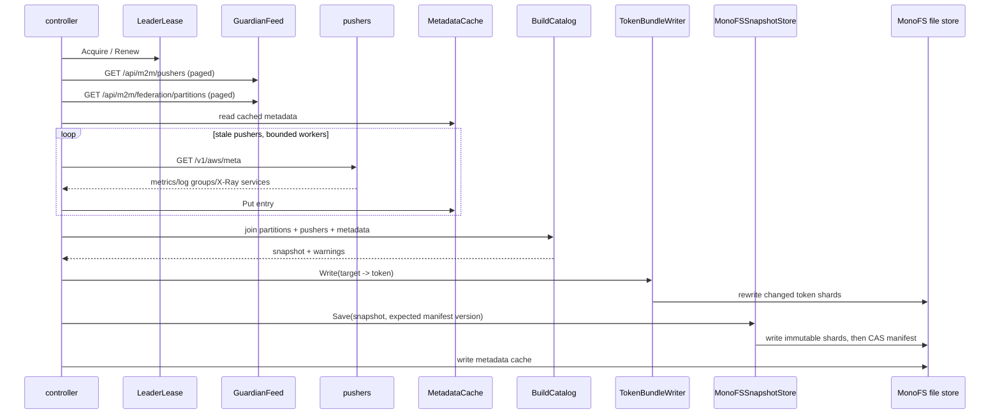

# Logical flow: federation

Federation has two planes:

- **control plane** (`doctor-federation-controller` / build / publish): Guardian + pusher metadata →
  catalog snapshot + token bundle in MonoFS;
- **query plane** (`doctor-query` + `federation.Manager`): catalog snapshot → planner → bounded
  fan-out to AWS pushers → merged results.

## 1. Control-plane sync



### 1.1 Leader election

`federation.LeaderLease` uses a CAS file:

```text
<root>/<tenant>/controller/leader.json
{"holder":"...","expires_at":"...","updated_at":"..."}
```

- Acquire if absent, expired, or owned by this holder.
- Renew every `LeaseTTL/3` (minimum 10s).
- Release writes an already-expired record if this holder owns it.
- `--once` acquires the lease, runs one sync, and releases.

### 1.2 Guardian feeds

`GuardianFeed.Pushers`:

- `GET /api/m2m/pushers?limit=2000` with cursor pagination;
- each pusher yields name, account, region, observed API URL, token/tokenEnv, version, priority,
  status, last heartbeat;
- tokens are returned in a separate map; the catalog snapshot never includes them;
- `TokenRef` is `guardian-pusher://<name>`.

`GuardianFeed.Partitions`:

- `GET /api/m2m/federation/partitions?limit=2000` with cursor pagination;
- name, provider, account, region, labels.

Both requests use `X-Guardian-Internal-Token` when configured. A controller without a token relies on
Guardian allowing the machine endpoint.

### 1.3 Pusher metadata

`MetadataFetcher.Fetch` calls `<endpoint>/v1/aws/meta`:

- bearer token from Guardian if available;
- up to 2 retries for network / 429 / 5xx;
- accepts either `metricNames`, `logGroups`, `xrayServices` arrays; `xrayServices` accepts strings or
  `{name}` objects;
- 16 MiB response cap, 5s default client timeout.

`MetadataCache` persists the last successful result per pusher name, including pusher version and
fetch time. A cached entry is reused when:

- the pusher version matches, and
- `now < fetchedAt + metadataTTL(base, pusherName)` (base + up to 10% jitter).

A failed fetch keeps the old metadata and emits a warning. The cache is saved to:

```text
<snapshotRoot>/<tenant>/controller/metadata.json
```

### 1.4 Catalog build

`BuildCatalog`:

1. reject empty partition input;
2. index pushers by `(account, region)`, dropping incomplete entries;
3. sort pushers per key by health score, priority, then name;
4. group AWS partitions by `(account, region)`; skip non-AWS or incomplete partitions with warnings;
5. for each group:
   - choose the best pusher;
   - create target `aws-<account>-<region>` with endpoint, token ref/env, provider `aws`, all three
     capabilities, health, version, priority;
   - merge partition labels (conflicts become warnings, first value wins);
   - add each partition's `log_group` plus the convention
     `guardian/<account>/<region>/<partition>/app`;
   - attach discovery metadata keyed by `account/region` or pusher name;
   - dedupe/sort all string lists;
6. if no targets, fail; otherwise assign a version (`controller-<unix-nano>` or input version) and
   timestamp.

Service partition mapping is not populated by the builder; `Target.ServicePartitions` is only
available from a hand-written/static catalog.

### 1.5 Token bundle

`targetTokens` maps each target to the token of its best pusher. `TokenBundleWriter.Write`:

- groups tokens by FNV-1a hash modulo `ShardCount`;
- iterates **every** configured shard (not only shards present in the new map) so removed targets
  are rewritten with an empty token map;
- skips shards whose decoded token map is unchanged;
- when `DOCTOR_FEDERATION_TOKEN_KEY` is set, writes `{"version","ciphertext":"..."}` using
  AES-256-GCM; otherwise writes the legacy `{"version","tokens":{...}}` plaintext form;
- uses a CAS expected version.

The controller refuses to publish a token map when a key is not configured, so production bundles
are encrypted. The resolver accepts both encrypted and legacy plaintext shards, which permits
migration. An encrypted shard without a key is a hard error.

### 1.6 Snapshot publish

`MonoFSSnapshotStore.Save`:

1. reject empty target list;
2. validate the target set with `NewCatalog`;
3. choose a version (`snapshot.Version` or a publish timestamp);
4. split targets into shards of `ShardTargets` (default 500);
5. for each shard, build `{version, generated_at, targets}` JSON, compute SHA-256, assign path
   `<tenant>/shards/<publishID>/<index>.json`;
6. write all shards in parallel (bounded 16 workers), each with expected version `absent`;
7. build the manifest `{version, generated_at, shards:[{id,path,targets,sha256}]}`;
8. if `expectedVersion` is set, read/verify the current manifest version, then write the manifest with
   a CAS on its file version;
9. if the manifest write fails, the new shards are orphaned but harmless; the old manifest still
   points at the old shards.

The manifest is the only commit point. Shards are immutable by convention (unique `publishID`).

### 1.7 Change suppression

The controller hashes only `snapshot.Targets` (not version/generated time). If the hash matches the
last successful publish in this process, it skips the publish and only saves the metadata cache.
After a restart the hash cache is empty, so the first sync republishes even if the target set is
unchanged.

## 2. Query-plane startup

### 2.1 Snapshot loading

Priority in `loadFederationCatalog`:

1. `DOCTOR_FEDERATION_CATALOG_JSON` inline snapshot;
2. `DOCTOR_FEDERATION_SNAPSHOT_STORE=monofs` → `MonoFSSnapshotStore.Load` (manifest + shards);
3. no snapshot yet (`ErrSnapshotNotFound`) → static `DOCTOR_FEDERATION_CATALOG_FILE`;
4. otherwise fail (or fall back to legacy AWS if configured and the error is specifically
   `ErrSnapshotNotFound`).

The source string records `inline:<version>`, `monofs:<version>`, or the file path.

### 2.2 Manager

`federation.NewManager` stores an atomic `managerState{catalog, planner, source, loadedAt}` and
defaults:

- max fanout 32, inflight 64, concurrent targets 8, attempts 2;
- client pool 10k, idle TTL 15m;
- breaker threshold 5, cooldown 30s;
- metadata TTL 1h, call timeout 5s.

`Run` periodically prunes idle clients. `Reload` swaps the state and prunes clients whose endpoint or
token reference changed. The reloader checks the snapshot version every
`DOCTOR_FEDERATION_RELOAD_INTERVAL` and skips unchanged versions.

### 2.3 Token resolution

Default `auto` chain order: **env → Guardian → MonoFS bundle**.

| Resolver | Behavior |
|---|---|
| `EnvTokenResolver` | returns `target.Token` or reads `target.TokenEnv`; unsupported when only `TokenRef` is set |
| `GuardianTokenResolver` | `GET /api/m2m/pushers/<name>` with `X-Guardian-Internal-Token`; caches token/error with positive/negative TTL; single-flight per pusher; invalidates on 401 |
| `BundleTokenResolver` | reads sharded MonoFS bundle; single-flight per shard; caches shard; `TokenNotFound` if missing |
| `ChainTokenResolver` | first success wins; unsupported/not-found fall through; other errors also fall through |

The manager's default client factory uses a static token if the target has one; otherwise it creates
an AWS client with a `targetTokenSource` backed by the resolver. The AWS client refreshes once after a
401.

## 3. Query planning

`Planner.Plan`:

1. if the catalog is empty → reject;
2. extract predicates from the request signal and expression:
   - metrics: parse PromQL and collect vector selectors; metric names and account/region/partition/
     log-group/service label matchers;
   - logs: regex over LogQL label matchers plus explicit log groups;
   - traces: regex over TraceQL matchers plus explicit trace ID;
3. if no predicates:
   - traces on a small catalog (≤ max fanout) → pull all targets;
   - otherwise reject with `scope required`;
4. resolve:
   - trace ID: use `byTrace` index if present (it is never populated), else fan out only if catalog ≤
     max fanout;
   - log groups without a cached index: parse `guardian/<account>/<region>/<partition>/...` into
     account/region/partition;
   - intersect index results for accounts, regions, partitions, log groups, services, metrics;
   - if a metric/service index has no match on a small catalog, fall back to all targets;
   - if no narrowing predicate was usable → reject;
5. if matched > max fanout → reject `too broad`;
6. otherwise pull.

`CheckScope` wraps rejections in `ScopeError` carrying matched/max fanout; HTTP handlers map them to
422.

## 4. Fan-out

`fanoutTargets`:

- checks the per-target circuit breaker; open circuits produce `errTargetCircuitOpen`, a warning, and
  a partial metric;
- bounds concurrent target calls with `maxConcurrentTargets` and global inflight with `m.inflight`;
- retries retryable errors with linear backoff (100ms × attempt + 0–25ms jitter), up to
  `MaxAttempts`;
- per attempt uses `context.WithTimeout(ctx, m.timeout)`;
- records success/failure/canceled metrics, latency, warnings, and breaker state;
- preserves input order in the result slice.

Retryable: `context.DeadlineExceeded`, HTTP 429/5xx, network timeout. Not retryable: scope errors,
client cancellation, HTTP 4xx (except 429), parse errors.

Breaker behavior:

- threshold failures opens for cooldown;
- after cooldown, one half-open probe is allowed; other callers wait;
- success closes; failure reopens; client-side/401 aborts the probe without counting a failure.

## 5. Query operations

| Method | Planning | Fan-out | Merge |
|---|---|---|---|
| `ListMetrics` | none unless cached names missing | all targets if ≤ max fanout | dedupe by namespace/name/region |
| `ListServices` | none | only targets with stale/missing metadata, if ≤ max fanout | dedupe by name/account/region; 1h cache |
| `ListLogGroups` | none | all targets if ≤ max fanout | string dedupe |
| `ResolveLogGroups` | catalog regex | fallback to list | regex filter |
| `QueryLogs` | log groups / query | selected targets | per-target limit = limit/targets; merge; truncate |
| `QueryTraces` | service/time | selected targets | dedupe by trace ID, prefer larger span count; sort newest |
| `GetTrace` | trace ID | selected targets | dedupe trace/span; partition from service map or single partition |
| `PrometheusQuery` | PromQL expression | selected targets | merge with `source=aws` |
| `PrometheusQueryRange` | same | same | same |
| `PrometheusSeries` | match[] | `planMatches` | dedupe series; `source=aws` |
| `PrometheusLabels` | match[] | `planMatches` | union |
| `PrometheusLabelValues` | match[] | `planMatches` | union |

Potential issues:

- `PrometheusSeries/Labels/LabelValues` build the plan from stripped selectors but forward the
  original selectors to targets; Doctor-only labels can make CloudWatch reject the request.
- `ListMetrics` dedupe omits account, so the same namespace/metric/region in multiple accounts
  collapses.
- `ListMetrics` can return every cached metric name for a 50k-target catalog in one response.
- `byTrace` is dead, so trace-ID planning is always a catalog scan/fallback.

## 6. Status and admin views

`Manager.StatusFor(visible)` returns:

- enabled, target count, account/partition maps (capped at 512 entries each) with truncation flags,
  account/partition counts, regions, max fanout, version, source, loaded_at, stale flag,
  open circuits, circuit snapshots (max 64), recent errors (max 16), client pool size.

`TargetsPageFor`:

- filters by account/region/partition/query;
- applies an optional partition visibility predicate and reduces each target’s partition list;
- sorts by target ID; cursor is the next target ID;
- includes breaker snapshot, metadata counts, and optional full metadata;
- never includes tokens.

`DebugPlan` returns the planner decision without fan-out. It is exposed at
`/v1/federation/plan`; only admin-gated when the repo policy is enforcing.

## 7. Failure modes

| Failure | Behavior |
|---|---|
| Guardian feed unavailable | controller sync fails; last snapshot remains |
| pusher metadata unavailable | cached metadata used; warning |
| leader lease lost | controller stops publishing until it reacquires |
| snapshot missing | query falls back to static file, or legacy AWS, or fails |
| catalog too broad | 422 scope error |
| target circuit open | warning/partial response |
| target 401 | token invalidated; next attempt refreshes; breaker probe aborted |
| token missing | target call fails; no token value is logged |
| token bundle stale | controller rewrites all shards and clears removed targets; encrypted shards require the shared key |
| reload version unchanged | no catalog swap |
| snapshot shard corrupt | checksum/count validation fails the load |

## 8. CLI usage

```bash
# Build a snapshot from an input document
doctor-federation-build --input catalog-input.yaml --out snapshot.json

# Publish a snapshot (optionally verify by reading it back)
doctor-federation-publish \
  --file snapshot.json \
  --monofs-router monofs-router:9000 \
  --monofs-token "$DOCTOR_MONOFS_TOKEN" \
  --root /doctor/v1/federation \
  --tenant default \
  --expected-version controller-... \
  --verify

# Run one controller sync (CronJob/CI)
doctor-federation-controller --once --dry-run \
  --guardian-url https://guardian.example \
  --monofs-router monofs-router:9000 \
  --monofs-token "$DOCTOR_MONOFS_TOKEN"
```

`--expected-version` empty means “latest/absent” in `doctor-federation-publish`; the controller
computes the expected manifest version itself.

The controller reads `DOCTOR_FEDERATION_TOKEN_KEY` from the environment (not a CLI flag) to encrypt
token shards.
