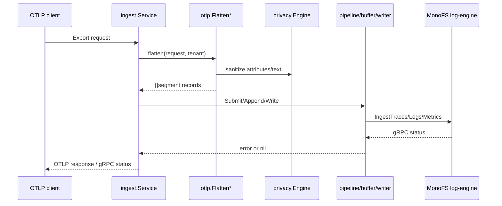
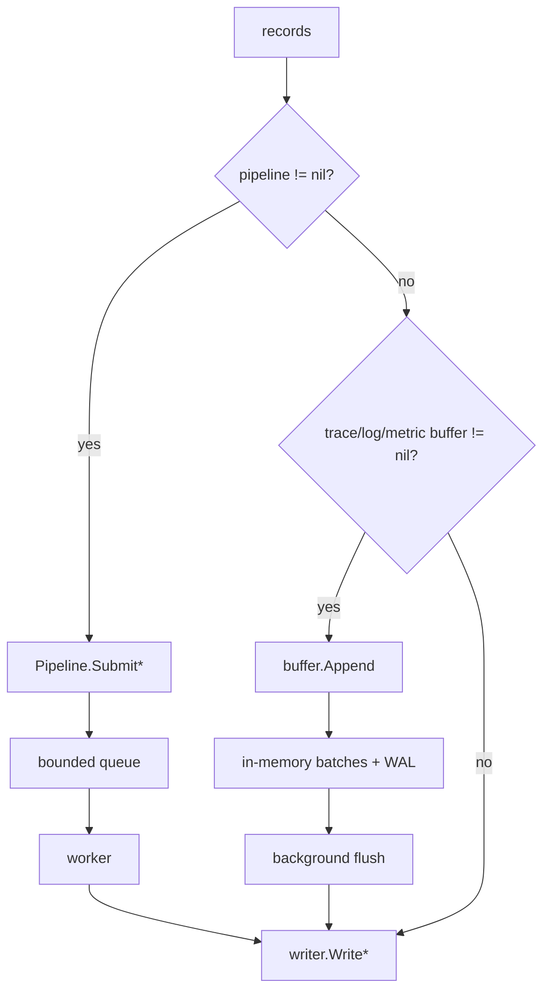

# Logical flow: ingest

## 1. Entry points

`doctor-ingest` exposes:

| Endpoint | Protocol | Purpose |
|---|---|---|
| `:4317` | gRPC | OTLP TraceService / LogsService / MetricsService |
| `:4318/v1/traces` | HTTP POST | OTLP/HTTP traces (protobuf or JSON) |
| `:4318/v1/logs` | HTTP POST | OTLP/HTTP logs |
| `:4318/v1/metrics` | HTTP POST | OTLP/HTTP metrics |
| `:4318/v1/guardian/events` | HTTP POST | Guardian event JSON (not persisted, see below) |
| `:4318/healthz` | HTTP GET | constant `{"status":"ok"}` |
| `:4318/api/v1/status/buildinfo` | HTTP GET | build metadata |
| `:6060/debug/pprof/*` | HTTP | Go pprof on localhost by default (`127.0.0.1:6060`, if enabled) |

OTLP gRPC and HTTP require `Authorization: Bearer $DOCTOR_INGEST_AUTH_TOKEN`. The token is checked by
a static bearer verifier; `/healthz` and `/metrics` are exempt. The tenant is read from the header or
gRPC metadata and must be in `DOCTOR_INGEST_ALLOWED_TENANTS` (which defaults to the configured
`DOCTOR_DEFAULT_TENANT`).

## 2. OTLP HTTP decoding

`Service.handleHTTPTraces/Logs/Metrics`:

1. reject non-POST with 405;
2. read at most 10 MiB from the body;
3. if `Content-Type` contains `json`, call `normalizeOTLPJSONIDs`:
   - decode generic JSON,
   - rewrite `traceId`, `trace_id`, `spanId`, `span_id`, `parentSpanId`, `parent_span_id` values from
     hex to base64,
   - re-encode,
   - decode with `protojson.UnmarshalOptions{DiscardUnknown:true}`;
   otherwise decode protobuf with `proto.Unmarshal`;
4. call `ingestTraces/Logs/Metrics` with the tenant from the HTTP header;
5. on success return 202 with an empty OTLP response in the same encoding;
6. map `ErrBufferFull` to 429, other errors to 500.

The hex→base64 rewrite exists because Guardian pushers emit OTLP/JSON with hex IDs, while protojson's
bytes mapping expects base64.

## 3. OTLP gRPC decoding

`traceServer.Export`, `logsServer.Export`, `metricsServer.Export`:

- tenant comes from incoming gRPC metadata `x-doctor-tenant` (case-insensitive) or the configured
  header, falling back to `DOCTOR_DEFAULT_TENANT`/`default`;
- call the same service method;
- map `ErrBufferFull` to `codes.ResourceExhausted`; other errors pass through as `Unknown`.

The gRPC server accepts up to 256 MiB per message. A unary auth interceptor validates the same static
bearer token as HTTP; there is no rate limiting or per-collector authorization beyond that token.

## 4. Flattening and privacy

Details:

- Resource attributes are sanitized once per resource.
- Span/log names, status messages, log bodies, and string attribute values go through
  `SanitizeText`/`SanitizeAttributes`.
- Identity keys are preserved even if their values match a secret pattern.
- Metrics are expanded from all OTLP point types; the raw point is also stored for histogram/
  exponential-histogram/summary variants where useful.
- Metric identity is normalized twice: once from the resource and once from point labels.

## 5. Execution path selection

With the default `DOCTOR_PIPELINE_ENABLED=true`, the pipeline branch always wins. The buffers are
constructed in `main` and start their WAL replay/background loops, but no new records reach them.
This is an important operational detail: buffer metrics stay at zero and WAL files do not grow under
normal traffic.

### Pipeline semantics

- `Submit*` sends a `work` item to a buffered channel and then **blocks** waiting for the worker's
  result on a private channel.
- If the queue is full, the submit is rejected with `ErrQueueFull` (mapped to 429/ResourceExhausted).
- Workers call the `Flusher`; a writer error is returned to the caller.
- `Stop` cancels the context, then workers drain remaining items using the canceled context. There is
  no retry or WAL for pipeline items; a failed write is lost from the caller's perspective.

### Buffer semantics

- `Append` reserves estimated bytes, appends a WAL batch, adds it to the in-memory list, and
  triggers a flush when the size/record threshold is crossed.
- `Replay` iterates WAL batches, flushes in bounded chunks, then truncates the WAL.
- `flushPending` snapshots the batches, clears the list, flushes, and rewrites the WAL with any
  remaining batches. On a flush error, batches are restored.
- `Stop` cancels the loop; the loop flushes pending batches with `context.Background()`.
- The metric buffer splits large flushes into chunks; log/trace buffers send one call.

## 6. Writing to MonoFS

`MonoFSWriter.WriteTraces/Logs/Metrics`:

1. return nil for empty input;
2. generate a chunk ID (`chunk-<segment.NewID>-<unix-nano>`);
3. call `LogEngineClient.Ingest*`;
4. the log-engine client converts records to protobuf entries:
   - logs: timestamp, level, service, trace/span IDs, raw message, merged labels;
   - metrics: timestamp, service, name, value, merged labels (unbounded labels removed);
   - traces: start/end, trace/span/parent IDs, service, name, status, merged attributes;
5. the MonoFS router forwards to a healthy node.

Errors are returned unchanged; the service maps only `ErrBufferFull` specially. A MonoFS error will
therefore become gRPC `Unknown` / HTTP 500, not a retryable status.

## 7. Guardian event endpoint

`POST /v1/guardian/events`:

1. decode a JSON array of `segment.GuardianEvent`;
2. fill missing tenant from the request tenant and missing timestamp with `now`;
3. call `writer.WriteGuardianEvents`.

`MonoFSWriter.WriteGuardianEvents` returns `ErrGuardianEventsUnsupported` because the log-engine has
no Guardian event chunk type. The endpoint now returns **501 Not Implemented** instead of reporting
`{"accepted": N}` and silently dropping events. The `internal/guardian` auth/rate-limit/dedup
helpers are still unused. This endpoint is not a working Guardian event sink.

## 8. Shutdown

- SIGINT/SIGTERM cancels the root context.
- gRPC `GracefulStop` waits for in-flight RPCs.
- HTTP `Shutdown` uses `context.Background()` (no timeout).
- Buffers (if active) flush on context cancellation with a 5s `Stop` timeout.
- Pipeline stops with a 5s timeout; queued items are drained with the canceled context.
- The MonoFS writer and clients are closed (deferred order is main’s defer stack).

## 9. Failure behavior summary

| Condition | Result |
|---|---|
| MonoFS address missing | process exits at startup |
| privacy key missing | process exits at startup |
| pipeline queue full | 429 / `ResourceExhausted` |
| buffer pending limit exceeded | 429 / `ResourceExhausted` |
| MonoFS write error | 500 / `Unknown` |
| missing/invalid ingest bearer token | 401 / gRPC `Unauthenticated` |
| tenant outside allowlist | 403 / gRPC `PermissionDenied` |
| malformed OTLP | 400 / gRPC decode error |
| JSON OTLP with hex IDs | normalized before decode |
| Guardian events | 501 Not Implemented (no event storage) |
| MonoFS unavailable at startup | `NewMonoFSWriter` fails and process exits |

## 10. What is not done

- No mTLS or per-collector authorization beyond a shared bearer token.
- No per-tenant credential mapping (one token can write any allowlisted tenant).
- No retry/backoff or durable queue for pipeline writes.
- No cost enforcement (`CostController` is unused).
- No legacy segment WAL (`internal/wal.WAL` is unused).
- No request IDs, structured access logs, or audit trail for accepted telemetry.
