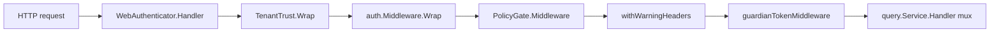
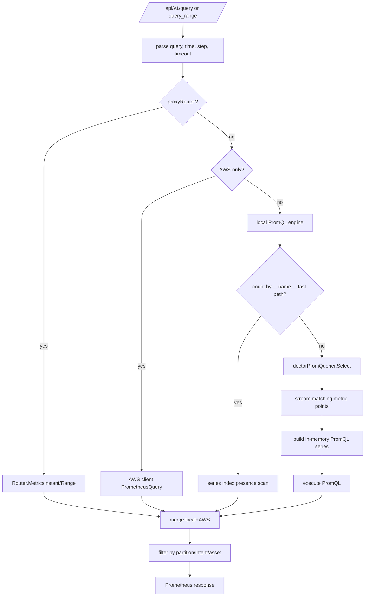
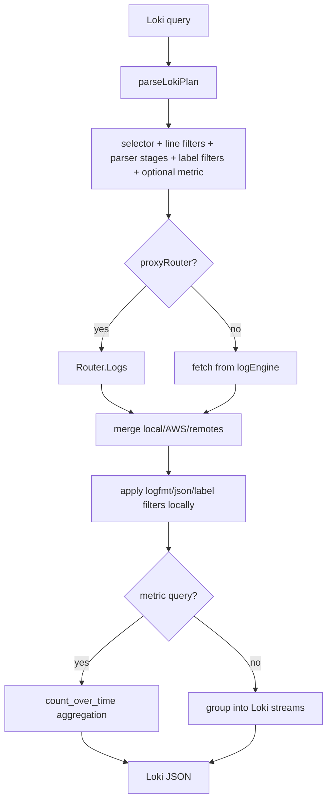
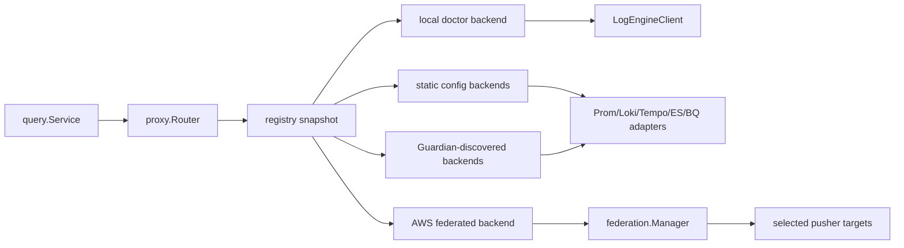

# Logical flow: query

## 1. Startup and wiring

`cmd/doctor-query/main.go` builds the service in this order:

1. `config.LoadQuery`, OTel telemetry, heartbeat.
2. Required MonoFS log-engine address → `LogEngineClient`.
3. `query.NewServiceLogEngine`, then `SetTraceDiscoveryCacheTTL`, `SetTraceDiscoveryWindow`,
   `SetTenantHeader`, Guardian URLs, default partition, rules URL.
4. Shared file store:
   - if `DOCTOR_MONOFS_TOKEN` is set, connect `GRPCClient` (writable) and use it for dashboards;
   - if a file token is configured, a MonoFS connection failure is fatal;
   - without a file token, use `ruler.NewMemoryStore()` and log “using in-memory store”.
5. Optional repo policy gate from `DOCTOR_ACCESS_POLICY_URL`/`_FILE`; `SetPolicyGate` wraps the log
   backend with `policyBackend`.
6. Federation token resolver (env/Guardian/bundle).
7. Optional AWS:
   - federation enabled: load inline JSON → MonoFS snapshot → file fallback; build catalog, manager,
     metrics, optional reloader, `go manager.Run`; `svc.SetAWSBackend(manager)`;
   - legacy AWS: `store/aws.Client`, `svc.SetAWSBackend(client)`.
8. `setupSecurity`: verifier (OIDC + break-glass), auth middleware, browser login, access resolver,
   legacy `access.Gate`.
9. Optional proxy router: static registry and/or Guardian discovery, local backend, AWS backend.
10. Handler chain and HTTP server.

## 2. Middleware and request identity

Execution order from the outside in:

| Layer | Behavior |
|---|---|
| `WebAuthenticator` | resolves `doctor_session` cookie (JWT verified, then opaque session fallback) or bearer; optionally redirects anonymous browser navigations to login; mounts `/auth/login`, `/auth/callback`, `/auth/logout` |
| `TenantTrust` | if no verified identity and tenant header/query param exists, attaches `ClientID=tenant:<name>`, group `doctor:tenant`; verified identity wins |
| `auth.Middleware` | re-verifies bearer if present; if `AuthRequire` and not exempt, rejects anonymous with 401; attaches identity |
| `PolicyGate.Middleware` | under enforcement, rejects whole log/trace requests when the policy denies or is not loaded; metrics paths pass |
| `withWarningHeaders` | attaches `proxy.WarningCollector` and federation `RequestMeta`; emits `X-Doctor-Partial*` headers |
| `guardianTokenMiddleware` | copies the caller's bearer or `doctor_session` cookie into context for server-side Guardian reads |
| mux | route handlers |

Exempt paths (when no custom list is set): `/healthz`, `/ready`, `/api/echo`, `/metrics`,
`/api/v1`. The `/api/v1` prefix exempts the entire Prometheus API. The UI and native `/v1` APIs are
not exempt.

## 3. Route map

### Health, UI, and metadata

| Method | Path | Handler | Notes |
|---|---|---|---|
| GET | `/healthz` | `handleHealth` | constant `{"status":"ok"}` |
| GET | `/ready` | `handleLokiReady` | 200 when log engine is configured and enforced policy is loaded; otherwise 503 |
| GET | `/metrics` | `promhttp.Handler()` | Prometheus scrape endpoint |
| GET | `/v1/ui/config` | `handleUIConfig` | default tenant, Guardian URL, default partition |
| GET | `/v1/ui/user` | `handleUIUser` | identity fields |
| GET | `/` and unknown non-API paths | `handleUI` | embedded SPA; API-prefixed missing routes → 404 |

### Prometheus-compatible

| Method | Path | Handler |
|---|---|---|
| GET/POST | `/api/v1/query` | `handlePrometheusQuery` |
| GET/POST | `/api/v1/query_range` | `handlePrometheusQueryRange` |
| GET/POST | `/api/v1/labels` | `handlePrometheusLabels` |
| GET | `/api/v1/label/{name}/values` | `handlePrometheusLabelValues` |
| GET/POST | `/api/v1/series` | `handlePrometheusSeries` |
| GET | `/api/v1/metadata` | `handlePrometheusMetadata` |
| GET/POST | `/api/v1/query_exemplars` | `handlePrometheusQueryExemplars` |
| GET | `/api/v1/rules` | `handlePrometheusRules` (empty groups) |
| GET | `/api/v1/status/buildinfo` | `handlePrometheusBuildInfo` |

### Loki-compatible

| Method | Path | Handler |
|---|---|---|
| GET/POST | `/loki/api/v1/query` | `handleLokiQuery` |
| GET/POST | `/loki/api/v1/query_range` | `handleLokiQueryRange` |
| GET | `/loki/api/v1/labels` | `handleLokiLabels` |
| GET | `/loki/api/v1/label/{name}/values` | `handleLokiLabelValues` |
| GET | `/loki/api/v1/series` | `handleLokiSeries` |
| GET | `/loki/api/v1/index/stats` | `handleLokiIndexStats` |
| GET | `/loki/api/v1/index/volume` | `handleLokiIndexVolume` |
| GET | `/loki/api/v1/index/volume_range` | `handleLokiIndexVolumeRange` |
| GET | `/loki/api/v1/patterns` | empty list |
| GET | `/loki/api/v1/detected_fields` | empty list |
| GET | `/loki/api/v1/detected_labels` | empty list |
| GET | `/loki/api/v1/status/buildinfo` | version `3.5.0` |

### Tempo-compatible

| Method | Path | Handler |
|---|---|---|
| GET | `/api/echo` | empty object |
| GET | `/api/status/buildinfo` | version `2.1.0` |
| GET | `/api/traces/{traceID}` | Tempo v1 trace (JSON or protobuf) |
| GET | `/api/v2/traces/{traceID}` | Tempo v2 `TraceByIDResponse` (JSON or protobuf) |
| GET | `/api/search` | tag search / TraceQL subset / span sets |
| GET | `/api/search/tags` | Tempo v1 tag names |
| GET | `/api/search/tag/{tag}/values` | Tempo v1 tag values |
| GET | `/api/v2/search/tags` | Tempo v2 tag scopes |
| GET | `/api/v2/search/tag/{tag}/values` | Tempo v2 tag values |
| GET | `/api/metrics/query_range` | TraceQL metrics range |
| GET | `/api/metrics/query` | TraceQL metrics instant |

### Native UI/API

| Method | Path | Purpose |
|---|---|---|
| GET | `/v1/traces/recent` | paginated trace summaries |
| GET | `/v1/traces/{id}` | full trace as `{trace_id, spans}` |
| GET | `/v1/spans/search` | span search by service/trace/time |
| GET | `/v1/logs/services` | service/partition/identity/log-group catalog |
| GET | `/v1/logs/search` | log search |
| GET | `/v1/metrics/range` | raw metric point range (legacy) |
| GET | `/v1/services/discover` | APM service catalog |
| GET | `/v1/services/suggest` | PromQL suggestions |
| GET | `/v1/federation/status` | catalog status |
| GET | `/v1/federation/targets` | paginated target view |
| GET | `/v1/federation/plan` | planner debug (admin-only when policy enforced) |
| GET | `/v1/proxy/endpoints` | proxy backend inventory/health |
| GET/POST | `/v1/rules`, `/v1/rules/*` | rules list/detail/evaluate proxy |
| GET/POST/PUT/DELETE | `/v1/dashboards*` | dashboard CRUD, versions, import/export |
| GET | `/v1/guardian/topology` | Guardian topology projection |
| GET | `/v1/guardian/events` | Guardian timeline projection |
| GET | `/v1/guardian/health` | derived health score |
| GET | `/v1/guardian/overview` | raw Guardian overview proxy |
| GET | `/v1/guardian/probes` | Guardian probe proxy + summary |

## 4. Prometheus flow

### 4.1 Query execution

Local engine details:

- `doctorPromQueryable.Querier` returns a `doctorPromQuerier` bound to tenant and optional partition.
- `Select` loads an index per matcher set, streams metric points, deduplicates points, sorts series,
  and applies matchers client-side.
- `__name__` matchers are expanded to exact stored names using the manifest-backed discovery mode;
  above 16 names the store is scanned once and filtered client-side.
- Per-query budgets: 4M samples, 100k series; global 8M samples. Exceeding them returns HTTP 422.
- `count by (__name__)` / bare `count` are served from the chunk series index, not samples.
- Broad all-series range selectors (`{__name__=~".+"}`) are rejected when the range exceeds 15
  minutes.
- A `?timeout=` duration is honored up to 5 minutes; otherwise the engine uses 30s or the caller
  deadline, whichever is longer.

AWS-only behavior when no proxy router:

- `source="aws"` is detected and stripped before forwarding to CloudWatch.
- If the local result is empty and AWS is ready, the original selector is forwarded verbatim as a
  transparent fallback.
- Local + AWS results are merged with `source` labels.

Proxy behavior:

- `Router.MetricsInstant/Range` selects backends, prunes by query labels (account/region/cluster/
  partition/backend/log group), applies circuit breakers, runs local first, then primary remotes, then
  fallback backends if the local result is empty.
- Results are merged; collisions get `shard`; partial failures become warnings.

### 4.2 Discovery endpoints

- `/api/v1/labels`, `/label/{name}/values`, `/series`, `/metadata` use either the proxy router or the
  local `doctorPromQuerier` discovery methods.
- Local discovery first tries the manifest-backed modes (`__doctor_discovery__=metric_names`,
  `label_names`, `label_values:<name>`), then falls back to sample or series-index scans.
- Discovery range is clamped to 15 minutes; 10k records / 200k series caps.
- AWS discovery adds `source` and uses `ListMetrics` for `__name__` when CloudWatch's Prometheus API
  has no label-values route.
- `/api/v1/query_exemplars` scans stored points for `trace_id`/`span_id`, capped at 500 series, 100
  exemplars/series, 5k total.

## 5. Loki flow

Supported LogQL subset:

- stream selector with `=`, `!=`, `=~`, `!~`;
- line filters `|=`, `!=`, `|~`, `!~`;
- parser stages recognized (and mostly ignored): `logfmt`, `json`, `line_format`, `label_format`,
  `pattern`, `regexp`, `unpack`, `decolorize`, `drop`, `keep`;
- label filter stages (`| label=...`);
- `count_over_time(...)` with optional `sum`, `sum by (...)`, and postfix grouping;
- range durations including `d`/`w`.

Storage reduction: only the selector + line filters are sent to storage. Parser/label filters and
aggregation are evaluated locally. This is why Loki responses are correct for the supported subset
but incomplete for arbitrary LogQL.

AWS logs:

- `proxy.AWSLogsForLoki` only activates when the selector matches `source="aws"`.
- log-group matchers are parsed; regex groups are resolved via the catalog or by listing groups;
- line filters become CloudWatch Logs Insights `filter @message like /.../` conditions;
- results are converted to `segment.LogRecord` with AWS partition/account/region labels.

Volume/index endpoints:

- stats and volume count stored records; chunks is always 0;
- volume_range groups by `targetLabels` and caps series/buckets;
- patterns and detected fields/labels return valid empty payloads;
- buildinfo advertises Loki 3.5.0 so Grafana enables the Drilldown UI, even though pattern mining is
  not implemented.

## 6. Tempo flow

### Search

`GET /api/search` parses either `q` (TraceQL) or `tags`/time/limit/minDuration/maxDuration.

- If a proxy router exists:
  - if any backend implements `TraceQLUpstream`, **only those backends are queried** for a TraceQL
    query; local and AWS backends are skipped even if they could evaluate the subset;
  - otherwise `ApplyTraceQL` folds the subset into tag matchers and all backends are searched.
- Without a proxy router, local and AWS search results are merged.
- `spss` requests span sets; failures are non-fatal enrichment failures.
- Results are deduplicated by trace ID, newest first.

TraceQL subset (`internal/proxy/translate/traceql.go`):

- `{}`, `true`, `false`;
- `nestedSetParent<0`, `nestedSetParent=-1` for root spans;
- `name`, `status`, `kind`, `duration`, `service.name`/`resource.service.name`;
- `resource.<attr>`, `span.<attr>`, bare attributes;
- `=`, `!=`, `=~`, `!~`, `nil`, `!= nil`, `= nil`;
- `&&`, same-key `||`, duration comparisons.

Unsupported TraceQL constructs return 400.

### Trace detail

- `latest`, `latest-aws`, `latest-doctor`, `latest-service:<prefix>` (and their magic 32-hex aliases)
  resolve to the newest matching trace in the requested window.
- `loadFederatedTrace` checks AWS first; if found, it uses the AWS span timestamps ±30 minutes as the
  local lookup window, merges local spans, and reports a partial warning if policy hides some AWS
  spans.
- Otherwise it uses the proxy router or local store.
- `Accept: application/protobuf` returns OTLP protobuf; v2 wraps it in a Tempo `TraceByIDResponse`.
- JSON v1 returns `{batches: ...}`; JSON v2 returns `{trace: ..., status: "COMPLETE"}`.

### Tags and metrics

- Tag names/values are collected from the router or local/AWS; per-identity TTL cache (30s default).
- Tempo v2 scopes classify names into intrinsic/resource/span.
- TraceQL metrics supports `rate()`, `count_over_time()`, and `quantile_over_time(duration, q...)`,
  optional `by (...)`, and ignores `with (sample=true)`.
- Evaluation loads up to 20k spans, aggregates into buckets, and caps 500 series / 5k buckets /
  500k samples.

## 7. Native APIs

### Traces

`/v1/traces/recent`:

- parses service, partition/intent/asset, from/to, limit (default 100, max 500), cursor;
- `queryLocalTracePage` scans up to 8 batches of 5k spans, builds trace summaries, and only emits a
  trace once the scan watermark is below its earliest span start (so the summary is complete);
- `queryAWSTracePage` reads up to 200 X-Ray summaries, applies the same cursor/partition rules;
- `mergeTracePages` deduplicates by canonical trace ID, applies the cursor and limit;
- returns `{returned, traces, has_more, next_cursor, page_size}`.

`/v1/traces/{id}` resolves latest magics, then uses the proxy router or local store; returns
`{trace_id, spans}` sorted by start time.

`/v1/spans/search` searches by service and/or trace ID; with a router it first searches summaries
and hydrates each trace, then filters by service.

### Logs

`/v1/logs/search`:

- tenant, partition, intent, asset, service, free text, log group, from/to, limit 1–1000;
- rejects broad live-AWS searches with 422 if the federation planner cannot scope them;
- with a proxy router, calls `Router.Logs`; if the router does not own AWS, optionally merges the
  direct AWS result;
- without a router, uses `QueryLogsRaw` if supported, otherwise `QueryLogs`;
- applies service/identity filters, sorts newest first, returns `{results, returned, ...}`.

`/v1/logs/services` scans 2k logs (and optionally traces) to build components, partitions,
identities, and AWS log groups. It applies the policy gate to AWS services/groups but does not
separately filter the log-derived lists beyond the already-filtered records.

### Metrics

`/v1/metrics/range` streams raw points for one metric name, caps at 200k points, returns
`{metric, points}`. It is a legacy UI convenience, not a PromQL endpoint.

### Services

`/v1/services/discover`:

- scans up to 5k traces, 5k logs, and 10k metric points over a window;
- builds a catalog of service name, canonical full name, alias, kind (runtime/asset), asset type,
  identity kind, partitions, intents, assets, cluster, pusher, last seen, trace/log counts, error
  rate, metric names, suggested dashboards;
- adds AWS X-Ray services;
- filters by policy `CanSeePartition` when enforcement is active;
- `include_assets=true` includes observation-only assets.

`/v1/services/suggest` returns canned PromQL suggestions (rate, errors, latency p50/p95/p99, log
volume, error logs) for a service name.

### Federation and proxy admin

- `/v1/federation/status`: manager status, optionally filtered by visible partitions.
- `/v1/federation/targets`: paginated target view; no tokens; optional metadata.
- `/v1/federation/plan`: planner debug; admin-only whenever a policy gate is configured.
- `/v1/proxy/endpoints`: full endpoint list or filtered page/summary; local AWS health probe is
  reported into the router; access decision is per returned page item.

### Dashboards

See [rules-dashboards.md](rules-dashboards.md).

### Guardian

- topology: fetch per-partition topology from Guardian, or all partitions concurrently (unbounded
  goroutines); map to Doctor node/edge shape with health scores.
- events: fetch history per partition, filter by window/intent, sort newest first, cap limit.
- health: aggregate history into success/failure/drift counts and a score/recommendation.
- overview: raw proxy with 1 MiB cap.
- probes: proxy Guardian `/api/probes`, filter partitions, add pusher summary (freshness ≤3 min).

## 8. Proxy and federation data path

Target selection for remote backends uses `parseSelectorCriteria` on PromQL/LogQL/TraceQL text:
equality/alternation matchers for region, account, cluster, partition, backend/shard/pusher, and
Guardian log-group names. Federated AWS backends skip this pruning because their planner owns target
selection.

Fan-out is bounded by `MaxInflight` and `MaxFanoutBackends`; local failures are fatal, remote failures
become warnings. Merge rules:

- metrics: tag remote series with `source`; add `shard` when the same label set appears from >1
  backend; skip type-mismatched results.
- logs: dedupe by timestamp/service/trace/span/body/sorted attributes; same-backend duplicates drop;
  cross-backend duplicates get shard labels.
- traces: dedupe by trace/span; same-source duplicates get shard labels; cross-source duplicates are
  merged and annotated with `sources`/`backends`.

## 9. Access filtering

Two layers can apply:

1. **`policyBackend`** decorates the local log engine:
   - logs and raw log queries → `PolicyGate.FilterLogs`;
   - traces → `PolicyGate.FilterSpans`;
   - metrics pass through.
2. **`proxy.Router`** calls the legacy `access.Gate` for remote log/trace backends. In observe mode
   denials produce warnings; in enforce mode denied backends are excluded. If every enforced backend
   is denied, the request returns `access.ErrAccessDenied` (403 in handlers).

The repo policy gate also:
- rejects whole log/trace requests when enforcement is on and policy is unavailable/anonymous;
- hides federation targets/status partitions;
- hides service catalog entries by partition;
- filters Guardian probes by partition.

Metrics are always allowed. This is intentional: metrics dashboards are a supported use case and
`/api/v1` is exempt by default. Deployments that need metric confidentiality must enforce it at an
external gateway or network layer.

## 10. Error and response conventions

| Family | Success | Error shape |
|---|---|---|
| Prometheus | `{"status":"success","data":...}` | `{"status":"error","errorType":...,"error":...}`; 400 bad_data, 422 execution/broad, 503 timeout/canceled |
| Loki | `{"status":"success","data":...}` | `{"status":"error","error":...}` |
| Tempo | JSON/protobuf | `{"status":"error","error":...}` with 400/403/500 |
| Native | JSON | `{"error": "..."}`, or plain `http.Error` text for older handlers |
| Partial failures | normal success body | `X-Doctor-Partial`, `X-Doctor-Partial-Count`, `X-Doctor-Access-Observed`, `X-Doctor-Federation-Version`, `X-Doctor-Fanout-Matched`, `X-Doctor-Fanout-Selected` |

Access enforcement maps to 403; planner scope errors map to 422 in Prometheus/query handlers.

## 11. Important correctness caveats

- TraceQL search now sends native TraceQL to capable backends and the supported subset to other
  backends, reporting a warning when the subset is unsupported.
- The proxy's Prometheus series/labels/label-values paths strip Doctor-only target labels before
  forwarding to AWS.
- `handlePrometheusMetadata` reports every metric as `untyped` with empty help/unit.
- `handlePrometheusRules` always returns no groups, even when doctor-rules has rules.
- `/ready` checks the log engine and enforced policy state, but not federation freshness or Guardian.
- The legacy direct and proxy paths can both query AWS unless `SetAWSViaRouter(true)` is used; the
  main binary sets it when a proxy router and AWS client exist.
