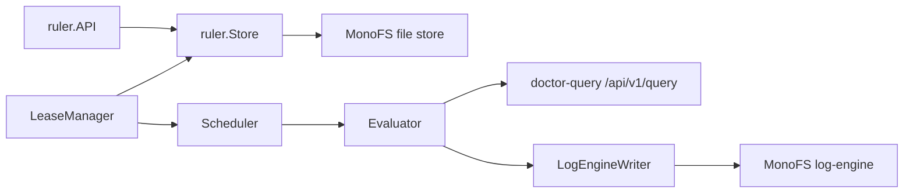
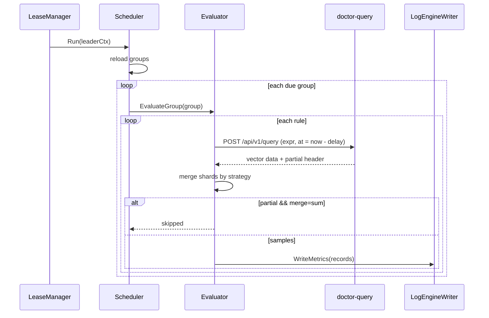
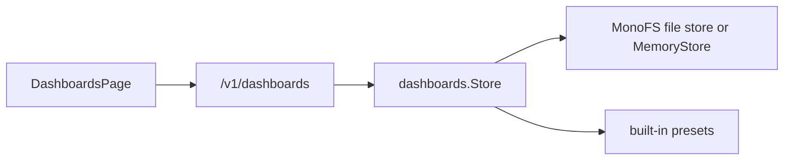

# Logical flow: recording rules and dashboards

## 1. Recording rules

### 1.1 Components

- `ruler.Store` persists YAML rule groups at `/doctor/v1/rules/<tenant>/<group>.yaml`.
- `ruler.LeaseManager` uses a CAS lease at `/doctor/v1/rules/.lease/leader.json`.
- `ruler.Scheduler` reloads groups every `DOCTOR_RULES_POLL_INTERVAL`, keeps a min-heap of next
  evaluation times, spreads new groups across the first 10% of their interval, and evaluates with a
  worker pool.
- `ruler.Evaluator` queries `doctor-query`, merges per-shard results, and writes derived metrics.
- `ruler.API` exposes CRUD, status, and manual evaluation.

### 1.2 Evaluation loop

Details:

- A group’s interval defaults to 1 minute; the minimum allowed interval is 5 seconds.
- `evaluation_delay` shifts the query time back.
- `MergeStrategy`:
  - `sum` (default): add values for identical label sets across shards;
  - `max`, `min`: element-wise;
  - `last`: newest timestamp;
  - `keep`: retain per-shard series (source/shard labels preserved).
- For `sum`, a partial response is skipped because adding a partial shard set would produce an
  incorrect total.
- Derived records set:
  - `Service` = a `service` label if present, else `"recording"`;
  - `Attributes` = rule labels + merged metric labels + `source="recording"`, `rule_group`, `rule`;
  - `MetricName` = `record`; `Type="gauge"`; `HasValue=true`.
- Writes go through `LogEngineWriter` with chunk ID `rules-<unix-nano>-<record-count>`.

### 1.3 Rule API

| Method | Path | Behavior |
|---|---|---|
| GET | `/healthz` | 200 |
| GET | `/v1/rules` | group summaries (`tenant`, `group`, `interval`, `rules`) |
| GET | `/v1/rules/status` | enabled, ruler ID, leader, lease status, scheduler stats |
| POST | `/v1/rules/evaluate?tenant=&group=` | load and evaluate all groups in the file |
| GET | `/v1/rules/{tenant}/{group}` | YAML rule file |
| PUT | `/v1/rules/{tenant}/{group}` | parse + validate + store (authenticated authorizer) |
| DELETE | `/v1/rules/{tenant}/{group}` | delete with CAS (authenticated authorizer) |

The server requires `DOCTOR_RULES_API_TOKEN` on every route except `/healthz` and `/metrics`. The
authorizer is `ruler.AuthenticatedAuthorizer`, so mutations require an authenticated service
principal. This is still all-or-nothing: any holder of the service token can modify any tenant/group.
The query service’s rules proxy only allows GET and POST `/v1/rules/evaluate` and injects the same
service token.

### 1.4 Lease behavior

- `TryAcquire` reads the lease; if absent, creates it; if expired or owned by this ruler, writes a
  new lease with CAS.
- `Run` acquires, invokes `onLeader` (the scheduler), renews every `Renew`, and steps down on loss.
- `FileLeaseStore` maps any CAS error to `ErrLeaseConflict`.
- `Status` reports ruler ID, leader, TTL, renew, path, and since.

### 1.5 Known gaps

- the rules API token is all-or-nothing; there is no per-tenant ownership;
- no tenant validation beyond the URL path;
- no dry-run/backtest API;
- no rule evaluation history/audit;
- the scheduler now skips missed intervals after a pause, but there is no catch-up policy;
- API `List` reads each rule file individually (N+1);
- rules self-telemetry is OTLP-only; `/metrics` exposes Go/process metrics.

## 2. Dashboards

### 2.1 Model

`doctor.dashboard/v1` documents contain:

- tenant, title, description, tags, built-in flag;
- default time range and refresh interval;
- variables (label values, custom, text, partition, service);
- a 12-column grid of widgets;
- widget queries with datasource (`prometheus`, `loki`, `tempo`, `native_logs`, `native_traces`);
- visualization options (line/area/bars, stacked, exemplars, unit, decimals, thresholds, markdown).

Six built-in presets are compiled into the binary:

1. Strata & Guardian Fleet Overview
2. Service RED Overview (APM template)
3. Synthetic Probes & SLO
4. MonoFS & LogEngine Storage
5. Doctor Self-Observability
6. AWS CloudWatch & X-Ray Federation

Built-ins are read-only and take precedence over stored documents with the same ID. The UI “clone”
action creates an editable copy with `builtIn:false`.

### 2.2 Store

- `List`: built-ins matching tenant/tag/search first, then stored YAML files under
  `<root>/<tenant>/*.yaml`; skips IDs that are built-in; sorts built-ins first then title.
- `Get`: built-in first; otherwise read YAML and attach `meta.versionId/updatedAt/updatedBy` from the
  latest file version.
- `Put`: refuse built-in IDs; YAML marshal; expected version from `If-Match` or the latest version;
  CAS write; map conflict to `ErrConflict`.
- `Delete`: refuse built-in; expected latest version; CAS delete; `ErrNotFound` if absent.
- `ListVersions`: returns file version history.
- Import: accepts a single document or a bundle; writes each with empty expected version (latest).
- Export: returns a bundle JSON/YAML with optional ID filter.

### 2.3 HTTP handlers

| Method | Path | Behavior |
|---|---|---|
| GET | `/v1/dashboards` | list with `tenant`, `tag`, `q` |
| GET | `/v1/dashboards/{tenant}/{id}` | get; `format=yaml`, `download=1` |
| PUT | `/v1/dashboards/{tenant}/{id}` | upsert; path tenant/id override body; `If-Match` |
| DELETE | `/v1/dashboards/{tenant}/{id}` | delete |
| GET | `/v1/dashboards/{tenant}/{id}/versions` | version history |
| POST | `/v1/dashboards/import` | import document/bundle |
| GET | `/v1/dashboards/export` | export bundle |

There is no per-tenant or per-user authorization here. Any caller that passes the general auth
middleware can read or write any tenant path. Writes are attributed to the service principal
`doctor-query`, not the end user.

### 2.4 UI render flow

`DashboardsPage`:

1. list dashboards for the configured tenant;
2. open a dashboard; load the document; parse variable defaults from the URL (`var-*`);
3. `DashboardVariableBar` resolves variables (including `$__all` → `.*`);
4. each `DashboardWidgetCard` interpolates macros (`$__interval`, `$__range`,
   `$__rate_interval`, `$tenant`) and variables;
5. queries:
   - Prometheus → `/api/v1/query` or `/query_range`;
   - Loki → `/loki/api/v1/query_range`;
   - Tempo → `/api/metrics/query_range`;
   - logs → `/v1/logs/search`;
   - traces → `/api/search`;
   - native tables → `/v1/...` via `getNativeJSON`;
6. edit mode supports widget editor, grid layout, save with version ID, clone/delete.

### 2.5 Known gaps

- no per-user dashboard permissions or audit;
- import uses no CAS precondition, so concurrent imports can overwrite;
- built-in preset IDs cannot be overridden by stored documents;
- dashboard save is attributed to the service principal;
- no server-side dashboard rendering/templating; all interpolation is client-side;
- no validation that referenced datasources/backends exist.
