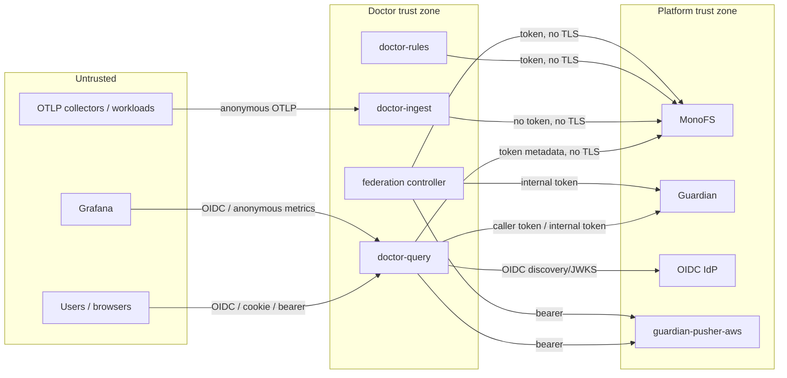

# Security architecture

> This document describes the security properties of the code as it is wired today, including
> controls that are present but not used, and controls that look correct but are not. It is not a
> claim that the system is secure. The highest-risk findings are summarized in
> [§11](#11-risk-register) and tracked in [internal/missing-pieces.md](internal/missing-pieces.md).

## 1. Scope and trust model

Doctor sits between telemetry producers, Grafana, the Doctor UI, Guardian, MonoFS, and AWS
guardian-pushers. The important trust boundaries are:



The model the code assumes:

- Guardian and MonoFS are trusted platform services.
- OIDC is the identity provider for humans and, optionally, machines.
- Grafana and the UI are untrusted clients.
- OTLP producers are untrusted.
- AWS pushers are semi-trusted: they are managed by Guardian, but their advertised URLs and tokens
  are used by Doctor.

The code does not enforce a network boundary. It relies on deployment topology for several
properties (tenant trust, MonoFS reachability, pprof reachability).

## 2. Authentication

### 2.1 Ingest

OTLP gRPC and HTTP require a shared bearer token (`DOCTOR_INGEST_AUTH_TOKEN`):

- gRPC uses a unary auth interceptor backed by a hashed static token verifier;
- HTTP uses the shared `auth.Middleware` with the same verifier;
- `/healthz` and `/metrics` are exempt;
- the tenant header/metadata must be in `DOCTOR_INGEST_ALLOWED_TENANTS` (default:
  `DOCTOR_DEFAULT_TENANT`);
- HTTP/gRPC TLS can be enabled with `DOCTOR_TLS_*` and `DOCTOR_GRPC_TLS_*`;
- pprof defaults to `127.0.0.1:6060` and has a read-header timeout.

Residual risks: the token is global (no per-collector identity), and partition/intent/asset labels
inside the payload are still caller-controlled. A collector can poison any allowlisted tenant and
any partition. If pprof is exposed, heap profiles can leak telemetry and tokens in memory.

### 2.2 Query: bearer and OIDC

`internal/auth` builds a verifier chain:

1. OIDC verifier when both `DOCTOR_OIDC_ISSUER` and `DOCTOR_OIDC_AUDIENCE` are set;
2. break-glass static token when `DOCTOR_BREAK_GLASS_TOKEN` is set.

If neither is configured, `NewVerifier` returns `(nil, nil)` and the middleware is a pass-through
(`internal/auth/auth.go:39-67`). `DOCTOR_AUTH_REQUIRE` defaults to `false`, so even a configured
verifier does not reject anonymous callers unless explicitly enabled
(`internal/config/config.go:310`).

OIDC details (from the shared MonoFS `authz` package):

- JWT signature verification with an allowlist of RS/ES/PS algorithms;
- issuer and audience validation;
- JWKS fetched lazily and cached (15 min default);
- verified token→identity cache (5 min default, capped by token expiry);
- claims: `sub`, `email`, `groups`, `client_id`/`azp`.

Break-glass:

- `authz.NewBreakGlassVerifier(token, "break-glass-admin")` creates an identity with
  `ClientID="break-glass-admin"` (`internal/auth/auth.go:60-61`; shared package
  `NewBreakGlassVerifier`).
- The policy gate’s admin check only looks at `id.Subject=="break-glass-admin"`
  (`internal/access/policy.go:115-117`), so the actual break-glass token does **not** bypass policy
  filtering. The test for this path constructs a `Subject`, not the real `ClientID`.

### 2.3 Query: browser login

`auth.NewWebAuthenticator` enables Authorization Code + PKCE when issuer, audience, client ID,
client secret, and redirect URL are present:

- state + PKCE verifier stored server-side with a 10-minute expiry;
- state cookie `monofs_oauth_state`, HttpOnly, SameSite=Lax, Secure when the redirect is HTTPS;
- callback exchanges the code, verifies the `id_token`, and sets `doctor_session` to the raw
  `id_token` (HttpOnly, SameSite=Lax, Secure on HTTPS, 12h);
- logout clears the cookie and performs RP-initiated logout when `EndSessionURL` is configured;
- persistent session store at `DOCTOR_SESSION_DIR` is optional.

`WebAuthenticator.Handler` mounts `/auth/login`, `/auth/callback`, `/auth/logout` at the route prefix
derived from the redirect URL. When `RequireLogin` is true (or `AuthRequire` is folded in), anonymous
browser navigations are redirected to login; other callers get 401, except exempt paths.

### 2.4 Query: tenant trust

`auth.TenantTrust` attaches a synthetic identity when a tenant header/query parameter is present and
no verified identity exists:

```text
ClientID = tenant:<name>
Groups   = [doctor:tenant]
```

It is disabled by default (`DOCTOR_ACCESS_TRUST_TENANT_HEADER=false`). When enabled, it deliberately
trusts the header. The code comment says it must only be used behind a trusted gateway that strips
client-supplied copies of the header. If exposed directly, any caller can claim any tenant.

### 2.5 Rules

`doctor-rules` requires `DOCTOR_RULES_API_TOKEN` on every route except `/healthz` and `/metrics`.
The authorizer is `ruler.AuthenticatedAuthorizer`, so mutations require a non-anonymous identity
established by the bearer middleware. The query service’s rules proxy injects the same service
token and restricts browser-origin methods to GET and POST `/v1/rules/evaluate`.

Residual risk: the token is a single service credential, so any holder can modify any tenant/group.
There is no per-tenant ownership or audit trail.

### 2.6 Federation controller and CLIs

- `doctor-federation-controller` authenticates to Guardian with
  `X-Guardian-Internal-Token` (`internal/federation/guardian_feed.go:141-160`) and to MonoFS with a
  bearer token.
- `doctor-federation-publish`/`controller` accept `--monofs-token` and `--guardian-token` flags
  (`cmd/doctor-federation-*/main.go`). Secrets on a command line are visible to other local users
  and may be captured by process auditing. Use the env fallbacks.
- The controller encrypts token shards with AES-256-GCM when
  `DOCTOR_FEDERATION_TOKEN_KEY` is set and refuses to publish a non-empty token map without it
  (see §4). The key is still an environment/flag secret.

### 2.7 MonoFS

- All MonoFS clients use `insecure.NewCredentials()`: no TLS, no mTLS
  (`internal/store/monofs/logengine_client.go:34`, `internal/store/monofs/grpc_client.go:117,566`).
- The file-store client sends the MonoFS token as `x-monofs-internal` metadata for node reads
  (`internal/store/monofs/grpc_client.go:305,344`).
- The log-engine client has **no token field at all**; ingest/query log traffic is unauthenticated
  beyond network reachability.

### 2.8 Doctor self-telemetry

- OTLP exporters infer `Insecure` from the endpoint scheme: `https://` defaults to verified TLS;
  host:port defaults to plaintext. The override is `OTEL_EXPORTER_OTLP_INSECURE`.
- The endpoint is operator-configured; if it points across a network boundary, use HTTPS or an
  explicit secure collector configuration.

## 3. Authorization

### 3.1 The policy model

The repo-managed policy (`github.com/radryc/monofs/pkg/authz/policy`) defines:

- scopes: `partitions`, `logs`, `traces`, `monofs`;
- defaults per scope;
- grants by group/user/client with partition/log/trace/path lists and optional role;
- AWS account/region → partition bindings;
- deny lists per scope;
- admin role bypass.

**Metrics are always visible** and are not configurable
(`policy.CanReadSignal` returns true for `SignalMetrics`). This is an intentional product decision:
metrics dashboards are expected to work without partition auth, and `/api/v1` is exempt by default.
Logs and traces are checked per partition. A missing/empty partition is denied under enforcement. The
policy loader keeps the last good bundle on fetch failure; enforcement fails closed while no bundle
has ever loaded.

### 3.2 Two authorization systems

Doctor has two independent authorization implementations:

1. **Repo policy gate** (`internal/access/policy.go`) — the newer model:
   - `PolicyGate.Middleware` rejects whole log/trace requests (403) when enforcement is on and the
     policy is unavailable or the caller is anonymous;
   - `FilterLogs`/`FilterSpans` remove records by partition and canonicalize AWS bindings;
   - `CanSeePartition` hides catalog/federation/probe entries;
   - `Allowed` passes metrics and observe-mode requests.
2. **Legacy endpoint gate** (`internal/access/resolver.go` + `owners.go` + `grants.go`) — used by
   `proxy.Router` for remote backends:
   - `allow-all`, `static`, `grants`, `owners`, `chain`;
   - OWNERS files at `<dir>/.guardian/OWNERS`, walking ancestors;
   - `Gate.Allowed` applies enforce/observe per signal (metrics never enforced);
   - denied backends produce warnings in observe mode and are excluded in enforce mode;
   - if every enforced backend is denied, the request returns `access.ErrAccessDenied`.

Both can be active at once. The repo gate wraps the local log backend; the legacy gate controls
remote proxy backends. They can disagree, and a local backend registered in the proxy router is
subject to the legacy gate as well. See
[internal/duplicate-functionality.md](internal/duplicate-functionality.md).

### 3.3 Observe mode defect

`PolicyGate.FilterLogs`/`FilterSpans` call `countLogDrops`/`countSpanDrops` in observe mode. Those
helpers call `PartitionVisible`, which returns `true` whenever `!g.enforce`. Therefore the
observe-mode “would_filter” count is always zero (`internal/access/policy.go:167-169,238,269,290-307`).
Operators cannot use observe mode to validate policy impact.

### 3.4 Default configuration is open

| Setting | Default | Consequence |
|---|---|---|
| `DOCTOR_AUTH_REQUIRE` | `false` | anonymous query access |
| `DOCTOR_OIDC_REQUIRE_LOGIN` | `false` | browser login not required |
| `DOCTOR_ACCESS_MODE` | `observe` | no log/trace filtering |
| `DOCTOR_ACCESS_TRUST_TENANT_HEADER` | `false` | tenant trust off |
| `DOCTOR_PROXY_ENABLED` | `true` | proxy fan-out enabled |
| `DOCTOR_AWS_ENABLED` | `true` | AWS fallback enabled if a URL exists |
| `DOCTOR_FEDERATION_ENABLED` | `false` | federation off |
| `DOCTOR_ACCESS_POLICY_URL/FILE` | empty | repo policy off |
| `DOCTOR_ACCESS_RESOLVER` | `owners` | legacy resolver built, but only used by proxy |
| `DOCTOR_AUTH_EXEMPT_PATHS` | `/healthz,/ready,/api/echo,/metrics,/api/v1` | all Prometheus API public |

A default deployment exposes metrics and health publicly and does not reject anonymous log/trace
queries unless auth/access are explicitly configured. The metrics exposure is intentional; metrics
dashboards are a supported use case.

### 3.5 Authorization matrix

| Surface | Authentication | Authorization | Notes |
|---|---|---|---|
| OTLP gRPC/HTTP ingest | none | none | any tenant/partition labels |
| `/v1/guardian/events` on ingest | none | none | accepted and dropped |
| Prometheus `/api/v1/*` | exempt by default | metrics public | auth not required even when `AuthRequire` |
| Loki `/loki/api/v1/*` | OIDC/bearer if configured | policy logs scope; legacy proxy gate | 403 under enforcement |
| Tempo `/api/*` | OIDC/bearer if configured | policy traces scope; legacy proxy gate | 403 under enforcement |
| Native traces/logs | OIDC/bearer if configured | policy logs/traces; service catalog filter | |
| Native metrics `/v1/metrics/range` | OIDC/bearer if configured | none | raw metric data |
| Service discovery `/v1/services/*` | OIDC/bearer if configured | policy partition filter when enforced | otherwise all |
| Dashboards `/v1/dashboards*` | OIDC/bearer if configured | **no tenant/user ACL** | any authenticated caller can read/write any tenant |
| Rules proxy `/v1/rules*` | OIDC/bearer if configured | read/evaluate only | writes blocked at proxy |
| Rules API `:18081` | **none** | **none** | full CRUD |
| Federation status/targets | OIDC/bearer if configured | partition filter only when policy enforced | account/region metadata visible |
| Federation plan | OIDC/bearer if configured | admin only when policy enforced | open otherwise |
| Proxy endpoints | OIDC/bearer if configured | per-page access decision | summary counts are unfiltered |
| Guardian proxy endpoints | OIDC/bearer if configured | caller token forwarded to Guardian | Guardian enforces its ACL |
| pprof on ingest | none | none | full process profile |
| MonoFS file store | token | MonoFS-side authz | no TLS |
| MonoFS log-engine | none | none | no TLS |

## 4. Secrets and sensitive data

### 4.1 Secrets inventory

| Secret | Where configured | Where used | Protection |
|---|---|---|---|
| Privacy HMAC key | `DOCTOR_PRIVACY_HMAC_KEY` | ingest tokenization | env only; no rotation/version |
| MonoFS file token | `DOCTOR_MONOFS_TOKEN`, flags | query/rules/controller file store | env or CLI flag; sent as metadata; no TLS |
| MonoFS log-engine access | (none) | ingest/query/rules | network-only |
| OIDC client secret | `DOCTOR_OIDC_CLIENT_SECRET` | browser code exchange | env |
| OIDC session cookie | `doctor_session` | browser auth; forwarded to Guardian | HttpOnly/SameSite/Secure-on-HTTPS; contains raw id_token |
| Break-glass token | `DOCTOR_BREAK_GLASS_TOKEN` | query verifier | env; constant-time compare in verifier |
| Guardian internal token | `DOCTOR_GUARDIAN_TOKEN` / `DOCTOR_ACCESS_POLICY_TOKEN` / flags | controller feed, token resolver, discovery | env or CLI flag; `X-Guardian-Internal-Token` |
| AWS pusher tokens | Guardian feed → token bundle / resolver | query → pusher | plaintext in MonoFS token shards or lazy fetch; bearer over HTTP |
| Access policy fetch token | `DOCTOR_ACCESS_POLICY_TOKEN` | policy bundle fetch | bearer |
| Grafana/other backend tokens | static backend file `token` | proxy upstreams | plaintext YAML file, bearer over HTTP |

### 4.2 Privacy engine

At ingest, `internal/privacy`:

- redacts values for sensitive keys and secret-looking values;
- tokenizes email/user/account/client/IP values with HMAC-SHA256, truncated to 8 bytes;
- tokenizes emails/IPs embedded in free text;
- preserves identity keys, including `service.name` and `guardian.*`.

Security properties:

- redaction is pattern-based, not a guarantee; unknown secret formats pass through;
- identity keys are an explicit bypass;
- tokenization is deterministic and stable for a key, so it preserves correlation but is
  pseudonymization, not anonymization;
- the 64-bit token suffix has a non-trivial collision probability at very large volumes and low-entropy
  inputs can be brute-forced if the HMAC key leaks;
- the engine has no key rotation/versioning; rotating the key breaks correlation and requires
  reprocessing;
- nested OTLP maps/arrays are serialized to JSON text and then sanitized as text, which may miss
  structured fields or alter values.

### 4.3 Federation token bundle

`TokenBundleWriter` supports encrypted token shards:

```json
{"version":"...","ciphertext":"<base64(nonce+ciphertext)>"}
```

- With `DOCTOR_FEDERATION_TOKEN_KEY`, the token map is encrypted with AES-256-GCM (key derived with
  SHA-256); without it, the legacy `{"tokens":{...}}` form is written.
- The controller refuses to publish a non-empty token map without a key.
- The writer iterates every shard, so removed targets are rewritten with an empty map
  (`internal/federation/token_bundle.go`).
- Encrypted and plaintext shards can be read; an encrypted shard without a key is a hard error.
- `Target.Token` is not serialized (`json:"-"`), but the bundle is still the actual secret store in
  fallback mode.
- The token resolver caches tokens (positive TTL 5 min, negative 30s) and the AWS client caches too;
  revocation is delayed by these caches.

Residual risk: the encryption key is an environment variable/flag with no secret-manager
integration, rotation, or audit.

## 5. Data protection and transport

- **HTTP/gRPC TLS is configurable** for ingest, query, and rules (`DOCTOR_TLS_*`,
  `DOCTOR_GRPC_TLS_*`). It is not enabled by default.
- **MonoFS is still plaintext**: `store/monofs` clients use insecure credentials and the log-engine
  client has no token. This is the largest remaining transport gap.
- **No mTLS** between Doctor components or between Doctor and MonoFS.
- **Bearer tokens travel in plaintext** when endpoints use `http://`; HTTPS endpoints use TLS, and
  Doctor no longer silently downgrades an explicit `https://` self-telemetry endpoint. The code does
  not enforce `https`.
- **No encryption at rest** in Doctor. MonoFS is the storage layer; Doctor does not add object
  encryption. Federation token shards can be AES-256-GCM encrypted; dashboards, rules, snapshots,
  and metadata are plaintext JSON/YAML.
- **No field-level encryption** for PII beyond the HMAC tokenization described above.
- **No data retention/deletion controls** in Doctor; retention is MonoFS’s responsibility.
- **No backup/restore tooling** for dashboards/rules/federation state beyond MonoFS versioning.

## 6. Availability and denial-of-service controls

Present controls:

- PromQL sample/series budgets and global budget;
- broad-selector guard;
- Loki/Tempo/volume output caps;
- proxy inflight/back-end caps;
- federation inflight/target caps;
- query timeouts and caller deadlines;
- OTLP HTTP 10 MiB body cap, gRPC 256 MiB;
- circuit breakers in proxy and federation.

Missing or weak controls:

- HTTP servers now set read-header/read/write/idle timeouts; the remaining DoS surface is the large
  gRPC 256 MiB receive limit;
- gRPC 256 MiB receive size is still very large for an OTLP endpoint;
- ingest pipeline queue is small (1000) and blocks callers; backpressure is a 429, not a durable
  queue;
- pprof defaults to localhost but remains unauthenticated if exposed;
- Guardian topology fetches are capped at 8 concurrent requests;
- trace discovery caches are capped at 10k entries per map and prune expired entries;
- service discovery scans up to 5k traces + 5k logs + 10k metric points per call with no cache;
- federation status/target list can serialize large metadata if `include_metadata=true`;
- dashboard/rule import body limits are 16 MiB / 4 MiB but parsing can be expensive.

## 7. Audit and logging

- Query authorization decisions are logged by the legacy gate and policy gate (observe/enforce,
  subject, endpoint, reason).
- Policy refresh/load failures are logged.
- There is no structured audit log for:
  - dashboard create/update/delete/import;
  - rule create/update/delete/evaluate;
  - federation snapshot/token publish;
  - admin/federation plan access;
  - break-glass token use;
  - data exports (dashboard export, raw query download).
- MonoFS mutations carry `PrincipalID` but Doctor sets it to a service principal
  (`doctor-query`, `doctor-rules`, `doctor-federation*`), not the end user.
- Many handlers return raw `err.Error()` text to clients (query, Guardian, dashboard, federation),
  which can leak upstream URLs, hostnames, policy reasons, or internal details.
- `doctor-ingest` has no access log at all.

## 8. Injection and SSRF considerations

### 8.1 Remote backend URLs

- Static proxy backends accept any `http(s)` base URL (`internal/proxy/backend.go` validation).
- Guardian discovery takes `observedApiUrl` and `endpoint` from Guardian and turns them into
  backends (`internal/proxy/discovery_guardian.go:250-360`).
- The federation controller takes `ObservedAPIURL` from Guardian pushers
  (`internal/federation/guardian_feed.go`).
- Doctor then sends bearer tokens to those URLs.

If an attacker can influence Guardian pusher metadata (or the static backend file), they can point
Doctor at internal services (SSRF) and receive Doctor’s configured bearer token. Treat Guardian and
the static file as trusted configuration, and restrict egress.

### 8.2 Query translation

- `translate.ParseSelector` validates label names against the OTel/AWS label grammar before they
  become ES\|QL fields or BigQuery columns. This blocks the previous breakout vector.
- `AWSLogsForLoki` escapes `/`, CR, and LF in `|~`/`!~` values so they cannot terminate the
  CloudWatch Insights `/.../` literal or inject a new pipeline stage. The regex content itself is
  still evaluated by CloudWatch.
- PromQL/TraceQL parsing is stricter (Prometheus parser / custom subset), but expression text is
  forwarded to remote backends; those backends own their own parser.

These require the ability to send a query to Doctor (any authenticated user, or anonymous if auth is
not enforced), so they compound the “open by default” finding.

### 8.3 Header/metadata trust

- `X-Doctor-Tenant` and `tenant` query params are trusted by query; ingest constrains them to the
  configured allowlist.
- Guardian token middleware copies any `Authorization: Bearer` or `doctor_session` cookie into
  Guardian requests. If a caller can set those headers, they can make Doctor forward arbitrary
  tokens to Guardian (but Guardian verifies them).
- `X-Guardian-Internal-Token` is sent to Guardian from configured secrets; no inbound endpoint
  accepts it.

## 9. Multi-tenancy

Tenant is not an isolation boundary:

- ingest constrains tenant claims to `DOCTOR_INGEST_ALLOWED_TENANTS` (default tenant only), but the
  shared collector token has no per-tenant identity;
- query accepts any tenant;
- MonoFS log-engine ignores the tenant parameter (`internal/store/monofs/logengine_client.go:132,
  170,187,371`);
- dashboards/rules use tenant only as a path segment with no ACL;
- the policy is partition-based; a user with access to a partition can query it regardless of tenant;
- metrics are global by design.

The only real isolation primitive is the partition policy. Deployments that need hard multi-tenancy
must enforce tenant identity and partition membership outside Doctor (gateway + policy).

## 10. Supply chain and deployment

- Go dependencies are pinned in `go.mod`/`go.sum`; the MonoFS module is replaced by `../monofs` at
  build time, so the container build context must include a trusted MonoFS checkout.
- The Dockerfile installs `otelc` at build time from a version tag.
- GitHub Actions use tag references (`actions/checkout@v4`, `@v7`) rather than commit SHAs.
- The frontend dependency tree is large (ECharts, Framer Motion, React, Router); `npm ci` uses the
  lockfile.
- The distroless runtime runs as the default non-root user? `gcr.io/distroless/base-debian12`
  defaults to root unless `USER` is set; the Dockerfile does **not** set `USER`. This is a
  container-hardening gap.
- No network policy, seccomp, read-only root filesystem, or resource limits are defined in this repo.

## 11. Risk register

Severity reflects the current wiring, assuming network reachability. The first table lists residual
risks after the remediation pass; the second lists findings that were fixed in code (details and
tests are in [internal/remediation-log.md](internal/remediation-log.md)).

### Residual risks

| # | Severity | Finding | Evidence | Impact | Next step |
|---|---|---|---|---|---|
| 1 | **High** | MonoFS transport is still insecure and the log-engine client has no credential | `internal/store/monofs/logengine_client.go:34`, `grpc_client.go:117,566` | credential/telemetry interception, unauthorized log writes on the internal network | mTLS for router/node connections; per-service credentials; remove `insecure.NewCredentials` |
| 2 | **High** | Tenant is not an isolation boundary; MonoFS ignores tenant | `internal/store/monofs/logengine_client.go:132,170,187,371`; query `tenantFromRequest` | cross-tenant reads/writes if partition ACL is wrong | bind tenant to identity and storage keys, or document single-tenant deployment |
| 3 | **High** | Dashboards have no per-user/per-tenant authorization, audit, or CSRF token | `internal/query/dashboards_handlers.go`, `internal/dashboards/store.go`, shared `webauth.go` | any authenticated user can alter any tenant’s dashboards; repudiation | tenant/OWNERS authorization, audit events, CSRF or strict origin checks |
| 4 | **Accepted** | Metrics are globally readable by design; `/api/v1` is intentionally exempt | `internal/auth/auth.go:105-109`; `policy.CanReadSignal(SignalMetrics)` | metric metadata/data is intentionally visible; metrics dashboards depend on it | no change. A deployment that must protect metrics does so with an external gateway/network policy; Doctor keeps metrics public by design |
| 5 | **Medium** | Remote backend URLs are trusted and receive Doctor tokens | `internal/proxy/discovery_guardian.go`, `internal/federation/guardian_feed.go`, `internal/proxy/upstream_*` | SSRF/token exfiltration via malicious Guardian metadata | host allowlists, block private/link-local ranges, per-backend credentials |
| 6 | **Medium** | No structured audit log or request IDs | all services; MonoFS mutations use service principals | no accountability for dashboard/rule/federation/admin actions | audit events, caller attribution, request IDs |
| 7 | **Medium** | Secrets can be passed as federation CLI flags | `cmd/doctor-federation-controller/main.go`, `cmd/doctor-federation-publish/main.go` | process-list/audit leakage | remove flags or read from files/stdin; prefer env/secret mounts |
| 8 | **Medium** | Proxy fleet summary is unfiltered; federation `byTrace` index is unpopulated | `internal/proxy/router.go:207-360`; `internal/federation/catalog.go:29,96,346` | metadata leak; trace-ID planning always falls back | filter summary by visibility; populate or remove the trace index |
| 9 | **Medium** | No retention/compaction control, key rotation, or secret-manager integration | federation token key, privacy HMAC key, MonoFS storage | unbounded data growth; weak key lifecycle | key versioning/rotation, secret manager, retention policy |
| 10 | **Low** | Embedded UI has no security headers/CSP | `internal/query/ui.go` | XSS impact amplification | add CSP, `X-Content-Type-Options`, `frame-ancestors` |
| 11 | **Low** | CI actions are not SHA-pinned; frontend tests/contract scripts are not in CI | `.github/workflows/*` | supply-chain and regression risk | pin action SHAs, add frontend tests and contract scripts |
| 12 | **Low** | HMAC token suffix is 64 bits | `internal/privacy/engine.go` | collisions/brute force at scale | use a longer suffix if correlation tokens are security-sensitive |

### Fixed in the remediation pass

- Ingest authentication and tenant allowlisting (`DOCTOR_INGEST_AUTH_TOKEN`,
  `DOCTOR_INGEST_ALLOWED_TENANTS`; default tenant allowlist).
- Rules API authentication and a real mutation authorizer.
- Federation token encryption (AES-256-GCM) and stale-shard revocation.
- Break-glass admin bypass for the production `ClientID` identity.
- Observe-mode would-filter counting.
- HTTP server timeouts, localhost-only pprof default, and configurable HTTP/gRPC TLS.
- `/metrics` endpoints and dependency-aware `/ready`.
- Telemetry endpoint TLS inference, non-root container runtime.
- Prometheus series/label target-label stripping and cross-account metric dedupe.
- TraceQL routing to both capable and subset backends.
- AWS partition canonicalization for dimension-only series when a policy gate is installed.
- Label-name validation before ES\|QL/BigQuery generation and CloudWatch regex delimiter escaping.
- Static access-list case normalization and OIDC partial-configuration failure.
- Guardian topology concurrency bound, trace-cache cap, scheduler catch-up skip, rules telemetry,
  explicit 501 for unsupported Guardian event storage, and fatal dashboard-store connection errors.

## 12. Current controls that are genuinely useful

- OIDC JWT verification with issuer/audience/algorithm checks and JWKS caching.
- Browser PKCE + state, HttpOnly/SameSite cookies, Secure-on-HTTPS, RP-initiated logout.
- Constant-time break-glass comparison.
- Repo policy fail-closed behavior under enforcement when no policy is loaded.
- Partition filtering for logs/traces and catalog views; metrics explicitly public.
- Federation planner rejects unscoped/broad live-AWS queries.
- Query sample/series/record budgets and broad-selector guard.
- Proxy/federation circuit breakers, retries, inflight caps, and partial-result warnings.
- Privacy redaction/tokenization before storage.
- CAS versioning for dashboards, rules, snapshots, tokens, leases, and metadata.
- Immutable federation shards validated by SHA-256 and target count.

## 13. Secure deployment checklist

Use this as the minimum for an Internet-reachable deployment:

- [ ] Set `DOCTOR_INGEST_AUTH_TOKEN` and distribute it to collectors; do not expose
      `:4317/:4318/:6060` publicly.
- [ ] Keep pprof disabled or bound to localhost/admin-only; the default is localhost.
- [ ] Enable TLS/mTLS for MonoFS; HTTP/gRPC TLS is available via `DOCTOR_TLS_*`/`DOCTOR_GRPC_TLS_*`
      but not enabled by default. `store/monofs` still needs mTLS.
- [ ] Set `DOCTOR_AUTH_REQUIRE=true`, configure OIDC issuer **and** audience, and verify that
      anonymous `/loki` and `/tempo` requests get 401.
- [ ] Keep `/api/v1` public only where metrics are intended to be public. Metrics visibility is an
      accepted design decision; if a deployment must protect metrics, enforce it at an external
      gateway/network policy rather than changing Doctor’s metrics semantics.
- [ ] Set `DOCTOR_ACCESS_MODE=enforce` after validating observe-mode would-filter counts.
- [ ] Set `DOCTOR_RULES_API_TOKEN` and keep the rules port on the internal network.
- [ ] Set `DOCTOR_FEDERATION_TOKEN_KEY` and store it in a secret manager; the controller refuses to
      publish plaintext tokens.
- [ ] Restrict egress from Doctor to known Guardian/pusher/MonoFS/IdP hosts.
- [ ] Add body limits where missing, request IDs, and structured audit logs.
- [ ] Add per-tenant/per-user authorization and CSRF protection for dashboards and rules.
- [ ] Keep the runtime non-root and add a read-only root filesystem/network policy.
- [ ] Set `DOCTOR_MEMORY_LIMIT_BYTES` from the container limit instead of relying on the default.
- [ ] Protect `/metrics` with network policy if it cannot be public; `/ready` now checks the log
      engine and enforced policy state.
- [ ] Pin CI actions to commit SHAs and add `govulncheck`/`staticcheck` to CI.
