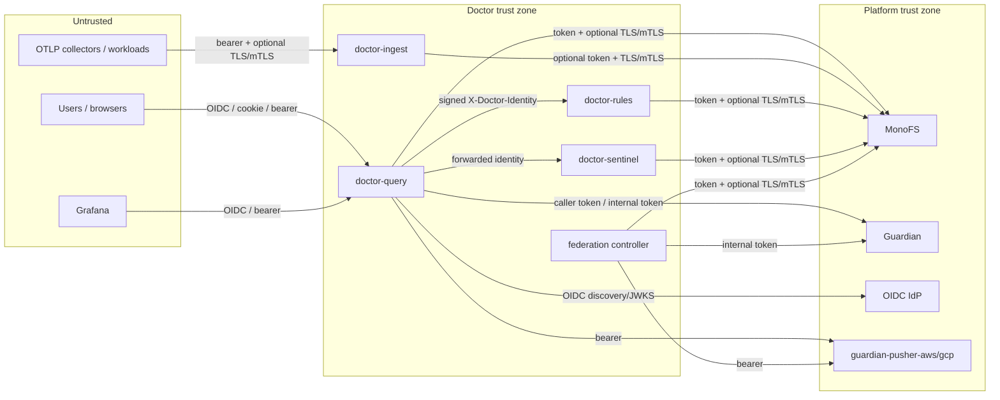

# Security architecture

> This document describes the security properties of the code as it is wired today, including
> controls that are present but not used, and controls that look correct but are not. It is not a
> claim that the system is secure. The highest-risk findings are summarized in
> [§11](#11-risk-register).

## 1. Scope and trust model

Doctor sits between telemetry producers, Grafana, the Doctor UI, Guardian, MonoFS, and AWS
guardian-pushers. The important trust boundaries are:



The model the code assumes:

- Guardian and MonoFS are trusted platform services.
- OIDC is the identity provider for humans and, optionally, machines.
- Grafana and the UI are untrusted clients.
- OTLP producers are untrusted.
- AWS pushers are semi-trusted: they are managed by Guardian, but their advertised URLs and tokens
  are used by Doctor.

The code does not enforce a network boundary. It relies on deployment topology for several
properties (tenant trust, MonoFS reachability, pprof reachability).

## 2. Authentication

### 2.1 Ingest

OTLP gRPC and HTTP require a bearer token:

- `DOCTOR_INGEST_TOKENS_FILE` is the preferred per-collector credential file. Each entry binds a
  SHA-256 token hash (or development plaintext) to one or more tenants and produces
  `ingest:tenant:<name>` groups;
- `DOCTOR_INGEST_AUTH_TOKEN` remains as a legacy shared token scoped to
  `DOCTOR_INGEST_ALLOWED_TENANTS`;
- gRPC uses a unary auth interceptor and HTTP uses `auth.Middleware`, both backed by the same
  verifier chain;
- `/healthz` and `/metrics` are exempt;
- the requested tenant must satisfy both the deployment allowlist and the collector's tenant groups;
- Optional collector mTLS is available: `DOCTOR_INGEST_MTLS_MODE` (`off`/`optional`/`require`) plus
  `DOCTOR_INGEST_MTLS_CA_FILE`, with `DOCTOR_GRPC_MTLS_*` / `DOCTOR_HTTP_MTLS_*` overrides. mTLS is
  transport authentication in addition to the bearer token; it does not replace tenant scoping.
  TODO(security): add OIDC workload identity as an alternative to client certificates;

Example `DOCTOR_INGEST_TOKENS_FILE`:

```yaml
tokens:
  - id: collector-edge
    sha256: "<64 hex characters>"
    tenants: [edge]
  - id: collector-prod
    token: "development-only-plaintext"
    tenants: [prod, edge]
```

The same shape is used by `DOCTOR_RULES_TOKENS_FILE` with `partitions` and `role`
(`admin`, `maintainer`, or `viewer`) instead of `tenants`.

- HTTP/gRPC TLS can be enabled with `DOCTOR_TLS_*` and `DOCTOR_GRPC_TLS_*`;
- pprof defaults to `127.0.0.1:6060` and has a read-header timeout.

Residual risks: partition/intent/asset labels inside the payload are still caller-controlled. A
collector can poison any tenant it is bound to and any partition inside that tenant. If pprof is
exposed, heap profiles can leak telemetry and tokens in memory.

### 2.2 Query: bearer and OIDC

`internal/auth` builds a verifier chain:

1. OIDC verifier when both `DOCTOR_OIDC_ISSUER` and `DOCTOR_OIDC_AUDIENCE` are set;
2. break-glass static token when `DOCTOR_BREAK_GLASS_TOKEN` is set.

If neither is configured, `NewVerifier` returns `(nil, nil)` and the middleware is a pass-through
(`internal/auth/auth.go:39-67`). `DOCTOR_AUTH_REQUIRE` defaults to `true`, so a configured verifier rejects
anonymous callers unless explicitly disabled
(`internal/config/config.go:310`).

OIDC details (from the shared MonoFS `authz` package):

- JWT signature verification with an allowlist of RS/ES/PS algorithms;
- issuer and audience validation;
- JWKS fetched lazily and cached (15 min default);
- verified token→identity cache (5 min default, capped by token expiry);
- claims: `sub`, `email`, `groups`, `client_id`/`azp`.

Break-glass:

- `authz.NewBreakGlassVerifier(token, "break-glass-admin")` creates an identity with
  `ClientID="break-glass-admin"` (`internal/auth/auth.go`).
- `PolicyGate.IsAdmin` recognizes both `Subject` and `ClientID` equal to `"break-glass-admin"`,
  so the production break-glass token bypasses policy filtering (`TestAdminBypass`).

### 2.3 Query: browser login

`auth.NewWebAuthenticator` enables Authorization Code + PKCE when issuer, audience, client ID,
client secret, and redirect URL are present:

- state + PKCE verifier stored server-side with a 10-minute expiry;
- state cookie `monofs_oauth_state`, HttpOnly, SameSite=Lax, Secure when the redirect is HTTPS;
- callback exchanges the code, verifies the `id_token`, and sets `doctor_session` to the raw
  `id_token` (HttpOnly, SameSite=Lax, Secure on HTTPS, 12h);
- logout clears the cookie and performs RP-initiated logout when `EndSessionURL` is configured;
- persistent session store at `DOCTOR_SESSION_DIR` is optional.

`WebAuthenticator.Handler` mounts `/auth/login`, `/auth/callback`, `/auth/logout` at the route prefix
derived from the redirect URL. When `RequireLogin` is true (or `AuthRequire` is folded in), anonymous
browser navigations are redirected to login; other callers get 401, except exempt paths.

### 2.4 Query: tenant trust

`auth.TenantTrust` attaches a synthetic identity when a tenant header/query parameter is present and
no verified identity exists:

```text
ClientID = tenant:<name>
Groups   = [doctor:tenant]
```

It is disabled by default (`DOCTOR_ACCESS_TRUST_TENANT_HEADER=false`). When enabled, it deliberately
trusts the header. The code comment says it must only be used behind a trusted gateway that strips
client-supplied copies of the header. If exposed directly, any caller can claim any tenant.

### 2.5 Rules

`doctor-rules` requires a bearer credential on every route except `/healthz` and `/metrics`.
`DOCTOR_RULES_TOKENS_FILE` binds each token to partitions and a role (`admin`, `maintainer`, or
`viewer`); `DOCTOR_RULES_API_TOKEN` remains as a legacy admin credential.
The authorizer is `ruler.ScopedRulesAuthorizer`, which enforces per-partition read/write scopes.
The query service’s rules proxy injects the service token alongside a short-lived HMAC-signed
`X-Doctor-Identity` header (`DOCTOR_INTERNAL_IDENTITY_SECRET`), so proxied writes are
authorized against the caller's partition scopes rather than the service credential.
Residual risk: there is no rule-mutation audit trail yet.

### 2.6 Federation controller and CLIs

- `doctor-federation-controller` authenticates to Guardian with
  `X-Guardian-Internal-Token` (`internal/federation/guardian_feed.go:141-160`) and to MonoFS with a
  bearer token.
- `doctor-federation-publish`/`controller` accept `--monofs-token` and `--guardian-token` flags
  (`cmd/doctor-federation-*/main.go`). Secrets on a command line are visible to other local users
  and may be captured by process auditing. Use the env fallbacks.
- The controller encrypts token shards with AES-256-GCM when
  `DOCTOR_FEDERATION_TOKEN_KEY` is set and refuses to publish a non-empty token map without it
  (see §4). The key is still an environment/flag secret.

### 2.7 MonoFS

- `internal/store/monofs/tls.go` (`TLSConfigFromEnv`) configures TLS and mTLS via
  `DOCTOR_MONOFS_TLS_CA`, `DOCTOR_MONOFS_TLS_CERT`, `DOCTOR_MONOFS_TLS_KEY`,
  `DOCTOR_MONOFS_TLS_SERVER_NAME`, `DOCTOR_MONOFS_TLS_REQUIRE`, and `DOCTOR_MONOFS_TLS_INSECURE`.
  When none are set, clients fall back to `insecure.NewCredentials()` unless `DOCTOR_MONOFS_TLS_REQUIRE=true`.
- The file-store client sends the MonoFS token as `x-monofs-internal` metadata for node reads.
- `LogEngineClient` accepts a token via `NewLogEngineClientWithToken` (`DOCTOR_MONOFS_TOKEN`).

### 2.8 Doctor self-telemetry

- OTLP exporters infer `Insecure` from the endpoint scheme: `https://` defaults to verified TLS;
  host:port defaults to plaintext. The override is `OTEL_EXPORTER_OTLP_INSECURE`.
- The endpoint is operator-configured; if it points across a network boundary, use HTTPS or an
  explicit secure collector configuration.

## 3. Authorization

### 3.1 The policy model

The repo-managed policy (`github.com/radryc/monofs/pkg/authz/policy`) defines:

- scopes: `partitions`, `logs`, `traces`, `monofs`;
- defaults per scope;
- grants by group/user/client with partition/log/trace/path lists and optional role;
- AWS account/region → partition bindings;
- deny lists per scope;
- admin role bypass.

**Metrics are globally visible to authenticated callers** and are not partition-scoped
(`policy.CanReadSignal` returns true for `SignalMetrics`). This is an intentional product decision:
metrics dashboards are expected to work across partitions after authentication. `/api/v1` is not
exempt by default. Logs and traces are checked per partition. A missing/empty partition is denied under enforcement. The
policy loader keeps the last good bundle on fetch failure; enforcement fails closed while no bundle
has ever loaded.

### 3.2 Two authorization systems

Doctor has two independent authorization implementations:

1. **Repo policy gate** (`internal/access/policy.go`) — the newer model:
   - `PolicyGate.Middleware` rejects whole log/trace requests (403) when enforcement is on and the
     policy is unavailable or the caller is anonymous;
   - `FilterLogs`/`FilterSpans` remove records by partition and canonicalize AWS bindings;
   - `CanSeePartition` hides catalog/federation/probe entries;
   - `Allowed` passes metrics and observe-mode requests.
2. **Legacy endpoint gate** (`internal/access/resolver.go` + `owners.go` + `grants.go`) — used by
   `proxy.Router` for remote backends:
   - `allow-all`, `static`, `grants`, `owners`, `chain`;
   - OWNERS files at `<dir>/.guardian/OWNERS`, walking ancestors;
   - `Gate.Allowed` applies enforce/observe per signal (metrics never enforced);
   - denied backends produce warnings in observe mode and are excluded in enforce mode;
   - if every enforced backend is denied, the request returns `access.ErrAccessDenied`.

Both can be active at once. The repo gate wraps the local log backend; the legacy gate controls
remote proxy backends. They can disagree, and a local backend registered in the proxy router is
subject to the legacy gate as well.

### 3.3 Observe mode counting

`PolicyGate.FilterLogs`/`FilterSpans` evaluate a non-short-circuited policy decision in observe mode
so `would_filter` metrics accurately reflect what enforcement would drop (`TestObserveModeReportsWouldFilter`).

### 3.4 Default configuration is open

| Setting | Default | Consequence |
|---|---|---|
| `DOCTOR_AUTH_REQUIRE` | `true` | anonymous query access is rejected when a verifier is configured |
| `DOCTOR_OIDC_REQUIRE_LOGIN` | `false` | browser login not required |
| `DOCTOR_ACCESS_MODE` | `observe` | no log/trace filtering |
| `DOCTOR_ACCESS_TRUST_TENANT_HEADER` | `false` | tenant trust off |
| `DOCTOR_PROXY_ENABLED` | `true` | proxy fan-out enabled |
| `DOCTOR_AWS_ENABLED` | `true` | AWS fallback enabled if a URL exists |
| `DOCTOR_FEDERATION_ENABLED` | `false` | federation off |
| `DOCTOR_ACCESS_POLICY_URL/FILE` | empty | repo policy off |
| `DOCTOR_ACCESS_RESOLVER` | `owners` | legacy resolver built, but only used by proxy |
| `DOCTOR_AUTH_EXEMPT_PATHS` | `/healthz,/ready,/api/echo,/metrics,/api/v1/status/buildinfo` | telemetry APIs require authentication |

Health and the scrape endpoint are public. Telemetry APIs require authentication whenever a verifier
is configured; metrics are globally visible to authenticated callers (no per-partition metric
scoping) but are never anonymous public data.

### 3.5 Authorization matrix

| Surface | Authentication | Authorization | Notes |
|---|---|---|---|
| OTLP gRPC/HTTP ingest | bearer (`DOCTOR_INGEST_TOKENS_FILE` or `DOCTOR_INGEST_AUTH_TOKEN`) + optional mTLS | tenant allowlist + per-collector tenant scopes | partition/intent/asset labels in payload are caller-controlled |
| `/v1/guardian/events` on ingest | bearer + optional mTLS | tenant allowlist | returns 501 Not Implemented (not persisted) |
| Prometheus `/api/v1/*` | bearer/OIDC when configured | metrics globally visible to authenticated callers | buildinfo remains exempt; no partition metric scoping |
| Loki `/loki/api/v1/*` | OIDC/bearer if configured | policy logs scope; legacy proxy gate | 403 under enforcement |
| Tempo `/api/*` | OIDC/bearer if configured | policy traces scope; legacy proxy gate | 403 under enforcement |
| Native traces/logs | OIDC/bearer if configured | policy logs/traces; service catalog filter | |
| Native metrics `/v1/metrics/range` | OIDC/bearer if configured | none | raw metric data |
| Service discovery `/v1/services/*` | OIDC/bearer if configured | policy partition filter when enforced | otherwise all |
| Dashboards `/v1/dashboards*` | OIDC/bearer if configured | **no tenant/user ACL** | any authenticated caller can read/write any tenant |
| Rules proxy `/v1/rules*` | OIDC/bearer if configured | forwards signed `X-Doctor-Identity` | `doctor-rules` enforces per-partition scopes |
| Rules API `:18081` | bearer/OIDC | per-partition token scopes or signed caller identity | legacy admin token is all-or-nothing |
| Federation status/targets | OIDC/bearer if configured | partition filter only when policy enforced | account/region metadata visible |
| Federation plan | OIDC/bearer if configured | admin only when policy enforced | open otherwise |
| Proxy endpoints | OIDC/bearer if configured | per-item access decision (`SummarizeEndpointsFor`) | |
| Guardian proxy endpoints | OIDC/bearer if configured | caller token forwarded to Guardian | Guardian enforces its ACL |
| pprof on ingest | none | localhost-only by default (`127.0.0.1:6060`) | disable by setting `DOCTOR_DEBUG_ADDR=""` |
| MonoFS file store | token | MonoFS-side authz | TLS/mTLS via `DOCTOR_MONOFS_TLS_*` |
| MonoFS log-engine | optional token (`DOCTOR_MONOFS_TOKEN`) | MonoFS-side authz | TLS/mTLS via `DOCTOR_MONOFS_TLS_*` |

## 4. Secrets and sensitive data

### 4.1 Secrets inventory

| Secret | Where configured | Where used | Protection |
|---|---|---|---|
| Privacy HMAC key | `DOCTOR_PRIVACY_HMAC_KEY` | ingest tokenization | env only; no rotation/version |
| MonoFS file token | `DOCTOR_MONOFS_TOKEN`, flags | query/rules/controller file store | env or CLI flag; sent as metadata; no TLS |
| MonoFS log-engine access | (none) | ingest/query/rules | network-only |
| OIDC client secret | `DOCTOR_OIDC_CLIENT_SECRET` | browser code exchange | env |
| OIDC session cookie | `doctor_session` | browser auth; forwarded to Guardian | HttpOnly/SameSite/Secure-on-HTTPS; contains raw id_token |
| Break-glass token | `DOCTOR_BREAK_GLASS_TOKEN` | query verifier | env; constant-time compare in verifier |
| Guardian internal token | `DOCTOR_GUARDIAN_TOKEN` / `DOCTOR_ACCESS_POLICY_TOKEN` / flags | controller feed, token resolver, discovery | env or CLI flag; `X-Guardian-Internal-Token` |
| AWS pusher tokens | Guardian feed → token bundle / resolver | query → pusher | AES-256-GCM encrypted in MonoFS token shards (`DOCTOR_FEDERATION_TOKEN_KEY`) or lazy fetch |
| Access policy fetch token | `DOCTOR_ACCESS_POLICY_TOKEN` | policy bundle fetch | bearer |
| Grafana/other backend tokens | static backend file `token` | proxy upstreams | plaintext YAML file, bearer over HTTP |

### 4.2 Privacy engine

At ingest, `internal/privacy`:

- redacts values for sensitive keys and secret-looking values;
- tokenizes email/user/account/client/IP values with HMAC-SHA256, truncated to 8 bytes;
- tokenizes emails/IPs embedded in free text;
- preserves identity keys, including `service.name` and `guardian.*`.

Security properties:

- redaction is pattern-based, not a guarantee; unknown secret formats pass through;
- identity keys are an explicit bypass;
- tokenization is deterministic and stable for a key, so it preserves correlation but is
  pseudonymization, not anonymization;
- the 64-bit token suffix has a non-trivial collision probability at very large volumes and low-entropy
  inputs can be brute-forced if the HMAC key leaks;
- the engine has no key rotation/versioning; rotating the key breaks correlation and requires
  reprocessing;
- nested OTLP maps/arrays are serialized to JSON text and then sanitized as text, which may miss
  structured fields or alter values.

### 4.3 Federation token bundle

`TokenBundleWriter` supports encrypted token shards:

```json
{"version":"...","ciphertext":"<base64(nonce+ciphertext)>"}
```

- With `DOCTOR_FEDERATION_TOKEN_KEY`, the token map is encrypted with AES-256-GCM (key derived with
  SHA-256); without it, the legacy `{"tokens":{...}}` form is written.
- The controller refuses to publish a non-empty token map without a key.
- The writer iterates every shard, so removed targets are rewritten with an empty map
  (`internal/federation/token_bundle.go`).
- Encrypted and plaintext shards can be read; an encrypted shard without a key is a hard error.
- `Target.Token` is not serialized (`json:"-"`), but the bundle is still the actual secret store in
  fallback mode.
- The token resolver caches tokens (positive TTL 5 min, negative 30s) and the AWS client caches too;
  revocation is delayed by these caches.

Residual risk: the encryption key is an environment variable/flag with no secret-manager
integration, rotation, or audit.

## 5. Data protection and transport

- **HTTP/gRPC TLS is configurable** for ingest, query, and rules (`DOCTOR_TLS_*`,
  `DOCTOR_GRPC_TLS_*`). It is not enabled by default.
- **MonoFS TLS/mTLS is configurable** via `DOCTOR_MONOFS_TLS_*` (`DOCTOR_MONOFS_TLS_REQUIRE=true`
  rejects plaintext). When unconfigured, clients fall back to plaintext for local development.
- **Bearer tokens travel in plaintext** when endpoints use `http://`; HTTPS endpoints use TLS, and
  Doctor no longer silently downgrades an explicit `https://` self-telemetry endpoint. The code does
  not enforce `https`.
- **No encryption at rest** in Doctor. MonoFS is the storage layer; Doctor does not add object
  encryption. Federation token shards can be AES-256-GCM encrypted; dashboards, rules, snapshots,
  and metadata are plaintext JSON/YAML.
- **No field-level encryption** for PII beyond the HMAC tokenization described above.
- **No data retention/deletion controls** in Doctor; retention is MonoFS’s responsibility.
- **No backup/restore tooling** for dashboards/rules/federation state beyond MonoFS versioning.

## 6. Availability and denial-of-service controls

Present controls:

- PromQL sample/series budgets and global budget;
- broad-selector guard;
- Loki/Tempo/volume output caps;
- proxy inflight/back-end caps;
- federation inflight/target caps;
- query timeouts and caller deadlines;
- OTLP HTTP 10 MiB body cap, gRPC 256 MiB;
- circuit breakers in proxy and federation.

Missing or weak controls:

- HTTP servers now set read-header/read/write/idle timeouts; the remaining DoS surface is the large
  gRPC 256 MiB receive limit;
- gRPC 256 MiB receive size is still very large for an OTLP endpoint;
- ingest pipeline queue is small (1000) and blocks callers; backpressure is a 429, not a durable
  queue;
- pprof defaults to localhost but remains unauthenticated if exposed;
- Guardian topology fetches are capped at 8 concurrent requests;
- trace discovery caches are capped at 10k entries per map and prune expired entries;
- service discovery scans up to 5k traces + 5k logs + 10k metric points per call with no cache;
- federation status/target list can serialize large metadata if `include_metadata=true`;
- dashboard/rule import body limits are 16 MiB / 4 MiB but parsing can be expensive.

## 7. Audit and logging

- `X-Request-ID` propagation and structured mutation audit events cover query-plane mutations
  (`internal/query/audit.go`).
- Query authorization decisions are logged by the legacy gate and policy gate (observe/enforce,
  subject, endpoint, reason).
- Policy refresh/load failures are logged.
- Remaining audit gaps:
  - `doctor-rules` rule evaluations/mutations (when called directly) and `doctor-federation-controller` publishes;
  - break-glass token use;
  - `doctor-ingest` per-request access log.
- 5xx handler responses are sanitized behind a generic error envelope with `requestId` (`internal/query/errors_test.go`); some 4xx handlers still return raw error text.

## 8. Injection and SSRF considerations

### 8.1 Remote backend URLs

- Static proxy backends and Guardian discovery validate URLs through `internal/netguard` (`DOCTOR_BACKEND_REQUIRE_HTTPS`, `DOCTOR_BACKEND_ALLOW_LOOPBACK`, `DOCTOR_BACKEND_ALLOW_PRIVATE`, `DOCTOR_BACKEND_ALLOWED_HOSTS`), rejecting loopback, link-local, metadata, and non-allowlisted hosts by default.
- The federation controller takes `ObservedAPIURL` from Guardian pushers
  (`internal/federation/guardian_feed.go`).
- Doctor sends bearer tokens to configured backend URLs.

If an attacker can influence Guardian pusher metadata (or the static backend file) within allowlisted ranges, they can still redirect traffic; treat Guardian and the static file as trusted configuration and restrict egress.

### 8.2 Query translation

- `translate.ParseSelector` validates label names against the OTel/AWS label grammar before they
  become ES\|QL fields or BigQuery columns. This blocks the previous breakout vector.
- `AWSLogsForLoki` escapes `/`, CR, and LF in `|~`/`!~` values so they cannot terminate the
  CloudWatch Insights `/.../` literal or inject a new pipeline stage. The regex content itself is
  still evaluated by CloudWatch.
- PromQL/TraceQL parsing is stricter (Prometheus parser / custom subset), but expression text is
  forwarded to remote backends; those backends own their own parser.

These require the ability to send a query to Doctor (any authenticated user, or anonymous if auth is
not enforced), so they compound the “open by default” finding.

### 8.3 Header/metadata trust

- `X-Doctor-Tenant` and `tenant` query params are trusted by query; ingest constrains them to the
  configured allowlist.
- Guardian token middleware copies any `Authorization: Bearer` or `doctor_session` cookie into
  Guardian requests. If a caller can set those headers, they can make Doctor forward arbitrary
  tokens to Guardian (but Guardian verifies them).
- `X-Guardian-Internal-Token` is sent to Guardian from configured secrets; no inbound endpoint
  accepts it.

## 9. Multi-tenancy

Tenant is not an isolation boundary:

- ingest binds per-collector tokens to tenants (`DOCTOR_INGEST_TOKENS_FILE`); the legacy shared token
  is scoped to `DOCTOR_INGEST_ALLOWED_TENANTS`;
- query enforces `DOCTOR_QUERY_ALLOWED_TENANTS` / `DOCTOR_QUERY_SINGLE_TENANT` via `TenantGuard` when configured;
- MonoFS log-engine ignores the tenant parameter (`internal/store/monofs/logengine_client.go`);
- dashboards/rules use tenant only as a path segment with no ACL;
- the policy is partition-based; a user with access to a partition can query it regardless of tenant;
- metrics are global by design.

The only real isolation primitive is the partition policy. Deployments that need hard multi-tenancy
must enforce tenant identity and partition membership outside Doctor (gateway + policy).

## 10. Supply chain and deployment

- Go dependencies are pinned in `go.mod`/`go.sum`; the MonoFS module is replaced by `../monofs` at
  build time, so the container build context must include a trusted MonoFS checkout.
- The Dockerfile installs `otelc` at build time from a version tag.
- GitHub Actions use tag references (`actions/checkout@v4`, `@v7`) rather than commit SHAs.
- The frontend dependency tree is large (ECharts, Framer Motion, React, Router); `npm ci` uses the
  lockfile.
- The distroless runtime sets `USER 65532` (non-root) and a writable `/tmp` workdir in `Dockerfile`.
- Reference Kubernetes manifests in `deploy/k8s/doctor.yaml` define probes, resource limits, non-root/read-only security contexts, and network policies.

## 11. Risk register

Severity reflects the current wiring, assuming network reachability. The first table lists residual
risks after the remediation pass; the second lists findings that were fixed in code.

### Residual risks

| # | Severity | Finding | Evidence | Impact | Next step |
|---|---|---|---|---|---|
| 1 | **High** | Tenant is not a storage isolation boundary; MonoFS ignores tenant | `internal/store/monofs/logengine_client.go`; query `tenantFromRequest` | cross-tenant reads/writes if `TenantGuard` / partition ACL is misconfigured | bind tenant to identity and storage keys, or use single-tenant deployment |
| 2 | **High** | Dashboards have no per-user/per-tenant authorization | `internal/query/dashboards_handlers.go`, `internal/dashboards/store.go` | any authenticated user can alter any tenant’s dashboards | add tenant/OWNERS authorization for dashboard reads and writes |
| 3 | **Accepted** | Metrics are globally readable by authenticated callers; telemetry APIs are not public | `internal/auth/auth.go`; `policy.CanReadSignal(SignalMetrics)` | any authenticated caller can see every partition's metrics; no anonymous metric data | no per-partition metric scoping. Grafana must send a bearer token; `/api/v1/status/buildinfo`, health, and the scrape endpoint stay exempt |
| 4 | **Medium** | Secrets can be passed as federation CLI flags | `cmd/doctor-federation-controller/main.go`, `cmd/doctor-federation-publish/main.go` | process-list/audit leakage | remove flags or read from files/stdin; prefer env/secret mounts |
| 5 | **Medium** | No retention/compaction control, key rotation, or secret-manager integration | federation token key, privacy HMAC key, MonoFS storage | unbounded data growth; weak key lifecycle | key versioning/rotation, secret manager, MonoFS-owned retention policy (Doctor only enforces per-partition admission) |
| 6 | **Low** | CI actions are not SHA-pinned | `.github/workflows/*` | supply-chain risk | pin action SHAs |
| 7 | **Low** | HMAC token suffix is 64 bits | `internal/privacy/engine.go` | collisions/brute force at scale | use a longer suffix if correlation tokens are security-sensitive |

### Fixed in the remediation pass

- Ingest authentication and tenant allowlisting (`DOCTOR_INGEST_AUTH_TOKEN`,
  `DOCTOR_INGEST_ALLOWED_TENANTS`; default tenant allowlist).
- Rules API authentication and a real mutation authorizer.
- Federation token encryption (AES-256-GCM) and stale-shard revocation.
- Break-glass admin bypass for the production `ClientID` identity.
- Observe-mode would-filter counting.
- HTTP server timeouts, localhost-only pprof default, and configurable HTTP/gRPC TLS.
- `/metrics` endpoints and dependency-aware `/ready`.
- Telemetry endpoint TLS inference, non-root container runtime.
- Prometheus series/label target-label stripping and cross-account metric dedupe.
- TraceQL routing to both capable and subset backends.
- AWS partition canonicalization for dimension-only series when a policy gate is installed.
- Label-name validation before ES\|QL/BigQuery generation and CloudWatch regex delimiter escaping.
- Static access-list case normalization and OIDC partial-configuration failure.
- Guardian topology concurrency bound, trace-cache cap, scheduler catch-up skip, rules telemetry,
  explicit 501 for unsupported Guardian event storage, and fatal dashboard-store connection errors.

## 12. Current controls that are genuinely useful

- OIDC JWT verification with issuer/audience/algorithm checks and JWKS caching.
- Browser PKCE + state, HttpOnly/SameSite cookies, Secure-on-HTTPS, RP-initiated logout.
- Constant-time break-glass comparison.
- Repo policy fail-closed behavior under enforcement when no policy is loaded.
- Partition filtering for logs/traces and catalog views; metrics explicitly public.
- Federation planner rejects unscoped/broad live-AWS queries.
- Query sample/series/record budgets and broad-selector guard.
- Proxy/federation circuit breakers, retries, inflight caps, and partial-result warnings.
- Privacy redaction/tokenization before storage.
- CAS versioning for dashboards, rules, snapshots, tokens, leases, and metadata.
- Immutable federation shards validated by SHA-256 and target count.

## 13. Secure deployment checklist

Use this as the minimum for an Internet-reachable deployment:

- [ ] Set `DOCTOR_INGEST_TOKENS_FILE` (preferred) or `DOCTOR_INGEST_AUTH_TOKEN` and distribute
      credentials to collectors; do not expose `:4317/:4318/:6060` publicly.
- [ ] For internet-reachable collectors, set `DOCTOR_INGEST_MTLS_MODE=require` and mount the
      collector CA bundle; use `DOCTOR_GRPC_MTLS_*` / `DOCTOR_HTTP_MTLS_*` when only one listener uses
      mTLS.
- [ ] Keep pprof disabled or bound to localhost/admin-only; the default is localhost.
- [ ] Enable TLS/mTLS for MonoFS; HTTP/gRPC TLS is available via `DOCTOR_TLS_*`/`DOCTOR_GRPC_TLS_*`
      but not enabled by default. `store/monofs` still needs mTLS.
- [ ] Set `DOCTOR_AUTH_REQUIRE=true`, configure OIDC issuer **and** audience, and verify that
      anonymous `/loki` and `/tempo` requests get 401.
- [ ] `/api/v1` now requires authentication when a verifier is configured. Metrics remain globally
      visible to authenticated callers; provision a Grafana bearer token instead of leaving the API
      anonymous.
- [ ] Set `DOCTOR_ACCESS_MODE=enforce` after validating observe-mode would-filter counts.
- [ ] Set `DOCTOR_RULES_TOKENS_FILE` (per-partition scopes) or `DOCTOR_RULES_API_TOKEN` and keep the
      rules port on the internal network.
- [ ] Set `DOCTOR_FEDERATION_TOKEN_KEY` and store it in a secret manager; the controller refuses to
      publish plaintext tokens.
- [ ] Restrict egress from Doctor to known Guardian/pusher/MonoFS/IdP hosts.
- [ ] Add body limits where missing, request IDs, and structured audit logs.
- [ ] Add per-tenant/per-user authorization and CSRF protection for dashboards and rules.
- [ ] Keep the runtime non-root and add a read-only root filesystem/network policy.
- [ ] Set `DOCTOR_MEMORY_LIMIT_BYTES` from the container limit instead of relying on the default.
- [ ] Protect `/metrics` with network policy if it cannot be public; `/ready` now checks the log
      engine and enforced policy state.
- [ ] Pin CI actions to commit SHAs and add `govulncheck`/`staticcheck` to CI.
